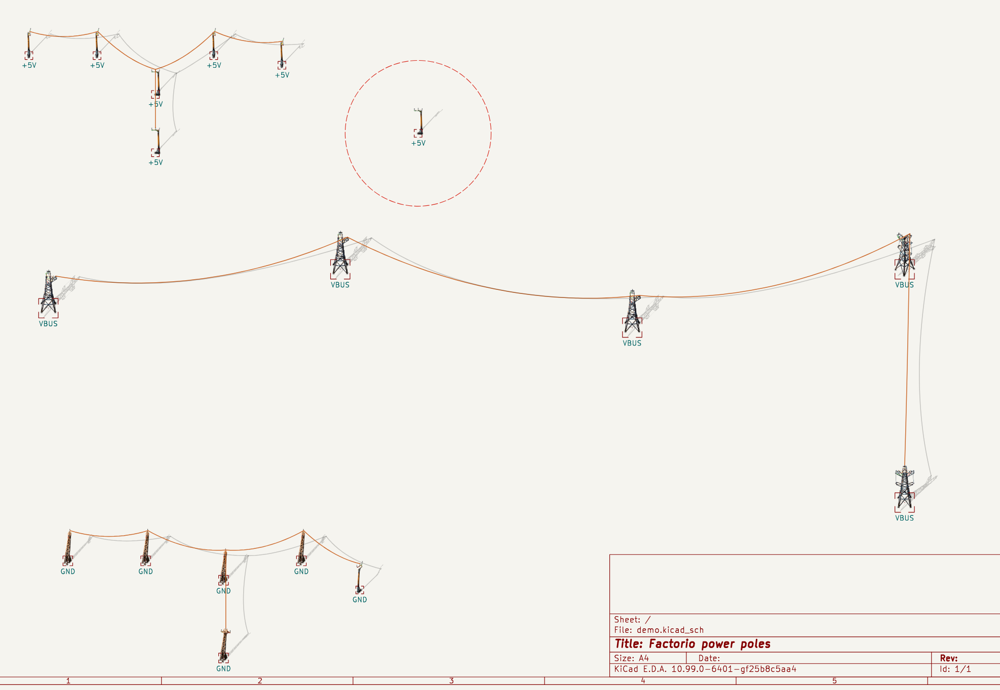

# Factorio power poles for KiCad

A KiCad (nightly / 11) plugin that adds Factorio-style electric poles to the schematic
editor. A pole works like a power symbol: its **Value** names the net, as with `VCC` or `GND`.
On top of that, **poles on the same net wire themselves to nearby poles**. The maximum
distance is the pole's wire reach in Factorio, and the power lines droop between poles
the way they do in the game.



*The demo project ([`demo/`](demo)).*

## How it works

* **Poles are power symbols.** The library [`symbols/factorio_poles.kicad_sym`](symbols)
  holds `Small_Electric_Pole`, `Medium_Electric_Pole` and `Big_Electric_Pole`.
  Each is a global power symbol with one power-input pin at the base of the pole. Place
  them with *Place → Power Symbol* and set the Value to the net name. Hang one on a wire
  and that wire gets the pole's net, exactly like `VCC`.
* **Automatic wiring.** Two poles on the same net are wired together if they are no
  further apart than the *shorter* reach of the two:

  | pole          | reach (tiles) | sprite sheet  | shadow sheet  |
  |---------------|--------------:|---------------|---------------|
  | small         | 7.5           | 288 × 220 (4 × 72 × 220)  | 1024 × 52  |
  | medium        | 9             | 336 × 252 (4 × 84 × 252)  | 1120 × 64  |
  | big           | 32            | 592 × 312 (4 × 148 × 312) | 1496 × 94  |

  One tile is 2.54 mm (100 mil) by default. In the default `tree` mode the plugin draws
  the fewest wires that connect every pole in reach (a minimum spanning forest). `mesh`
  mode wires every pair in reach, shortest first. Either way a pole holds at most 5 wires,
  as in the game. Poles of different nets are never wired together.
* **Poles face their wires.** As in the game, each pole picks one of its 4 sprite
  orientations so the cross-arm sits across its wires.
* **Drooping power lines.** Each wire is a real catenary between the two poles' copper
  connection points. It is 1.5 % longer than the straight line, so long big-pole spans
  sag much more than short small-pole hops.
* **Shadows.** Poles and wires cast light shadows (opacity 0.2) backwards, away from the
  viewer: diagonally up-right at 45° on the sheet. The sprite sheets have the game's shadows baked in, falling almost straight to the
  right, so the plugin re-casts them for the new sun direction. Shadow length scales with
  height and the pole's foot stays put, and the wire shadows go through the same
  transform, so they start exactly where the pole shadows end. A sagging wire's shadow
  bends back towards the poles. `shadow_angle` is in degrees clockwise from "to the
  right": `-45` (default) falls backwards, `45` towards the viewer, and `null` keeps the
  game's direction. eeschema always draws lines above images, so where a wire's shadow
  crosses another pole it passes over that pole's sprite.
* **Stranded poles.** If a net's poles fall apart into several separate networks, the
  plugin draws the reach of each pole cut off from the main network as a dashed red
  circle, and prints a warning.

The sprites and wires are ordinary schematic items (images and polylines). They show up
in plots and PDFs, but they are **locked** and tagged with a custom property
(`factorio_poles`), so the plugin can find and update them. It only touches what
changed: move a pole and only its sprite and its wires are redrawn. KiCad's selection
filter leaves out locked items by default, so clicks go through the sprites to the pole
symbols underneath.

### Actions

| toolbar action              | what it does |
|-----------------------------|--------------|
| **Update power lines**      | Redraw everything once (all sheets). |
| **Live power lines (toggle)** | Keep running in the background and redraw whenever a pole is added, moved, deleted or its net changes. Run it again to stop it. |
| **Remove power lines**      | Delete everything the plugin drew; the poles stay. |

Every redraw is a separate undo step ("Update power lines"). If you undo one of those,
live mode puts the drawing back within a few seconds.

### Settings

Put a `factorio-poles.json` next to the `.kicad_pro` to override the defaults:

```json
{
  "tile_mm": 2.54,
  "connection_mode": "tree",
  "max_connections": 5,
  "wire_slack": 0.015,
  "wire_width_mm": 0.2,
  "wire_color": [0.80, 0.42, 0.18, 1.0],
  "shadows": true,
  "shadow_angle": -45,
  "shadow_opacity": 0.2,
  "mark_islands": true,
  "textures": ["../art/poles"],
  "use_factorio_install": true
}
```

All keys are listed in [`plugin/factorio_poles/config.py`](plugin/factorio_poles/config.py);
unknown keys are an error, so typos don't go unnoticed.

## Textures

Pole art is read from a **texture pack**: any directory laid out like Factorio's
`data/base/graphics/entity`:

```
<root>/small-electric-pole/small-electric-pole.png
<root>/small-electric-pole/small-electric-pole-shadow.png
<root>/medium-electric-pole/…
<root>/big-electric-pole/…
```

The frame layout, sprite offsets and wire connection points come from the game's
prototype definitions, transcribed in
[`plugin/factorio_poles/prototypes.py`](plugin/factorio_poles/prototypes.py). Any pack
with the sheet sizes in the table above will line up, including the wires. The plugin
searches, in order:

1. `textures` from `factorio-poles.json`
2. `$FACTORIO_POLES_TEXTURES` (`:`-separated)
3. a local Factorio installation (`/usr/share/factorio`, Steam, …), unless
   `use_factorio_install` is false
4. the art bundled in [`plugin/factorio_poles/textures/`](plugin/factorio_poles/textures)

A sheet that is missing or has the wrong size falls back to the next directory on that
list (with a warning), one sheet at a time.

The bundled art is the development set: the game's own pole sprites. **Before
publishing, replace the six sheets in `plugin/factorio_poles/textures/`** with the
release art, keeping file names and sizes, and build the package.
`tests/test_textures.py` checks that every bundled sheet has the expected size.

## Installing (KiCad nightly)

The plugin uses KiCad's IPC API. The schematic half of that API exists only in KiCad
nightly (10.99, the future 11).

1. Get the package: `dist/factorio-poles-<version>.zip` from `tools/build_pcm.py`
   (see below).
2. In KiCad's project window: *Plugin and Content Manager → Install from File…* → pick
   the zip.
3. Enable *Preferences → Plugins → Enable KiCad API*, if it isn't on already.
4. **Restart KiCad.** The nightly loads newly installed schematic plugins and PCM
   libraries only at startup. Afterwards the library shows up as `PCM_factorio_poles`,
   and the schematic editor's top toolbar has two pole buttons, Update and Live. On
   narrow windows they may be in the toolbar's overflow menu (▾).

On first start KiCad creates the plugin's Python environment
(`~/.cache/kicad/10.99/python-environments/org.jaseg.factorio-poles` on Linux) and pip
installs its dependencies from PyPI. This needs network access and takes a moment.

kicad-python with the schematic API (0.9) is not on PyPI yet, so the package bundles a
build of it, made against the nightly's API, in `plugins/vendor/kipy` (MIT, license
included). The entry scripts put it ahead of any kicad-python installed in the
environment. Rebuild the package when you move to a newer nightly, so the bundled
bindings match its API.

### Building the package

```bash
tools/kicad-nightly.sh fetch          # newest official nightly AppImage -> .cache/kicad-nightly
tools/dev-setup.sh                    # .venv + kicad-python built against that nightly's API
.venv/bin/python tools/build_pcm.py   # -> dist/factorio-poles-<version>.zip
```

`--no-vendor` leaves kicad-python out and lists it in `requirements.txt` instead, for
when kicad-python 0.9 is on PyPI.

### Working on the plugin

Instead of reinstalling the package after every change, link the checkout into KiCad:

```bash
tools/install-dev-plugin.sh           # link plugin/ into KiCad's plugin directory
tools/kicad-nightly.sh kicad          # start KiCad once (API server enabled)
tools/install-dev-plugin.sh           # again: point the plugin's Python env at our kicad-python
```

The second run is needed because KiCad creates the plugin's Python environment from
`plugin/requirements.txt` the first time it loads the plugin. That environment gets
kicad-python 0.8 from PyPI, which has no schematic API; the script puts the source build
in front of it. For a linked checkout, add `symbols/factorio_poles.kicad_sym` to your
symbol library table, or open `demo/demo.kicad_pro`, which already has it.

## Development

```bash
.venv/bin/python -m pytest              # unit tests + end-to-end tests against the nightly
```

The end-to-end tests (`tests/test_kicad_integration.py`) start
`kicad-cli api-server` from the cached nightly on a copy of the demo project, then
exercise the real API: reading poles, drawing, idempotency, moving a pole, changing a
net, and the save round trip. Without the nightly they are skipped.

| file | |
|------|-|
| `plugin/plugin.json` | IPC plugin manifest (three schematic actions) |
| `plugin/factorio_poles/prototypes.py` | pole data from the game: reach, sprite layout, connection points |
| `plugin/factorio_poles/network.py` | which poles get wired, islands, pole orientation |
| `plugin/factorio_poles/geometry.py` | catenary sag, wire and shadow curves |
| `plugin/factorio_poles/textures.py` | texture packs: search, validation, sprite composition |
| `plugin/factorio_poles/plan.py` | poles → items to draw (no KiCad involved) |
| `plugin/factorio_poles/kicad_io.py` | reading poles from and syncing items into KiCad |
| `plugin/factorio_poles/actions.py` | toolbar actions, live mode |
| `tools/gen_symbols.py` | generates the symbol library from `prototypes.py` |
| `tools/gen_icons.py` | draws the toolbar icons |
| `tools/make_demo.py` | rebuilds `demo/demo.kicad_sch` through the API |
| `tools/kicad-nightly.sh` | fetch / run the official nightly AppImage |

Headless use: every action takes `--socket ipc:///path/to/api.sock`, `--open` (a
headless server starts with no schematic open) and `--save`, e.g.

```bash
tools/kicad-nightly.sh kicad-cli api-server --socket /tmp/fp.sock demo/demo.kicad_pro &
.venv/bin/python plugin/update.py --socket ipc:///tmp/fp.sock --open demo/demo.kicad_sch --save
```

### Notes on the nightly API (as of 10.99.0-6401-gf25b8c5aa4)

* `Schematic.create_items()` / `update_items()` in kicad-python unpack KiCad's reply twice
  and raise `AttributeError: type_url`. `kicad_io.create_items()` / `update_items()` send
  the requests directly instead.
* `SchematicImage` has an `opacity` field that kicad-python doesn't wrap. It defaults to 0,
  which makes images invisible, so the plugin sets it on the protobuf.
* `PolygonWithHoles.outline = …` now closes the outline by default. Wires reset
  `closed = False`, otherwise eeschema draws them as closed shapes (with an extra straight
  chord between the two ends).
* Free-standing poles get the same ERC errors as any free-standing power symbol
  ("pin not connected", "power pin not driven"). Pole-to-pole lines are only drawings;
  connectivity comes from the net name, like any power symbol.
