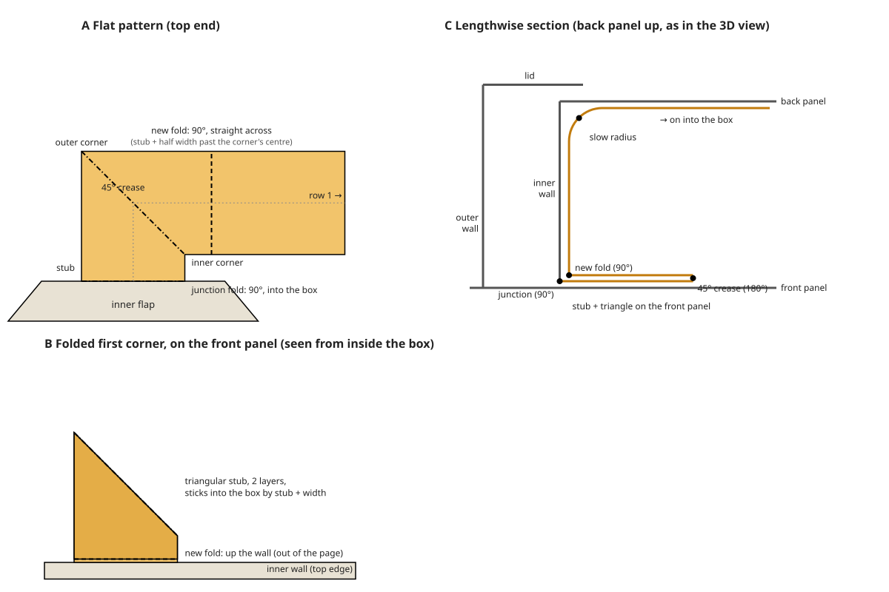

# yanartas-pillowbox

Generate **laser-ready SVG folding patterns for pillow boxes**, configured through a local web
UI with live 2D and 3D previews. The tool runs entirely offline: the UI is served from
`127.0.0.1`, and all frontend assets, including three.js, ship inside the package.

A pillow box is cut from one flat sheet. It has two shell panels and a glue tab. Each short
end of each panel has a curved (circular-arc) fold. The lens-shaped flap outside that fold
closes the end, and pressing the flaps in makes the shell bulge into a "pillow". It can also
be made of two identical pieces instead (see *Two pieces*).

## Installation & running

Requires Python ≥ 3.11. With [uv](https://docs.astral.sh/uv/):

```sh
uvx yanartas-pillowbox                 # from PyPI, once published
uvx --from . yanartas-pillowbox        # from a checkout
uv run yanartas-pillowbox              # inside a checkout (dev environment)
```

Or use `pip install .`, then run `yanartas-pillowbox`.

### Commands

```text
yanartas-pillowbox [serve] [--port N] [--no-browser]
```
Starts the web UI on a free port, or on `--port`. It prints the URL and opens it in your
browser unless you pass `--no-browser`. The server only listens on `127.0.0.1`.

```text
yanartas-pillowbox generate [--config FILE | --from-svg FILE] [--set key=value ...] -o out.svg
```
Generates an SVG from the command line, using the same engine as the UI.

* `--config FILE` takes a JSON config, either the persisted `yanartas-pillowbox.json` or any
  subset of the parameters below.
* `--from-svg FILE` reuses the config embedded in a previously generated SVG.
* `--set key=value` overrides a single parameter and can be repeated. Booleans accept
  `true/false/yes/no/1/0`.
* `-o -` writes the SVG to stdout.

Validation errors are printed per field, and the command exits with status 2.

```sh
yanartas-pillowbox generate --set width=80 --set length=150 --set height=30 \
    --set thickness=0.5 -o box.svg
```

```text
yanartas-pillowbox pcb [--config FILE | --from-svg FILE] [--set key=value ...] -o DIR [--name NAME]
```
Lays the box out as a flex PCB with a security mesh on both sides (see *PCB layout* below)
and writes `NAME.kicad_pcb` and `NAME.kicad_pro`, the Gerber and drill files in
`NAME-gerbers/`, and `NAME-top.svg` / `NAME-bottom.svg` into `DIR` (`NAME` defaults to
`pillowbox`). Needs the FPC cable.

### Persistence

The UI saves the last valid configuration to **`./yanartas-pillowbox.json`** in the current
working directory. Saves happen through the server, debounced, and the file is reloaded on
startup. If the file is missing, corrupt, invalid or from another schema version, the tool logs a warning and starts with
the defaults. It never crashes because of the file.

## Web UI

* **Left column:** the parameter form, in collapsible groups (*Payload* first and the only
  one open at first; which are open is remembered per browser). The button left of the title
  hides the column (and shows it again). Invalid values are flagged inline next to the field.
  While any value is invalid, the previews keep showing the last valid design and
  *Download* is disabled.
* **Derived geometry** (a panel beside the folded box and the cross-section): the computed
  fold and cut radii, arc length, the straight-edge length, the circumference and the flat
  panel width, and once a mesh is generated, its figures under *PCB mesh*.
* Any preview (and the derived geometry) can be maximized from its title bar (Escape
  restores): it fills the previews' area; the settings stay. The 2D views have a scale bar.
* **Pattern (2D):** the exact SVG you will download. Zoom with the wheel, the +/− buttons or a
  pinch, drag to pan, and double-click or press *Fit* to reset (the
  cross-section view works the same way). The title bar shows the pattern and
  sheet sizes. All lines are black, as in the export, and differ only in dashing (see
  *Output SVG*). A legend shows the line types; dashes keep their on-screen size at any
  zoom. The backdrop stays light in the dark theme so the black lines remain visible.
* **Folded box (3D):** an orbitable, shaded view of the closed box, folded exactly from the
  pattern faces (drag to orbit, scroll to zoom), back panel (with the lids) up. Fold lines
  are drawn black, dashed by fold direction, and the visible cut edges solid. The inner end flaps, inside the box behind the
  end wall gaps, are drawn translucent purple through the paper. The camera has almost no inertia, and the
  dimension labels keep the same on-screen size at any zoom.
* **Generate mesh** (at the end of the *PCB mesh* settings) lays out the PCB's security mesh
  for the current design and shows it: F.Cu (the box's outside) in copper red, B.Cu (inside)
  in blue. KiMesh takes seconds, the space-filling curve minutes; *Cancel* stops it. A bar
  shows its progress, and a log below it its phases (collapsed: the latest line; open: all).
  A layout that fails says why in a dialog. **Mesh** (in the pattern's and the folded box's
  title bars) shows or hides the mesh; with none generated for the current design (none
  yet, or the design changed since) the views say so. Its figures (cell size, cells per
  side, the longest trace) appear under *PCB mesh* in *Derived geometry*. Its copper is
  drawn into a bitmap once (in 3D, a texture on each side of the paper), never as SVG
  paths; zoomed in, the 2D view draws the visible part again at screen resolution.
  *Download PCB* saves the KiCad, Gerber and SVG files of the generated mesh as a zip
  (generating it first if there is none for the design).
* **Shell cross-section:** a 2D section through the closed shell, perpendicular to its length.
  The shell has this same section everywhere between the curved folds. It shows the closed
  width and height, and marks the two straight folds where they are seen end-on. Like the
  3D view, it shows the back panel up.
* **Payload:** below the shell controls, set the width, depth and height of a rectangular
  payload, and a **clearance**: the minimum true distance from any point of the payload to
  the nearest point of the box surface. The payload is drawn centred inside the box in the
  cross-section and 3D views, with the clearance envelope dashed in the cross-section. It
  turns red if the clearance is not met. *Derived geometry* shows the actual clearance. It is never drawn in the SVG,
  but it is saved with the settings and in the SVG's embedded config. Set any payload
  dimension to 0 to hide it.
  * **Board preset** fills in the payload size of a common development board: Raspberry Pi
    Model A, Model B and Zero (each also with a HAT or pHAT), Arduino UNO Q (with and
    without a shield), STM32 Nucleo-64, BeagleBone Black, Odroid C4 and N2+, and Jetson
    Orin Nano (Super) and Orin Nano 2. The board's long side runs along the box. The sizes
    are approximate (`presets.py`): heights include connectors and stacked add-on boards, and
    some are estimated, so check your own board. The preset is not a setting; the dropdown
    just shows which preset, if any, matches the current payload size.
  * **Max** next to each payload field sets it to the largest value that keeps the clearance
    in the current box.
  * **Fit box to payload** (in the shell controls) sets width, length and height to the
    smallest box that holds the payload with its clearance, minimizing the area of the
    pattern's bounding box.
    Glue tab, end wall gap, lid overlap, lid offset and thickness are left alone; the box is
    made as much wider as the lid offset needs. Results are rounded to 0.01 mm, always
    towards a box that still fits.
* **Parameter dimensions:** all three views annotate the inputs they show:
  * **Pattern:** circumference (both panels, flat), length and end wall gap (along the
    front panel's midline), lid overlap (on the top lid), height (across an inner flap),
    and the glue-tab width and, if it has one, its taper (both at the tab's bottom end);
  * **Folded box:** width, length, end wall gap and lid overlap (along the back panel's
    ridge, on top), the lid offset (where the lid comes closest to the back panel) and
    height;
  * **Cross-section:** width, height, and the front panel's arc (part of the
    circumference). This view shades the material at its thickness, the box interior and the
    payload space, and draws the glue tab, the FPC cable (through its middle) and, dashed,
    the payload clearance.

  Width, length and height are interior dimensions, so where they are measured inside the
  material their end points sit off the drawn lines by the material allowance.

  Focusing or hovering a field highlights its dimensions in every view, and clicking a
  dimension jumps to its field. Each view has a *Dimensions* toggle. The dimensions are
  computed in Python from the same geometry (`dimensions.py`) and are preview-only: they
  never appear in the downloaded SVG.
* **Import:** *Import SVG…* or drag and drop a previously downloaded SVG anywhere onto the
  page to restore all of its parameters. A file without an embedded config, or with an
  incompatible one, produces a clear error message.
* **Download SVG** and **Reset to defaults** are in the top bar.
* **Download OpenSCAD** saves a model of the box's interior (`.scad`, mm, centred on the
  interior; X across, Y along the length, Z height with the front panel up). It has the
  main space for the payload, bounded by the panels' inner surfaces and the inner end walls,
  and with an end wall gap the two end spaces between each inner and outer end wall, from
  the front panel to the lid. Each space is a module (`main_space()`,
  `end_space()` / `end_spaces()`), built as the intersection of a cross-section prism and a
  plan prism. The payload is a `payload()` module, shown only in the preview. FPC cutouts
  and the inner flaps' cut corners are not modelled.
* Light and dark themes follow `prefers-color-scheme`.

## Parameter reference

All lengths are in millimetres.

| Key | Default | Meaning / constraints |
|---|---|---|
| `pieces` | `one` | `one`: the usual one-piece pattern. `two`: two identical pieces, each one panel with an outer flap at its top end, an inner flap at its bottom end, the FPC cable on its free edge and a glue tab on the other (see *Two pieces*). |
| `width` | 107 | Interior width of the closed box's cross-section, from fold to fold (between the material's inner corners). 10–1000. This drives the panel size: see *circumference* below. |
| `length` | 101 | Interior length along the middle of the box, between the inner end walls: the shortest distance between the curves. 10–2000. The back panel's straight edges (corner to corner) are `length + height + 3·thickness` long, the front panel's `2·end_wall_gap` longer. |
| `end_wall_gap` | 10 | Clear gap, in the middle of the box, between each outer end wall and the inner end wall inside it, covered by a lid (see *End wall gap* below). 0–500. 0 stacks the two walls of each end on each other, with no lid. |
| `lid_overlap` | 5 | How far each lid runs on over the outside of the back panel, past the inner end wall's outer surface (measured along the box). 0–200. Only with an end wall gap. |
| `lid_offset` | 2 | How far the lids float above the back panel where they come closest; the box's end sections grow by as much in height, and wider to match (see *End wall gap*). 0–100, limited per box: the widened sections may turn at most 45° at the sides, so steep boxes and thick material allow less (the UI states the limit). Only with an end wall gap. |
| `height` | 48.5 | Interior height of the closed box at maximum bulge. At most ≈ 0.46·width (the UI states the exact limit). |
| `payload_width` | 56 | Payload size across the box. 0–2000. Preview only (see *Payload*). |
| `payload_depth` | 85 | Payload size along the box length. 0–2000. It has to fit between the inner end walls. |
| `payload_height` | 22 | Payload size along the box height. 0–2000. |
| `payload_clearance` | 8 | Minimum clearance between payload and box surface (true 3D distance). 0–100. |
| `glue_tab_width` | 12 | Width of the glue tab, and of the lids' glue tabs. 3–100, and narrower than the front panel it is glued onto. The tab's ends are cut back only as far as needed to stay off the front panel's curved folds, from square up to 45° (*Glue-tab taper* in the UI); the default end wall gap needs none. |
| `fpc_cutout` | `none` | `none`, `front`, `back` or `both`: cuts the top of the inner flaps' curved edge off level at that end of the box, leaving a slot for a flat cable (FPC). `front` is the end at the top of the pattern, `back` the one at the bottom. The outer flaps are never cut. |
| `fpc_cutout_width` | 15 | Width of that flat section. 0 to the inner flaps' width − 1. The cut is level and exactly this wide. The flap's edge is not quite symmetric, so the section sits around its highest point, within about a millimetre of the flap's centre. |
| `fpc_cable` | `up` | `none`, `up` or `down`: a flat cable of the flex PCB leaving the front panel's free straight edge (the glued edge), turning up (towards the top of the pattern, the box's front end) or down along it (see *FPC cable* below). |
| `fpc_entry_offset` | 0 | Where the cable leaves the edge: how far (mm) from the lowest it can go (turning up; the highest, turning down). Folded into the box, its first corner lies on the back panel beside the edge and must stay clear of the inner flap at that end: 0 puts it as near as that allows. |
| `fpc_cable_length` | 55 | From the front panel's edge to the plug's tip, with every corner folded flat. 10–2000. The cable sticks out beside the edge; every further row makes the pattern wider (the default takes one). |
| `fpc_pins` | 61 | Contacts of the FPC connector, 2–200. The default holds the default space-filling-curve mesh: 3 partitions × 4 traces × 2 ends × 2 sides, and a GND pin after every four ends (plus pin 1). The PCB layout refuses a plug with too few pins. |
| `fpc_pitch` | 0.5 | Contact pitch, 0.1–2.54. |
| `fpc_edge_margin` | 0.5 | From the outermost contacts' centres to the plug's edges: the plug is `(pins − 1)·pitch + 2·margin` wide (31 mm by default, the usual `(pins + 1)·pitch`). At most the front panel's straight edge beside the back panel, less 1 mm. |
| `fpc_plug_length` | 4 | Length of the plug at the cable's end, 1–50. |
| `fpc_cable_inset` | 0 | How much narrower than the plug the rest of the cable is on each side; the plug's ears then stick out. 0–10. |
| `fpc_corner_radius` | 1 | Rounds the cable's corners and where it meets the front panel's edge (not the plug's). 0–10; smaller where there is no room, e.g. at most half the clearance at the slots between rows. |
| `fpc_cable_gap` | 1 | Cut-to-cut clearance between the cable's rows, and between the cable and the rest of the pattern. 0.1–20. |
| `mesh_trace_width` | 0.15 | PCB layout: width of the security mesh's traces, on both copper layers and along the cable. 0.05–2. |
| `mesh_trace_space` | 0.15 | The least copper-to-copper space between them (and the clearance of the rest of the layout): never undercut, checked by the design rules. Settled, the traces spread into the room left over, so the average space is larger: about 20 % with the space-filling curve, 5 % with the KiMesh grid (reported as *Average space*). 0.05–2. |
| `mesh_traces` | 4 | Mesh traces (loops, two ends each) per side of the foil: for the space-filling curve, per partition (so `mesh_partitions × mesh_traces` per side); for KiMesh, in all. The exit cell is twice as many trace pitches wide as a side has traces (KiMesh: every cell, 2.4 mm by default). Whole numbers 1–16; the plug needs a pin per end plus the GND pins. |
| `mesh_partitions` | 3 | Space-filling curve only: each side's mesh area is split into this many partitions of equal area, each with `mesh_traces` traces of its own from the connector. Whole numbers 1–16. KiMesh ignores it. |
| `mesh_edge_clearance` | 0.5 | How far the mesh keeps off the foil's cut edges and slits. 0–10. |
| `mesh_seed` | 0 | Seed of the mesh's random walk: the same seed gives the same mesh. Whole number. |
| `mesh_algorithm` | `kimesh` | How the mesh is laid out: `kimesh` (tiles on a square grid, fast) or `sfc` (a closed space-filling curve after Bedel et al. 2022: follows edges and folds, crosses each fold as seldom as can be, takes a minute or more per layer). See *PCB layout*. |
| `mesh_shape` | `lines` | Space-filling curve only: how its traces are drawn: `lines` the polylines, simplified; `arcs` each trace redrawn in straight lines and circular arcs (KiCad track arcs) within a few micrometres of it. |
| `mesh_back_offset` | `cell` | KiMesh only: how far the back (B.Cu) mesh's grid is offset from the front one's, in x and y: `cell` half a cell; `cell_trace` half a cell plus a trace width, so that the back traces also lie over the front traces' gaps. |
| `print_side` | `outside` | `outside` or `inside`: the side of the material the fold indicators are drawn for (e.g. the side the laser scores). It only switches the fold lines between mountain and valley; the pattern is identical either way. |
| `thickness` | 0.2 | Material thickness, 0–5. Width, length and height are interior dimensions; the pattern adds the material around them (see *Material thickness* below). Height − thickness must be at least 0.5. |

The stroke width is fixed at 0.1 mm.

**Computed, not set:** the **circumference** is the perimeter of the closed shell's
cross-section (along the middle of the material), i.e. the flat width of both panels
together. It follows from `width`, the height and the thickness: the more the panels bulge,
the more material it takes to span the same width. The two panels differ slightly in width
(see below). The UI shows these values, and the outside dimensions, under *Derived
geometry*, and the pattern view dimensions the circumference.

### Payload fit and clearance

Distances are measured to the material's inner surface, half a thickness inside the
mid-surface that the geometry model folds. That surface consists of the panels, which are
cylinders with rulings along the length, and the inner flaps' end walls, which are
cylinders with vertical rulings. For a payload inside the box, the true distance to the
surface is the smaller of two 2D distances, each minus half the thickness:

* **Panels:** the distance in the cross-section between the payload rectangle and each
  panel's mid-surface.
* **End walls:** the distance in plan view between the payload and the back panel's crease
  curve. It is `(length − payload_depth)/2` whenever the payload spans the box's centre.

This works because the nearest point on an unbounded cylinder that isn't on the real surface
lies outside the box, so the real surface is crossed first.

*Fit box to payload* sets `length = payload_depth + 2·clearance`. It picks the height with a
fast search on an approximation: the interior as a zero-thickness box, whose cross-section
shape depends only on its sagitta/panel ratio. The pattern area is flat around its minimum,
so the approximation costs next to nothing. It then solves the exact smallest width for that
height (`payload.py`). The tests check the clearance against a brute-force distance to every
vertex of a fine 3D mesh.

### FPC cable

The pattern can carry a flat cable for a flex PCB (`fpc.py`). It leaves the front panel's
free straight edge (the glued edge, at the pattern's left), outward, by default as low as it
can (turning up; as high, turning down; `fpc_entry_offset` moves it from there): folded
into the box, its stub and first corner lie on the inside of the back panel beside the edge,
and keep the clearance (`fpc_cable_gap`) from the inner flap's wall at that end, past half
its thickness (the wall stands further in, deeper into the box, by its fold's sagitta there;
the rest of the cable, along the front panel, is not checked). Where it leaves the edge the
cable is as wide as the meshes' exits need (`fpc.exit_width`: each layer's exit cell, the
back one offset by half a cell, off the junction's fillets), if that is wider than the cable:
the stub widens on the side away from its first turn, up to the first corner's far side, a
rectangle there, its fold still the cable's square's diagonal. The mesh's traces then neck
down in that corner (see *PCB layout*). The cable
runs out from the edge for the clearance plus the inset plus a thickness (the stub), turns 90°
up or down (`fpc_cable`) and then meanders in rows along the edge, stacked outward, between the
end sections beside the edge (the overhangs and the lids' glue tabs, or the outer flaps). The last
`fpc_plug_length` is the plug, the board shape of the connector end (contacts, soldermask,
keepouts and stiffener are not drawn). The cable always sticks out beside the edge; the
default length takes one row, longer cables add rows further out. The cable takes as few rows
as fit, with its turns spread evenly: each one sits the same distance in from its side, so
the tip ends at its side. The FPC cutouts (`fpc_cutout`) are independent of it.

Every corner is a square, the cable's width on a side, folded flat along its diagonal from
the outer to the inner corner (the fold lines on the cable). That lays the next run back
along the one before: the first corner turns the cable back over the stub, and each U-turn
(two corners) sends the next row on in the same direction as the one before. Folded, the
cable is one straight strip, `fpc_cable_length` long from the edge.

In the box, the front panel's free edge rests against the inside of the back panel, by the
glue fold; the glue tab wraps round it on the outside (see *Material thickness*). The cable
folds into the box along the junction, so the stub lies on the inside of the back panel. The
first corner folds it back towards the glued edge, leaving a two-layer triangle (half the
corner square) beside the stub. A fold straight across the first row, where it gets back to
the glued edge, turns it onto the inside of the front panel, along which it runs on (round the
straight fold onto the back panel, if it is that long). The panels curve along the cable, not
across it, so it lies on them exactly. The 3D view draws it that way, through the paper, the
cross-section draws it through its middle, and the fold indicators follow from it.

How the cable's first folds take it into the box (A: the flat pattern; B: the cross-section
at the glued edge, back panel up as in the 3D view, thickness exaggerated; not to scale):



### PCB layout

`pcb.py` lays the box out as a two-layer flex PCB: the foil carries a security mesh on each
side, and the mesh's traces leave through the FPC cable to the plug.

* **Mesh:** a port of [KiMesh](https://git.yasec.de/jaseg/kimesh) (`kimesh.py`). The foil,
  kept `mesh_edge_clearance` off its cut edges and slits and without the cable, is divided
  into square cells `2 × mesh_traces` trace pitches wide. A randomized depth-first walk from
  the *exit cell* visits every cell it can reach, and each cell gets KiMesh's tile for the
  sides on which it connects in the walk's tree. Each of the `mesh_traces` traces is one
  loop through every cell, with both ends at the exit cell. F.Cu and B.Cu each get their own
  mesh (different seeds). The cells only cover whole squares, so up to a cell's width along
  the edges stays bare, as in KiMesh; the B.Cu mesh's grid is offset from the F.Cu mesh's by
  half a cell in x and y, so the two layers leave different strips bare (and optionally by a
  trace width more, `mesh_back_offset`, so that its traces lie over the F.Cu traces' gaps).
  Each mesh trace runs some 44 m in the default box: *Derived geometry* (and the `pcb`
  command) reports the longest, loop and cable runs together.
* **Space-filling curve** (`mesh_algorithm = sfc`, `sfc.py`), after A. Bedel, Y. Coudert-Osmont,
  J. Martínez, R. I. Nishat, S. Whitesides, S. Lefebvre, *Closed space-filling curves with
  controlled orientation for 3D printing*, Computer Graphics Forum 41(2), 2022
  ([doi](https://doi.org/10.1111/cgf.14488), [code](https://github.com/mfx-inria/controllable-space-filling-curve)).
  Each panel of the folding pattern is filled by a closed curve on the edges of a
  centroidal Voronoi tessellation (a perfect matching's complement, cell centres threaded
  in, cycles joined); the panels' curves are joined across the folds along a spanning
  tree, two crossings per join, the least a closed curve can make. Each side's area is
  split into `mesh_partitions` partitions of equal area, each with `mesh_traces` traces of
  its own through its own port at the cable's junction: from each port a strip exactly a
  pair of trace lanes wide runs straight in (its traces at the pitch, side by side with the
  next port's, the middle ones longest) to where its partition's curve opens; the
  partitions grow over Voronoi cells from the strips' ends, their borders keeping to the
  folds where they can and differing between the two sides. All are laid out in one pass:
  a partition's border is kept like a fold (each curve half a spacing off it, so
  neighbouring partitions' traces run a pitch apart, nothing between them) and all traces
  settle together, lengths matched within each partition; then each hole left more than a
  pitch from any trace is filled on its own: the pairs of traces round it re-settled in a
  box round it as one trace along each pair's middle, then split again, kept only where
  every trace still keeps the pitch. Each partition's curve is
  relaxed towards an even spacing of as many pitches as it carries traces (folds and edges hold it off by
  half that), the mesh's traces are its offsets, spread to share its spacing, and the exit
  is a "stem" of two straight rails built into the curve's graph. It follows edges and
  folds closely (no bare strips) at the cost of a less regular structure: the space
  between traces varies, mostly within −5 %…+20 % of the nominal one, rarely below.
* **Metrics** (*Derived geometry*, `pcb` command): the space between the traces, measured
  along every trace on both sides (the share within −5 %…+20 % of `mesh_trace_space` and the
  length below it), the coverage (the copper's share of the area about each point, blurred
  over 1 mm, against the nominal share: how much it varies, and the share of the area
  under 70 % of nominal, i.e. holes between runs), and, taking each pair of neighbouring
  traces matched in length as a differential pair, the difference in their lengths and the
  largest local difference (the most one is longer than the other along the way), over the
  mesh. KiMesh matches every neighbouring pair (1+2, 2+3, 3+4); the space-filling curve
  matches a partition's traces in pairs (1+2, 3+4, ...; with an odd count the middle three
  together, e.g. 1+2, 3+4+5, 6+7) and not between pairs, so that a pair can grow into a
  hole at a tight corner that the whole ribbon cannot fill: the pairs of a ribbon may then
  differ in length.
* **Check:** every layout is checked before it is given out (preview, download, CLI):
  each mesh net one piece of copper from its contact pad to its other one (no opens), no
  copper of two nets touching on a layer (no shorts). A layout that fails is an error.
* **Into the cable:** each side has one exit cell, `2 ×` its traces' pitches wide. The F.Cu
  mesh's sits against the junction, where the cable leaves the front panel's free edge (open
  towards the cable), the B.Cu mesh's half a cell further in and on its offset grid along the
  edge (its traces running straight on across the gap); their traces run on into the cable and along
  it at the mesh's pitch, each layer's on its own side (F.Cu's on pin 1's side). Before the
  plug they fan out with 45° jogs to their contacts' places; the B.Cu traces change to the
  contact side (F.Cu) through two staggered rows of vias (0.45 mm, 0.2 mm drill).
  Where the exit cells do not fit the cable centred on their pins (a wide trace space, many
  traces), they sit side by side across the junction, widened to hold them (see *FPC
  cable*), and the traces neck down in the cable's first corner: up the stub at the mesh's
  pitch, each turns into the first row where its place along the stub meets its place
  across the row, at the plug's pitch (the mesh's, if less), each layer's block centred on
  its pins. The turns nest, none crossing; no stitching vias in the stub and that corner.
  The design rules (and the GND zone's clearance) are then the cable's space.
* **Plug pinout,** from pin 1 (on the cable's left, looking from the edge towards the tip):
  GND, then each group of mesh ends followed by a GND pin; the rest are free. With `N`
  traces per side (KiMesh: `mesh_traces`; the curve: `mesh_partitions × mesh_traces`),
  ends 1–2N are the F.Cu mesh's, the next 2N the B.Cu mesh's. A group is one partition's
  ends (KiMesh: a side's), nested: its loops' two ends mirrored about its middle
  (`p1t1s p1t2s p1t3s p1t3r p1t2r p1t1r GND p2t1s …`). The default KiMesh layout (N = 4)
  uses pins 1–19; the default curve layout (N = 12, three partitions of four) pins 1–55.
  Contacts are 0.6 pitch wide and stop 0.2 mm short of the tip.
* **Ground:** the cable is a GND zone on both layers. It is a KiCad zone, filled in KiCad;
  the Gerber and SVG output leaves it out (fill and re-export in KiCad for fabrication).
  Vias behind the GND contacts and stitching vias along the cable (kept 1 mm off its folds
  and off the folded-flat corners) join the two layers.
* **Output:** through [gerbonara](https://gitlab.com/gerbolyze/gerbonara): the KiCad board
  (outline on Edge.Cuts, with the slits as 0.1 mm slots; fold lines on Dwgs.User; plug
  contacts as footprint J1), a KiCad project carrying the design rules (net class Default:
  the trace width and space, the vias), Gerber and drill files, and SVG renderings of both
  sides. The board is made without its tracks and they are written into its file as text,
  each copper layer's in a process of its own (gerbonara takes minutes over a mesh's
  millions of segments; in the browser, one after the other); the Gerbers and SVGs draw them
  straight from the layout (a lines-and-arcs track's arcs through their true centres).

### Geometry model

The flat pattern is laid out as front panel, back panel and then the glue tab, side by side.
Each flap sits between its panel's **curved fold**, a circular arc through the panel corners
that bows *into* the panel by the fold sagitta `s_f` (distance `f(u)` from the chord at
position `u`), and its **cut edge**, which bows *out* of the panel.

The model folds the material's mid-surface. The closed box (shown in the 3D preview) is
folded exactly from the pattern faces, without stretching:

* **Panels:** each panel bends into a cylinder whose rulings run along the length. Measured
  along the panel width `u`, the cross-section rises by exactly `f(u)`. That puts each
  curved fold in a plane at 45°.
* **Flaps:** folding along such a planar crease mirrors the flap across that plane. Each flap
  becomes a curved end wall standing straight across the box's height, at its own panel's
  crease. Nothing creases the flaps along a midline.

This only works if a fold arc turns at most 45° at the corners (`s_f < 0.207·W`, `W` being
the panel's flat width). The tool allows `s_f ≤ 0.2·W`, which limits the height to roughly
0.46·width. The tests check that every 3D face is an isometric image of its pattern face
and that the faces stay joined along every fold.

#### End wall gap

Seen in a lengthwise cut, each end of the box has an outer end wall (the front panel's
flap) and an inner end wall (the back panel's flap) with a gap between them: `)_)___(_(`
rather than the stacked `))___((`.

* Each wall stands at its own panel's curved fold, so the walls are spread apart by making
  the panels different lengths. The front panel runs on by `end_wall_gap` at each end; the
  back panel and the glue tab keep the length that `length` and `height` give them, and sit
  centred on the front panel.
* In the pattern, the front panel's edge at the straight fold is cut free over the gap at
  each end, down to the back panel's corner.
* The walls are `end_wall_gap` apart (clear, material to material) in the middle of the
  box. The outer wall curves a little further out towards the sides.
* The back panel ends at the inner wall, so each outer flap carries a **lid** that covers
  the gap. The flap's top edge becomes a fold, and the lid folds over onto the outside of
  the back panel and runs on `lid_overlap` past the inner wall.
* **Lid glue tabs:** outer lids tend to spring back up, so each lid's two straight sides
  carry a square glue tab, as wide as the shell's. It folds round the box's side and is
  glued onto the outside of the overhang and the front panel. Where the inner flap's curved
  edge rises into the tab beside it, the tab butts up against that edge (one shared cut),
  and the small piece left between them beside the overhang is cut out (a closed slit path).
  In the 3D view the tabs are drawn as flat panels.
* The lid's fold lies in a plane at 45°, like the curved folds, so the lid folds exactly:
  in the pattern the fold is the front panel's curved fold turned over (an arc of the
  same radius, bowing out of the panel). Folded, the lid takes the front panel's profile,
  turned over, about one thickness flatter than the back panel.
* **Widened ends:** the lids float `lid_offset` above the back panel where they come
  closest (a little more towards the middle), so the end sections are taller than the
  shell. They are wider to match: over the gap only, the front panel's cross-section runs
  on past both side folds, along its own fold arc continued, until it meets the lid's
  fold. The outer flap closes to a point there again, and nothing needs an extra crease.
  In the pattern the front panel grows two small **overhangs** over each gap, and its curved
  fold continues across them. At the straight fold the overhang ends on the inner flap's cut
  edge: a single cut separates the two. In the SVG that shared stretch is a short open
  **slit** path in the cut layer, next to the closed outline, so it is cut once. Because the outer walls follow the continued arc, they reach
  slightly past the front panel's ends at the sides, so the box is a few millimetres
  longer overall. *Derived geometry* shows how much wider and taller the ends are.
* The continued arc must turn less than 45°, which limits the lid offset. Steep boxes and
  thick material allow less, and the steepest have no room for lids at all (use no gap).
* The folding stays exact: the tests check the folded model with and without a gap.
* The payload has to fit between the inner walls, as before. *Fit box to payload* keeps the
  gap and minimizes the pattern including it.

#### Material thickness

`width`, `length` and `height` are the interior. With thickness `t`, the material's
mid-surface lies `t/2` outside it, and with no end wall gap the two flaps of each end lie on
top of each other:

* The **front** panel's flaps close on the **outside**. Its fold bows in by `height/2`. The
  **back** panel's flaps close on the **inside**, and its fold bows in by `height/2 + t`, so
  the outer wall stands one thickness outside the inner wall. As a result the front panel
  is about `t` flatter than the back.
* **Inner flaps** are cut short to the front panel's inner surface. Near the corners, where
  that surface dips below the fold chord, their edge runs along the chord.
* **Outer flaps'** cut edges are flush with the back panel's outer surface all along. At the
  corners they reach slightly past the panel corners, which shows as short cut steps.
* With `t > 0` the cut edges are fine polylines (about 0.5 mm segments) that follow these
  surfaces exactly. At zero thickness they are the plain circular arcs.
* **Glue tab:** it lies on the **outside** of the front panel, unlike in usual packaging. The
  back panel's glue fold sits `t / sin α` beyond the front panel's free edge (α being the
  panel's angle at that edge), so the tab wraps around that edge.
* **Width solve:** the interior width runs between the inner corners at the two side folds,
  where the panels' inner surfaces meet. The tool solves for the two panels' flat widths so
  that this is exactly `width` (`crosssection.solve_shell`).
* **Lengths:** the back panel's straight edges are `length + height + 3·t` long, the front
  panel's `2·end_wall_gap` longer.

#### Two pieces

With `pieces = two` the box is made of two identical pieces (`geometry._build_piece`); the
SVG and the PCB files hold one of them, to be made twice.

* Each piece is one panel: at its top end the outer flap (with the lid, its glue tabs and
  the overhangs, with an end wall gap), at its bottom end the inner flap; the free edge, with
  the FPC cable, on the left, and the glue tab beyond the glue fold on the right.
* The second piece is the first **turned over**: its print side (F.Cu) faces **into** the box,
  so its folds go the other way round (mountain and valley swapped; the pattern is labelled
  for the first). It closes the box from below, its outer flap at the other end: at each
  end one piece's outer flap closes over the other's inner flap, and each glue tab is glued
  onto the outside of the other piece's free edge. Both pieces' cables plug in.
* **Cross-section** (`crosssection.solve_two_piece`): both panels have the same section, the
  second the first turned half a turn about the box's axis. Both folds bow in by
  `(height + t)/2`; both seams are glued edges, like the one-piece pattern's (the free edge
  resting inside the other panel, its glue fold `t / sin α` beyond).
* **Lengths:** each piece's straight edges are `length + height + 3·t + end_wall_gap` long
  (the gap only at its outer flap). The other piece's ends stand `end_wall_gap + t` further on
  (the folds bow in alike, so the outer wall's thickness comes from there): its free edge,
  under this piece's glue tab, starts that far down, and the glue tab with it, tapered off the
  other piece's inner flap fold; at the bottom it ends square at this piece's corner.
* **Lids:** only at the outer flap, and the same on both sides (the overhang and lid glue tab
  on the right as on the left). The lid's free edge follows the other piece's inner wall,
  continued along its tangent past that piece's free edge.
* **FPC cable:** it clears the other piece's inner flap at the top and this piece's own at
  the bottom (*Cable entry*); with nothing beside the free edge at the bottom end, its rows
  may run down to the piece's corner.

## Output SVG & line convention

All lines are black (`#000000`) and differ only in dashing. Folds are grouped by their
direction as seen from the **print side**: by default the outside of the box, which is the
side facing you when you view the SVG. Set `print_side` to `inside` if you score or mark the
other side of the material. The pattern is not mirrored for that, since a pillow box is its
own mirror image. Only the fold indicators flip.

| Layer (`<g id>`) | Inkscape label | Line | `stroke-dasharray` (mm) |
|---|---|---|---|
| `cut` | Cut | solid | — |
| `fold-mountain` | Fold - mountain | dash-dot | `3 1.5 0.5 1.5` |
| `fold-valley` | Fold - valley | dashed | `3 2` |

The dashes follow the origami convention. Each fold's direction is computed from the folded
3D model, not set manually. Seen from the outside, every fold of a pillow box is a mountain
fold: the panels fold around the interior, and the flaps and glue tab fold inwards. Seen
from the inside, every fold is a valley fold. A fold layer is only written when it has
folds.
Fold lines use butt caps so dashes and dots keep their nominal lengths. Some laser software
turns dashed strokes into separate short segments or ignores the dashing. Either way the
layers keep the line types apart.

* **Units and canvas:** `width`/`height` are given in mm with a matching `viewBox`, so one
  user unit is 1 mm. The canvas is the pattern's bounding box plus exactly **10 mm** on every
  side. There are no page-size settings.
* **Cut outline:** exactly one closed `<path>` (one `M`, ending in `Z`) that traces the whole
  contour in one direction. Arcs are exact SVG `A` commands; with material thickness,
  flap edges that follow the shell are fine polylines. The path has no duplicate segments
  and no stray subpaths.
* **Fold lines:** separate open paths, dashed by fold direction. They end exactly on the
  outline and never run along it.
* **Styling:** `fill="none"`, `stroke` and `stroke-width` are plain attributes on every
  element, with a fixed 0.1 mm stroke width. There are no CSS classes and no `<style>`.
* **Metadata:** the complete config is stored as JSON in
  `<metadata><pillowbox:config version="9">…</pillowbox:config></metadata>`, with the
  namespace `https://github.com/jaseg/yanartas-pillowbox/ns/config`. That is what *Import*
  and `--from-svg` read back. The `version` field is the config schema version. Files from
  another version are rejected with a clear message.
* **Schema versions:** the version is bumped whenever the meaning of saved settings
  changes. Settings files and SVGs from any other version are rejected; there are no
  migrations.

## HTTP API

| Method & path | Request | Response |
|---|---|---|
| `GET /api/defaults` | — | `{config, fields, payload_presets}` with the default config, field specs (labels, units, ranges) and board presets |
| `GET /api/config` | — | `{config}` with the current (persisted) config |
| `PUT /api/config` | `{config}` | Validates and saves it, returns `{config, saved}`; `422 {errors}` if invalid |
| `POST /api/render` | `{config}` | `{config, svg, model, section, info, dimensions, payload}`; `422 {errors: {field: message}}` if invalid |
| `POST /api/payload` | `{config, action: "fit"}` or `{config, action: "maximize", field}` | `{config}` with the fitted box or maximized payload (not saved); `422 {errors}` if impossible |
| `POST /api/scad` | `{config}` | OpenSCAD source of the interior (`application/x-openscad`); `422` if invalid |
| `POST /api/pcb` | `{config}` | The PCB layout's copper for the previews: `{layers: {front, back}, vias, pads, width, via_size, bbox, offset, meshes}` (tracks as flat coordinate lists); `422 {error}` if it cannot be laid out |
| `POST /api/pcb/files` | `{config}` | The PCB layout's KiCad, Gerber and SVG files as a zip (`application/zip`); the last layout (and its files) is kept, so the files of the one the previews show are not laid out again |
| `POST /api/pcb/cancel` | — | Stops the PCB layout under way: `{cancelled: true}` (the layout's own request answers `409 {error, cancelled: true}`) |
| `POST /api/import` | SVG as raw text or a multipart `file` | `{config}`; `400 {error}` if unusable |

## Development

```sh
uv run --group dev pytest        # tests
uv run --group dev ruff check .  # lint
uv run --group dev ruff format . # format
```

A PCB layout's steps are timed (`checkpoint.report()`). To work on one step without laying
out the whole board again, set `YANARTAS_CHECKPOINT=<dir>`: every step's inputs and result
are written there as gzipped JSON (each run first clears the last run's), and `checkpoint.resume("<dir>/<nnn>-<layer>-<step>.in.json.gz")`
runs that step again on its own. `scripts/crop_checkpoint.py` cuts a window out of a
settling step's checkpoint for a small case of one spot.

Layout:

* `src/yanartas_pillowbox/config.py`: the config dataclass, field specs, validation and
  schema versioning.
* `geometry.py`: pure geometry (typed outline, folds, 3D mesh). It has no Flask or SVG code.
* `svg.py`: SVG serialization and config extraction.
* `payload.py`: payload fit test, per-dimension maximize and the box fit.
* `dimensions.py`: preview dimension annotations, tagged with the parameter they show.
* `scad.py`: the OpenSCAD interior model.
* `api.py`: the JSON API, shared by the Flask server and the in-browser build.
* `persistence.py`, `server.py`, `cli.py`.
* `static/`: the no-build ES-module frontend, with web components for the parameter input
  and both previews. three.js r160 is vendored under `static/vendor/three` (MIT).

## License

GNU Affero General Public License v3.0 or later (AGPL-3.0-or-later): see LICENSE. The Rust
core in `rust/` is under the same license.
