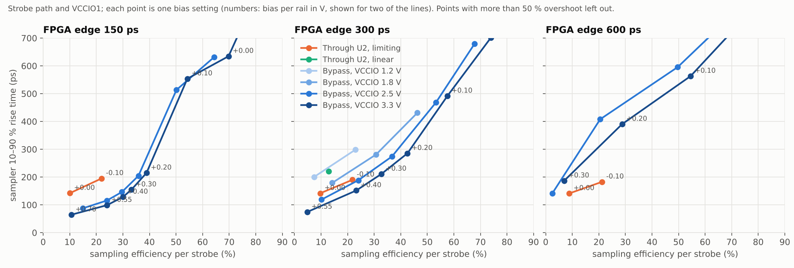
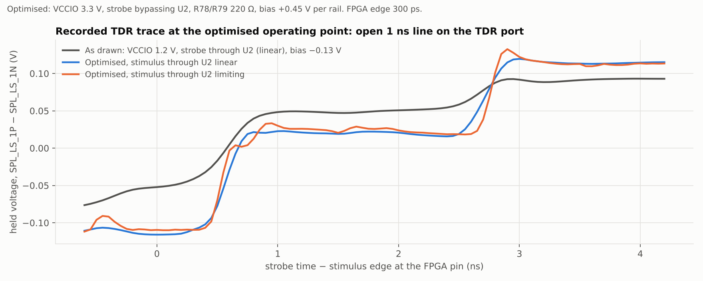
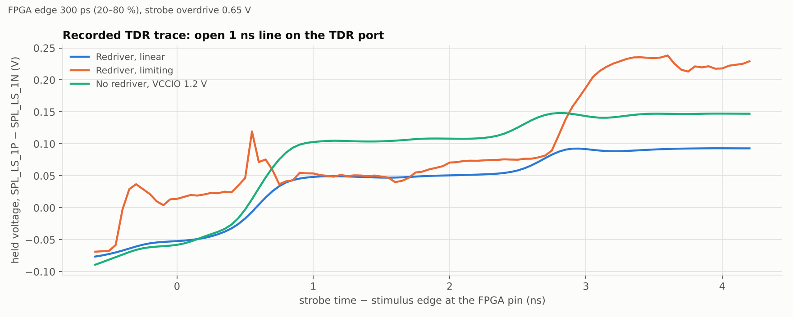

# Speed of the yanartas-sensors sampling front end, with and without the redriver

ngspice simulation of one channel of the sampling front end on the sensing board
(`sensing/yanartas-pillowbox-sensing.kicad_sch` in yanartas-sensors, commit `b0547da`).
Written by an LLM (Claude); nothing in yanartas-sensors was changed.

Two topologies are compared:

- **Redriver as drawn**: FPGA pin → 10 Ω → 220 nF → U2 (PI3HDX12311) → 220 nF → splitter / clip lines.
- **No redriver**: U2 not fitted and each RX pad linked to its TX pad, so the FPGA pin
  drives the splitter and the strobe clip lines itself. Simulated with VCCIO1 at 1.2 V
  (R54, as fitted) and at 3.3 V (the R55 option).

## Result

The speed of the sampler is set by the strobe pulse, and the strobe pulse is set by the
edge that reaches the clip lines. The clip lines are 13.3 mm long (about 160 ps there
and back). An edge slower than that gives a pulse that is as wide as the edge and lower.

| | Sampler 10–90 % rise time (bandwidth) at FPGA edge 150 / 300 / 600 ps | Stimulus 10–90 % at the TDR port |
|---|---|---|
| Redriver, limiting | 134 / 133 / 134 ps (2.6 GHz) | 185 / 228 / 241 ps |
| Redriver, linear | 167 / 236 / 488 ps (2.1 / 1.5 / 0.7 GHz) | 295 / 401 / 689 ps |
| No redriver, 1.2 V | 156 / 283 / 656 ps (2.2 / 1.2 / 0.5 GHz) | 324 / 471 / 819 ps |
| No redriver, 3.3 V | 103 / 82 / 390 ps (at bias +0.93 / +0.53 / +0.20 V per rail) | 326 / 421 / 791 ps |

- **The redriver only makes the front end faster if it limits.** A limiting redriver
  regenerates the edge, so the sampler is about 135 ps whatever the FPGA does. A linear
  redriver passes the FPGA edge on, and the front end is then 10 to 25 % faster than
  without it at 300 to 600 ps FPGA edges and no faster at 150 ps.
- **Which of the two the PI3HDX12311 does on this board is not known.** The part is
  linear for HDMI 2.x and limiting for HDMI 1.4, selected by its straps and its DDC
  listener. I could not obtain the full datasheet (DS46192), so both are simulated.
- **The FPGA edge rate is not known either.** Gowin publishes no slew rate or IBIS data
  for the GW1NZ-1, so it is swept from 150 to 600 ps (20–80 %).
- **Without the redriver at 3.3 V** the strobe pulse is 1.1 to 2.5 V, which allows a
  real reverse bias, so only the tip of the pulse turns the bridge on. That gives the
  fastest sampler of the four cases at FPGA edges up to 300 ps. The stimulus, however,
  would then reach the bridge with 4.3 V differential (the BAT15 is rated 4 V reverse),
  so the stimulus should stay on the redriver. The next section does that.

## Optimised operating point

Free choice of VCCIO1 and of whether the strobe passes through U2; the stimulus stays
on U2. For each option the bridge bias was swept (`sim/optimize.py`,
[all results](results/optimize.md)).

**Recommendation: VCCIO1 at 3.3 V, strobe bypassing U2, bias about +0.45 V per rail**
(VBIAS_K − VBIAS_A ≈ 0.9 V).

| FPGA edge | Operating point | Sampler 10–90 % | Gain | Efficiency | Overshoot |
|---|---|---|---|---|---|
| 150 ps | bypass, 3.3 V, bias +0.55 V | 99 ps | 0.27 | 24 % | 17 % |
| 300 ps | bypass, 3.3 V, bias +0.45 V | 123 ps | 0.25 | 17 % | not recorded |
| 300 ps | bypass, 3.3 V, bias +0.40 V | 152 ps | 0.30 | 23 % | 7 % |
| 600 ps | bypass, 3.3 V, bias +0.30 V | 187 ps | 0.12 | 7 % | 13 % |
| any | through U2 if it limits, bias 0 V | 141–142 ps | 0.15 | 9–10 % | 20–30 % |
| 300 ps | as drawn: through U2 linear, 1.2 V, bias −0.13 V | 236 ps | 0.14 | 16 % | not recorded |

- **Why it is better.** The bias is the speed control: raising it shortens the part of
  the pulse that turns the bridge on, at the price of efficiency. Only a large strobe
  leaves room to do that. Through U2 the pulse is 0.75 V at most and the bridge stops
  working above about 0.1 V of bias.
- **Reverse bias at last.** At +0.45 V per rail the diodes stay off for the ±0.26 V
  that the stimulus puts on the bridge. In the TDR trace the baseline before the edge
  is flat, where the as-drawn case sloped.
- **Recorded TDR edge** (FPGA edge 300 ps): 294 ps incident with U2 linear in the
  stimulus path, against 493 ps as drawn. With U2 limiting the reflected edge is 133 ps.
- **When not to bypass.** At a 600 ps FPGA edge the bypassed strobe needs a low bias and
  is slower than a limiting U2 (187 ps against 141 ps). If the FPGA turns out that slow
  and U2 limits, keep the strobe on U2.
- **VCCIO 2.5 V** is nearly as good (119 ps at +0.30 V and 300 ps, 10 % efficiency) if
  3.3 V is a problem for the other pins of that bank.

What limits the recorded incident edge at this operating point (FPGA edge 300 ps):

| Stimulus path | Edge at the bridge input, 10–90 % | Sampler alone | Limit |
|---|---|---|---|
| U2 linear | 398 ps (409 ps at the FPGA pin) | 122–155 ps | The FPGA edge; U2 passes it on unchanged |
| U2 limiting | 92 ps | 122–155 ps | The sampler for the main rise (about 150 ps in the trace), then a dip 200 ps after the edge |

- The 294 ps read from the trace with U2 linear is shorter than the stimulus itself and
  is not a faithful figure. With the open test line the stimulus rests at ±0.47 V per
  side, as large as the 0.45 V bias, so the bridge compresses the lower end of the edge.
  The ±0.26 V quoted above only holds for a terminated line. For an open or high-impedance
  load the stimulus has to be smaller or the bias larger.
- The sampler slows from 122 ps to 155 ps as the input step grows from 0.05 V to 0.52 V
  per side, and its efficiency falls from 20 % to 11 %.
- The dip with U2 limiting is a reflection from U10, 16.4 mm from the splitter. U10 is
  modelled as 8 Ω with 0.5 pF on each side, which is an estimate, so the size of the dip
  is uncertain. It turns the 10–90 % reading into 345 ps.

Changes on the board:

| Change | Why |
|---|---|
| Fit R55 instead of R54 | VCCIO1 = 3.3 V |
| R78, R79, R82, R83: 10 Ω → about 220 Ω | The stimulus pins now swing 3.3 V; this keeps U2's input near 1.2 V differential. Value not optimised |
| Strobe: connect STROBE_R to STROBE_C through one 220 nF, leaving U2 channels B and D unconnected | Bypass. In the model this is a 1 nH link across the U2 pads; a wire bodge will differ |
| Bias: VBIAS_K ≈ 2.1 V, VBIAS_A ≈ 1.2 V | Tune per board: sweep the bias and take the fastest edge that still has enough amplitude |

Diode reverse voltage at this operating point, simulated over both strobe edges with
the stimulus on an open line (BAT15-04W rating: 4 V): 1.70 V worst case at a 300 ps
FPGA edge, 1.91 V at 150 ps, and 2.17 V at 150 ps with the bias raised to 0.70 V. The
peak falls on the non-sampling strobe edge.

Not checked: the other pins of bank 1 at 3.3 V, the FPGA's drive into the 10 Ω strobe
series resistors at 3.3 V, and R3–R6 (91 Ω), which were left as they are.

In the recorded TDR trace of the four original cases (FPGA edge 300 ps), the incident
edge takes 493 ps with the linear redriver and 541 ps without it at 1.2 V. The
no-redriver 3.3 V trace is left out of that figure. The trace with the limiting redriver is
too noisy to measure, because only 4 % of the error is removed per strobe there.
All numbers are in [results/summary.md](results/summary.md).

## Other things the simulation shows

These apply to both topologies and matter more than the redriver question.

1. **The strobe is barely large enough to turn the bridges on.** With the redriver the
   pulse between the clip-line nodes is 0.2 to 0.75 V, against two diode drops plus
   2 × 91 Ω. To get a 0.65 V forward peak, VBIAS_K − VBIAS_A has to be between +0.1 V
   and −0.4 V, that is, zero or forward bias at idle. The sampling efficiency is then 4
   to 20 % per strobe.
2. **The held voltage is only 0.1 to 0.2 of the input.** Each bridge rail is fed
   through 91 Ω from a clip-line node that is AC-grounded by C73/C74, so the rails are
   not floating. While the bridge conducts, the hold node settles to a divider between
   the signal and the rails.
3. **The stimulus is larger than the bias.** It arrives at the bridge with 0.9 to
   1.4 V differential, so the diodes conduct between strobes. This shows as the sloping
   baseline before the first edge in the TDR trace.

## Method

- `tools/kinet.py` and `tools/pcbpaths.py` read the netlist and the pad-to-pad trace
  lengths from the KiCad files (the files are from a KiCad nightly that no packaged
  `kicad-cli` reads). Their output is in `extracted/`.
- `sim/frontend.py` builds the ngspice deck: both halves of channel 1, traces as LC
  ladders (50 Ω, 6.05 ps/mm), 0402 capacitors with 0.4 nH, the two bridges with their
  91 Ω feeds, hold capacitor and the trace to U13.
- The sampler is measured in equivalent time. For each strobe delay, two transients
  with different starting hold voltages give the voltage a repetitive strobe converges
  to, and the fraction of the error removed per strobe.
- "Sampler rise time" is that held voltage against delay for a 1 ps step driven into
  SPL_HS from 50 Ω. The bias is set per case so that the strobe peaks 0.65 V forward
  across a bridge. With the limiting redriver the response overshoots by 60 % for
  about 300 ps, so its 10–90 % figure flatters it.
- `sim/experiments.py` runs everything (about 40 minutes on 4 cores, ngspice 42),
  `sim/plots.py` makes the figures and the table.

## Assumptions

| Item | Value | Basis |
|---|---|---|
| BAT15-04W | Infineon chip model D315 v7.0, plus 0.7 nH and 0.16 pF per diode | model file; package values from datasheet LS 1.4 nH and C 0.3 pF |
| FPGA output | ramp 150 / 300 / 600 ps into 30 Ω (1.2 V) or 12 Ω (3.3 V), 3 pF | estimate from the DC drive spec; no edge data published |
| PI3HDX12311 | 50 Ω in and out, 9 GHz, 80 ps delay, 1 Vpp differential swing. Linear: 0 dB with 5.6 dB peaking at 6 GHz. Limiting: 20 dB into the same clamp | estimate from the product brief; full datasheet not read |
| Redriver passes single edges at low repetition rate | assumed | not confirmed; a signal-detect or squelch would break this |
| U10 TMUXHS4212 | 8 Ω with 0.5 pF each side | estimate |
| Mesh | ideal 50 Ω line, 1 ns, open | U4/U12, U3/U9, connectors and the mesh itself are not modelled |
| Traces | lossless | |
| Leakage of the hold node between strobes | ignored | |

The estimates decide the absolute numbers. The comparison between the cases depends
mainly on the two unknowns named above.
