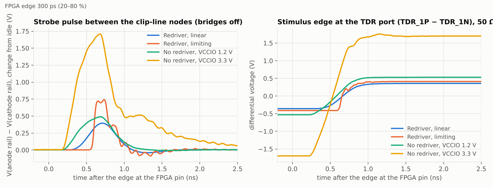
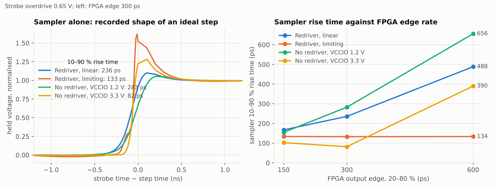

# Speed of the yanartas-sensors sampling front end, with and without the redriver

ngspice simulation of one channel of the sampling front end on the sensing board
(`sensing/yanartas-pillowbox-sensing.kicad_sch` in yanartas-sensors, commit `b0547da`).
Written by an LLM (Claude); nothing in yanartas-sensors was changed.

Two topologies are compared:

- **Redriver as drawn**: FPGA pin → 10 Ω → 220 nF → U2 (PI3HDX12311) → 220 nF → splitter / clip lines.
- **No redriver**: U2 not fitted and each RX pad linked to its TX pad, so the FPGA pin
  drives the splitter and the strobe clip lines itself. Simulated with VCCIO1 at 1.2 V
  (R54, as fitted) and at 3.3 V (the R55 option).

## Result

The speed of the sampler is set by the strobe pulse, and the strobe pulse is set by the
edge that reaches the clip lines. The clip lines are 13.3 mm long (about 160 ps there
and back). An edge slower than that gives a pulse that is as wide as the edge and lower.

| | Sampler 10–90 % rise time (bandwidth) at FPGA edge 150 / 300 / 600 ps | Stimulus 10–90 % at the TDR port |
|---|---|---|
| Redriver, limiting | 134 / 133 / 134 ps (2.6 GHz) | 185 / 228 / 241 ps |
| Redriver, linear | 167 / 236 / 488 ps (2.1 / 1.5 / 0.7 GHz) | 295 / 401 / 689 ps |
| No redriver, 1.2 V | 156 / 283 / 656 ps (2.2 / 1.2 / 0.5 GHz) | 324 / 471 / 819 ps |
| No redriver, 3.3 V | no usable result, see below | 326 / 421 / 791 ps |

- **The redriver only makes the front end faster if it limits.** A limiting redriver
  regenerates the edge, so the sampler is about 135 ps whatever the FPGA does. A linear
  redriver passes the FPGA edge on, and the front end is then 10 to 25 % faster than
  without it at 300 to 600 ps FPGA edges and no faster at 150 ps.
- **Which of the two the PI3HDX12311 does on this board is not known.** The part is
  linear for HDMI 2.x and limiting for HDMI 1.4, selected by its straps and its DDC
  listener. I could not obtain the full datasheet (DS46192), so both are simulated.
- **The FPGA edge rate is not known either.** Gowin publishes no slew rate or IBIS data
  for the GW1NZ-1, so it is swept from 150 to 600 ps (20–80 %).
- **Without the redriver at 3.3 V** the strobe pulse is 1.1 to 2.5 V, which would allow a
  proper reverse bias. But the stimulus then reaches the bridge with 4.3 V differential
  (the BAT15 is rated 4 V reverse) and the method used here to find the held voltage
  stops working, so I give no sampler figure. The topology would need an attenuator in
  the stimulus path before it can be judged.

In the recorded TDR trace (FPGA edge 300 ps), the incident edge takes 493 ps with the
linear redriver and 541 ps without it at 1.2 V. The trace with the limiting redriver is
too noisy to measure, because only 4 % of the error is removed per strobe there.
All numbers are in [results/summary.md](results/summary.md).

## Other things the simulation shows

These apply to both topologies and matter more than the redriver question.

1. **The strobe is barely large enough to turn the bridges on.** With the redriver the
   pulse between the clip-line nodes is 0.2 to 0.75 V, against two diode drops plus
   2 × 91 Ω. To get a 0.65 V forward peak, VBIAS_K − VBIAS_A has to be between +0.1 V
   and −0.4 V, that is, zero or forward bias at idle. The sampling efficiency is then 4
   to 20 % per strobe.
2. **The held voltage is only 0.1 to 0.2 of the input.** Each bridge rail is fed
   through 91 Ω from a clip-line node that is AC-grounded by C73/C74, so the rails are
   not floating. While the bridge conducts, the hold node settles to a divider between
   the signal and the rails.
3. **The stimulus is larger than the bias.** It arrives at the bridge with 0.9 to
   1.4 V differential, so the diodes conduct between strobes. This shows as the sloping
   baseline before the first edge in the TDR trace.

## Method

- `tools/kinet.py` and `tools/pcbpaths.py` read the netlist and the pad-to-pad trace
  lengths from the KiCad files (the files are from a KiCad nightly that no packaged
  `kicad-cli` reads). Their output is in `extracted/`.
- `sim/frontend.py` builds the ngspice deck: both halves of channel 1, traces as LC
  ladders (50 Ω, 6.05 ps/mm), 0402 capacitors with 0.4 nH, the two bridges with their
  91 Ω feeds, hold capacitor and the trace to U13.
- The sampler is measured in equivalent time. For each strobe delay, two transients
  with different starting hold voltages give the voltage a repetitive strobe converges
  to, and the fraction of the error removed per strobe.
- "Sampler rise time" is that held voltage against delay for a 1 ps step driven into
  SPL_HS from 50 Ω. The bias is set per case so that the strobe peaks 0.65 V forward
  across a bridge. With the limiting redriver the response overshoots by 60 % for
  about 300 ps, so its 10–90 % figure flatters it.
- `sim/experiments.py` runs everything (about 40 minutes on 4 cores, ngspice 42),
  `sim/plots.py` makes the figures and the table.

## Assumptions

| Item | Value | Basis |
|---|---|---|
| BAT15-04W | Infineon chip model D315 v7.0, plus 0.7 nH and 0.16 pF per diode | model file; package values from datasheet LS 1.4 nH and C 0.3 pF |
| FPGA output | ramp 150 / 300 / 600 ps into 30 Ω (1.2 V) or 12 Ω (3.3 V), 3 pF | estimate from the DC drive spec; no edge data published |
| PI3HDX12311 | 50 Ω in and out, 9 GHz, 80 ps delay, 1 Vpp differential swing. Linear: 0 dB with 5.6 dB peaking at 6 GHz. Limiting: 20 dB into the same clamp | estimate from the product brief; full datasheet not read |
| Redriver passes single edges at low repetition rate | assumed | not confirmed; a signal-detect or squelch would break this |
| U10 TMUXHS4212 | 8 Ω with 0.5 pF each side | estimate |
| Mesh | ideal 50 Ω line, 1 ns, open | U4/U12, U3/U9, connectors and the mesh itself are not modelled |
| Traces | lossless | |
| Leakage of the hold node between strobes | ignored | |

The estimates decide the absolute numbers. The comparison between the cases depends
mainly on the two unknowns named above.
