# Low-cost sampling front end: theory of operation

Equivalent-time sampling front end for 2 GHz / 3 Gbps signals, built around a 4-diode sampling bridge, a 16-tap
delay-line phase detector and a small FPGA. An on-board STM32G474CBT6 supplies the ADC, the DACs and the calibration
(it replaced the earlier header to a user STM32 board on 21 Nov 2026).
Every number in this document is a simulation result or a design value; no board has been built. Sources: `../SPEC.md`
(Decisions section), `../sim/*/RESULT.md`, `../kicad/README.md`, `bom.md`, `../layout/*/README.md`,
`../../../docs/research/`.

## 1. Overview

```
              (no termination)  5:1 C/R divider, 1 Mohm
SIG_IN SMA ──┬─────────────────── Ctop/Cbot + 900k/100k ── BUF802 (G 0.98) ── OUT pin
             │                  OPA197 integrator servo ◄─ VOFS (DAC)        │
             │                                                     ┌─────────┴──────────┐
             │                                                  10 R (sampler)   49.9 R + 50R line
             │                                                     │                    │
             │   S_STROBE ─ TRF37D73 ─ 12 dB ─ TRF37D73 ─ 80 ps stub ─ balun ─►  BRIDGE  │
             │                                     (BAT15-03W clamp)   2x BAT15-04W     │
             │                                                     2.2 pF hold          │
             │                                          TPH2501 G=+3 ─ TPH2501 shift ─► ADC_IN (PA0)
             │                                                                          │
EXT_CLK SMA ─┴──────────────────────────────────────────────────── TMUX136 (A sig / B ext)
                                                                       │
                                               TRIG_LEVEL (DAC) ─► TLV3801 ─ LVDS ─┬─ SN65LVDS2 ─► COARSE
                                                                       │ CMP_P      │
                                               TRF37D73 ─ 12 dB pad ─► signal line, 16 x 70 ps ─► 50 R
                                                                       ║ 16 gates (BAT15-04W, 2x 0.5 pF)
  PH_STROBE_P/N ─ 2x (TRF37D73 ─ 10 dB ─ GVA-84+ ─ 80 ps stub) ─► PSTRB_A/K, 16 x 35 ps ─► 50 R
                                                                       │ 2.2 k / 2x 1 k readout
                                                VTAP_TH (DAC) ─► 8x COS3502 ─► TAP[15:0]
   MS5351M ─ FPGA_CLK ─► GW1NZ-1 FPGA: PH_STROBE 50 MHz, S_STROBE 3.125 MHz, latch TAP, ADC_TRIG, SPI
           └ MCU_CLK ──► STM32G474CBT6 (on board): ADC, 5 DACs, I2C, USB FS, firmware, calibration
```

The sampler takes one sample per S_STROBE (3.125 MHz). The phase path measures, on every 50 MHz phase strobe, where a
rising edge of the trigger signal lies inside a 560 ps window. Because both strobes come from the same FPGA
serializer, every edge found in a snapshot is a time stamp on the strobe grid. Software fits the signal phase and
frequency to those stamps and assigns each sample its equivalent time. No trigger divider or programmable delay is
needed.

Key figures (simulated, behavioural amplifier models; see section 9):

| Item | Value |
|---|---|
| Input | 1 Mohm // 2.0 pF (sim; about 3 pF apparent at 2 GHz), no on-board termination: for 50 ohm use an external SMA feed-through terminator; fixed 5:1; linear range +/-2.5 V around the offset |
| Input -3 dB | external 50 ohm terminator: 3.3 GHz with the ideal BUF802 model (a real BUF802 is expected to give about 2 GHz); unterminated from a 50 ohm source: 1.7 GHz |
| Input S11, external 50 ohm terminator | -16 dB at 0.5 GHz, -10 dB at 1 GHz, -3.4 dB at 2 GHz (ideal terminator, 3 mm SMA-divider line) |
| Step at the splitter (20 ps input) | external terminator 130 ps 10-90 %, 13 % overshoot; unterminated 191 ps, 0.5 % |
| Sampler aperture | 84 ps (2x TRF37D73 strobe, 80 ps stub); 109 ps 10-90 % behind a 2 GHz first-order input |
| Noise, referred to the input tip | input stage 0.57 mV rms; sampler + ADC 0.35 mV rms at the bridge = about 1.75 mV at the tip, per deconvolved point |
| Sample rate | 3.125 MS/s (S_STROBE = PH_STROBE / 16) |
| Phase detector | 16 taps, 34.7 +/- 3.1 ps spacing (31-44 ps), window 58-579 ps; 19 ps rms per snapshot (22 ps with 6.5 mV comparator offsets) |
| Trigger | down to 200 mVpp at the tip (+/-20 mV at the comparator); TRIG_LEVEL +/-0.30 V at the comparator |
| Power | USB-C 5 V, about 0.9 A |
| Parts cost | 64.31 USD per board (MCU included, PCB excluded), 6.04 USD of it estimates |

## 2. Input stage

SIG_IN goes over a short (3 mm, as short as possible) 50 ohm line straight to VIN. There is no on-board termination
(SPEC decision 10): the input is 1 Mohm // about 2-3 pF, and a user who needs 50 ohm plugs an external SMA feed-through
terminator onto SIG_IN. With an ideal terminator the board load behind the SMA gives S11 -10 dB at 1 GHz and -3.4 dB
at 2 GHz, +1.2 dB peaking at the BUF802 input and 13 % step overshoot at the output; a 6 mm line would raise the
output peaking to +1.1 dB at 2 GHz (`sim/input/RESULT.md`).

The HF path is a C0G divider: Ctop 1.5 pF from VIN to the gate node, Cbot 3.3 pF to ground, then Rg 10 ohm into the
BUF802. With the BUF802 input capacitance (2.4 pF typical) the ratio is 0.206 and the HF gain 0.200. The LF path is a
1.000 Mohm resistive divider (3 x 300k + 100k, alpha 0.100) into an OPA197 differential integrator that drives the
BUF802 auxiliary input (composite-loop mode). The servo sums the BUF802 output, the offset voltage VOFS and a feedback
network so that the LF gain is also 0.200; its loop bandwidth is 8.8 kHz and does not depend on the op-amp GBW. An 18
pF capacitor at the divider tap cancels the integrator feed-through. The 50k trimmer RV101 in Rf2 matches LF and HF
gain (trim range about -8 % to +7.6 %); a +/-0.3 pF spread of the BUF802 input capacitance alone moves the HF gain by
+/-4 %. Trimmed, the crossover is flat to -0.25 % ... +0.67 % from 1 Hz to 100 MHz.

The simulated network took VOFS from 0-3.3 V and gave +/-2.5 V of input offset. The schematic takes the bipolar VOFS
(+/-0.48 V) from mcu_if, drops the centring resistor and recomputes Rofs (14.3k) and Rf2 (22.1k + RV101): OUT offset =
-0.70 x VOFS = +/-0.33 V, i.e. +/-1.7 V at the input. This recomputation is arithmetic, not simulated.

CLH/CLL = +/-1.5 V limit the BUF802 output and so the bridge input. Protection is the BUF802's internal clamps; Ctop
limits the current. Recovery from a +20 V overload takes about 50 us (servo wind-up).

The BUF802 output pin feeds two legs: 10 ohm directly into the sampler bridge (bridge within about 3 mm), and 49.9 ohm
into a 50 ohm line to the TMUX136 (high-impedance end, full amplitude after one round trip). A 0 ohm series position
in the trigger leg can take a ferrite or 100 ohm against strobe kick-out.

## 3. Sampler and hold chain

The bridge is two BAT15-04W (four diodes). The strobe balun drives the anode rail STRB_A and the cathode rail STRB_K
through 47 pF C0G and 24.9 ohm each; VBIAS_A (-1 V) and VBIAS_K (+1 V) reverse-bias the bridge through 1 k. A strobe
pulse forward-biases all four diodes for about 84 ps and the input charges the 2.2 pF hold capacitor. The hold node
drives U201 (TPH2501, non-inverting, G = +3, 1.00 k / 499 ohm, +/-2.5 V). U202 (TPH2501 on 3.3 V) inverts and shifts:
Vadc = 1.45 V - U201out, giving 0.41-2.49 V at PA0 for +/-0.5 V at the bridge. 33 ohm + 220 pF C0G at the pin absorb
the ADC kick-back.

Simulated with an ideal 3 V strobe the bridge gain is 0.69 and the efficiency per strobe 69 %; with the simulated 2x
TRF37D73 strobe and 80 ps stub it is 0.74 and about 100 % (finite-difference estimate). The pedestal is +49 mV and
moves 0.29 V per V of rail common mode; it is nulled with about -0.17 V rail common mode through the two bias DACs.
Droop with the model leakage is 1.25 % of the hold voltage per 320 ns; it is deterministic at a fixed ADC delay.
Kick-out on a quiet input: 174 mVpp at the bridge, 113 mVpp at the BUF802 pin, 19 mVpp at the trigger end of the line.

**Efficiency correction.** With efficiency e < 1 the hold node remembers the previous sample: v_k = (1-e) v_(k-1) + e
(g x_k + ped). For the sampler RESULT values (e = 0.69, g = 0.69): x_k = (v_k - 0.31 v_(k-1)) / 0.48 (after pedestal
removal). v_(k-1) is the previous strobe in time order, not in equivalent-time order, so the MCU keeps the raw ADC
stream for this step. The coefficients are calibrated per board (section 8) because they move with strobe amplitude,
bias and temperature; with the final strobe chain the efficiency is close to 1 and the correction small. A rail
bootstrap was rejected: it raises gain but not the weight of the new sample. Deconvolution doubles the noise (x2.08);
the ADC (0.48 mV rms at the pin) dominates the 0.35 mV total.

## 4. Strobe generation

The GW1NZ-1 has no true LVDS output, so each strobe is a complementary LVCMOS33 pin pair driven by a 1 Gbps
serializer. The gain blocks are AC coupled and saturating.

**Why 50 % duty.** A low-duty pulse lets the AC-coupled chain idle in its linear range, so the output step is only one
saturation level (about 2.4 V for TRF37D73). A 50 % square wave saturates both levels and the step is 2 Vsat: 4.59 V
for 2x TRF37D73, 7.18 V for TRF37D73 + GVA-84+ (4.30 V for S_STROBE with the 47 uH chokes, real 3.125 MHz pattern). A
shorted stub at the launch point differentiates the step into a pulse of twice the stub delay. The other edge produces
a reverse pulse half a period later.

**Sampler strobe.** S_STROBE_P -> 47 ohm -> TRF37D73 -> 12 dB pi pad (82/91/82) -> TRF37D73 -> 80 ps shorted stub ->
common-mode-choke balun (DLW21SN) -> STRB_A/STRB_K. S_STROBE_N is terminated in 50 ohm. Edge 133-152 ps (FPGA edge
300-600 ps), aperture 84 ps. A fitted BAT15-03W shunt clamp at the stub node cuts the reverse pulse on the bridge from
3.27 V to 1.90 V (BAT15 BV 4 V). The reverse pulse still shifts the held value by -13 mV (-17 mV with the clamp), so
**the ADC must sample before the S_STROBE falling edge, 160 ns after the strobe**.

**Phase strobes.** PH_STROBE_P and PH_STROBE_N each drive TRF37D73 -> 10 dB pad (100/68/100) -> GVA-84+ (VBUS, 2.2 uH
choke) -> 80 ps shorted stub -> PSTRB_A resp. PSTRB_K. With the 80 ps stub the pulse is +4.14 V / 221 ps at tap 0 and
+2.87 / -2.75 V / 286-319 ps at tap 15; every gate gets at least 2.75 V against the 2.0 V it needs. The reverse pulse
reaches at most 2.95 V on a tap diode (74 % of BV) and moves the comparator inputs by less than 0.5 mV, so the PSTRB
clamps are not fitted (footprints kept). The stub length is 13.2 mm at 6.057 ps/mm (50 ohm microstrip, 0.36 mm on
JLC04161H-7628); the sampler layout fragment draws it at 13.207 mm.

**Bias adjustment.** The sampler bridge only conducts if the strobe overcomes the reverse bias. At +/-1 V bias it
stops at about -35 % strobe amplitude; a -40 % strobe still works at +/-0.6 V (gain 0.70, 93 %). VBIAS_A and VBIAS_K
are therefore DAC-driven, each 0.4-1.6 V in magnitude, and set at calibration so that the efficiency is high and the
input range (bias limits it to about +/-0.4 V at +/-0.6 V) is sufficient.

## 5. Trigger path and phase recovery

**Source and comparator.** TMUX136 selects the signal (A, BUF_OUT_T) or EXT_CLK (B, 50 ohm terminated). It runs on a
local -0.9 V ground so that the +/-0.5 V signal stays 0.4-1.4 V above its GND; TRIG_SEL is level-shifted from a 3.3 V
GPIO. The TLV3801 (+/-2.5 V) compares against TRIG_LEVEL and drives an LVDS pair with 100 ohm across the outputs.

**Delay line.** CMP_P -> 1 uF -> TRF37D73 -> 1 uF -> 12 dB pad -> signal line; CMP_N sees an equal dummy load. The
line carries +/-0.21 V for data, 0.42 V steps for isolated edges (0.50 V in the array model), and its edge is 229 ps
10-90 % at tap 0 and 321 ps at tap 15. Each of the 16 taps is a BAT15-04W pair: the common pin sits on the signal
line, the anode and cathode hold nodes are coupled through 0.5 pF (0.47 pF simulated) to the strobe lines PSTRB_A and
PSTRB_K. The strobe forward-biases the pair for its width (221-319 ps FWHM) and the hold nodes take the line voltage
at that instant.

**Co-propagating geometry.** A 35 ps tap spacing cannot be made with a strobe that reaches all gates at once. Instead
the strobe lines run along the taps at about 35 ps per tap (loaded) and the signal line, launched from the same end,
takes 70 ps per tap (meander). A signal edge and a strobe that start together separate by 35 ps per tap: the effective
spacing is the difference. Simulated: strobe 34.2 ps/tap, signal 75.7 ps/tap (aim the meander about 5 ps shorter),
effective 34.7 +/- 3.1 ps. Counter-propagation gave 69.8 ps and weak far taps. On JLC04161H-7628 the signal line
PH_LINE is a 0.26 mm (59 ohm) F.Cu meander of 9.929 mm per tap, designed for 70 ps loaded to 50 ohm (about 75 ps
expected); the strobe lines PSTRB_A/K are 0.16 mm (72.8 ohm) at a 4.514 mm tap pitch, 40 ps per tap loaded. The
layout uses 40 / 75 ps instead of the simulated 35 / 70 ps so that the meander keeps 0.5 mm same-net gaps; the
effective spacing stays 35 ps, but this combination is not re-simulated.

**Readout.** Each hold node goes through 2.2 k to VTAP_N / VTAP_P (-/+2.5 V), and 2 x 1 k sum the two nodes into the
IN+ of one COS3502 comparator half (8 dual parts, 3.3 V). IN- is VTAP_TH. The comparator input peaks 1-2 ns after the
strobe and is down to 5 % of the previous snapshot after 20 ns.

**Threshold and rising edges only.** The hold nodes also see the line moving after the strobe (feed-through through
the diode capacitance). A tap the edge has already passed reads +45 ... +55 mV; a tap the edge has not reached reads
-8 ... -21 mV, not 0. The decision threshold is the midpoint, **VTAP_TH = +17 mV** for 3 pF comparator input
capacitance (+10 mV for 6 pF). The earlier single-gate result (`phase/RESULT.md`) gave +15 mV; the array verification
supersedes it. The threshold sign follows the edge polarity, so only rising edges are used; falling edges read as all
zeros. This also handles the AC coupling: on a slow clock the line idles at 0 V, which reads 0. VTAP_TH is re-found
per signal class by a threshold sweep.

**Latch and coarse stamp.** COS3502 outputs are valid from strobe + 9 ns (worst case) to strobe + 24 ns. The FPGA
latches TAP[15:0] at **strobe + 12 ns** (window 10-22 ns), before the next phase strobe. The SN65LVDS2, bridged onto
CMP_P/CMP_N by 2 x 470 ohm, gives COARSE to FPGA pin 47 (GW1NZ-1 has no differential input). The FPGA deserializes it
at 1 Gbps: 1 ns bins, usable for edges up to about 100-150 MHz (1.4 ns RC).

**From snapshots to sample times.** A snapshot with a rising edge is a thermometer code: taps the edge has passed read
1. The transition position k gives the edge time t = t_PH(n) - d_k, where t_PH(n) is the known phase strobe time
(serializer grid plus the known dither offset) and d_k the calibrated position of tap k. The coarse stamp only
identifies which edge this was (cycle count); the check is
|t_fine - t_coarse - latency| < one bin. A type-2 tracking loop (phase and frequency, so it follows
spread-spectrum clocks) fits the signal phase to the stamps. Each S_STROBE sits a fixed number of serializer bits plus
a calibrated board constant from a phase strobe, so the fitted phase at that instant is the equivalent time of the ADC
sample. The FPGA reduces each snapshot to (strobe index, k, valid) so that only one phase value per sample (3.125 M/s)
has to reach the MCU.

**Minimum signal levels.** The delay line always sees a saturated comparator output, so its amplitude does not depend
on the input. The trigger needs about 200 mVpp at the tip (+/-20 mV at the TLV3801). The strobe kick-out (19 mVpp,
about 100 ps, at the strobe instant) is comparable to that and is not yet mitigated. The phase strobes must deliver at
least 2.0 V at every gate (1.5 V gives 3.5 mV, a failure).

**Minimum trigger rates.** With a 560 ps window, 50 MHz strobes and rising edges only, a free-running clock of
frequency f gives about 0.028 f stamps/s: 10 k/s from about 360 kHz, and gaps over 100 us become rare (< 1e-3) from
about 2.5 MHz. These are the both-polarity figures of `timing-architecture.md` doubled (arithmetic, not simulated). 3
Gbps data gives roughly half of the 34 M/s listed there. Below that, the FPGA aims phase strobes at the predicted edge
(coarse plus fine history, 1 ns bits plus IODELAY steps); for crystal sources this works down to the kHz range at one
stamp per period. Non-periodic single events get a random hit with probability about 2.8 %. Strobe phase must be
dithered so that commensurate signals (for example 10 MHz against 50 MHz) do not land on a fixed set of phases.

**External clock mode.** TRIG_SEL switches the TMUX136 to EXT_CLK; the comparator, delay line and coarse path are
unchanged. EXT_CLK must stay within +/-0.5 V into 50 ohm (the TMUX136 range); TRIG_LEVEL is set to the clock midpoint.

## 6. Time base and FPGA functions

The MS5351M (Si5351A-compatible, 25 MHz crystal, I2C from the MCU) supplies FPGA_CLK (pin 33, rPLL input) and MCU_CLK
(STM32 HSE bypass on PF0), so ADC and strobes share one reference. The FPGA PLL makes the 1 Gbps serializer clock
(OSER10, 100 MHz fabric).

| Function | Pins | Behaviour |
|---|---|---|
| PH_STROBE_P/N | 40/39 (IOT16A/B) | 50 MHz, 50 % (10 bits high, 10 low); 70 % high is an option that moves the reverse pulse to +14 ns |
| S_STROBE_P/N | 38/35 (IOT17A/B) | 3.125 MHz = PH_STROBE / 16, 160 ns / 160 ns, fixed bit offset from a phase strobe (10 ns proposed in research) |
| Dither | - | pseudo-random coarse offset in 1 ns bits per strobe plus a slow IODELAY sweep; both known, the sweep calibrated by code density |
| TAP[15:0] | 9-11, 13-24, 27 | latched at phase strobe + 12 ns |
| COARSE | 47 (GCLKT_0) | IDES at 1 Gbps, 1 ns bins |
| ADC_TRIG | 41 -> PB11 (EXTI11) | strobe + 40 ns (sampling window 40-148 ns, must end before the falling edge at +160 ns) |
| SPI slave | 28-31 | per-strobe records with sequence numbers to the MCU |

**Programming header J501** (Würth WR-WST 490107671612, Redfit IDC direct-to-board footprint, no part fitted) has
the yanartas sensing board J3 pinout: 1 VBUS, 3 +3V3, 6/15/16 GND, FPGA JTAG on 7/9/11/13 (TCK/TMS/TDI/TDO), DBG2 on 5
(FPGA pin 6), and for the STM32 SWDIO 8, SWCLK 10, NRST 14, DBG1 12 (PB9) and the USART1 console on 2 (HOST_RX = MCU RX,
PA10) and 4 (HOST_TX = MCU TX, PA9), each through 100 R. One cable debugs both chips.

The ratio 16 sets the sample rate below the G474 ADC limit (4 MS/s) while keeping the phase strobe at the 50 MHz the
COS3502 and the readout allow. Snapshot reduction, coarse/fine combination and the tracking loop run in the FPGA
fabric (1152 LUT; the fit is not checked).

**MCU (STM32G474CBT6, LQFP-48, on board, U704).** ADC12_IN1 on PA0, 6.5-cycle sampling (108 ns) at 60 MHz with the synchronous ADC
clock, VREFBUF 2.9 V, triggered by ADC_TRIG; DMA into SRAM. Five DAC outputs, scaled by TP2272 difference amplifiers
on +/-2.5 V around VMID = VREF+/2:

| DAC | Net | Range |
|---|---|---|
| PA4 DAC1_OUT1 | TRIG_LEVEL = 0.25 (Vdac - VMID) | +/-0.30 V |
| PA5 DAC1_OUT2 | VOFS = 0.40 (Vdac - VMID) | +/-0.48 V |
| PA6 DAC2_OUT1 | VTAP_TH = Vdac / 31 | 8-85 mV |
| PA2 OPAMP1 (DAC3_CH1) | VBIAS_A = -1.0 V + 0.5 (Vdac - VMID) | -0.4 ... -1.6 V |
| PB1 OPAMP3 (DAC3_CH2) | VBIAS_K = +1.0 V + 0.5 (Vdac - VMID) | +0.4 ... +1.6 V |

GPIOs drive TRIG_SEL (PB6), read FPGA_DONE (PB0) and pull FPGA_RECONFIG (PB2); SPI1 master on PB3/PB4/PB5 with CS on
PB10, I2C1 on PA15/PB7, MCU_CLK into PF0 (HSE bypass), ADC_TRIG into PB11 (EXTI11, ADC12 external trigger), USB FS on
PA11/PA12 to the USB-C receptacle (USBLC6-2SC6 ESD). The MCU pairs ADC results
with FPGA records by count, applies the efficiency correction and all calibration tables, and builds the
equivalent-time record. ADC_REF_MID (0.725 V) is VREF+ / 4 by divider.

## 7. Power

Input is USB-C 5 V (PTC 1.5 A, SMAJ5.0A, ferrite) = VBUS, about 0.85 A in total: a 1.5 A supply is needed (no PD
negotiation).

| Rail | Regulator | Load |
|---|---|---|
| +3V3 | AMS1117-3.3 from VBUS (about 0.8 W) | 0.45 A: TRF37D73 x5, FPGA IO, MS5351M, COS3502, LVDS receiver |
| +1V2 | AP2112K-1.2 from +3V3 | FPGA core, 0.03 A |
| +5V4 | MT3608 boost to 5.32 V, pi filter -> +5V4F | 0.2 A |
| +5V | LP2985-5.0 from +5V4F | BUF802, OPA197 |
| -5V | LM27761 inverter from +5V4F | BUF802, OPA197, -2V5 |
| +2V5 / -2V5 | LP5907-2.5 / LM337 | TLV3801, TMUX136, hold amp, TP2272, VTAP rails (12.5 mA each) |
| VBUS | direct | GVA-84+ x2 (own chokes) |

The boost exists because the LM27761 cannot hold the BUF802's -4.5 V minimum from a 4.75 V USB input. The -2V5 rail
feeds the offset network and VTAP_N, so it must be quiet below 10 kHz. The TMUX136 needs a VCC-to-GND ramp of 100-1000
us/V.

## 8. Calibration

1. **LF/HF match** (once, in production): 1 kHz square at the input, adjust RV101 for a flat top. Software cannot
   repair this in equivalent-time records.
2. **Bridge bias**: sweep VBIAS_A/K magnitude against a DC step to find the bias with full efficiency and the required
   input range; set the rail common mode to null the pedestal.
3. **Gain, offset, efficiency coefficients**: DC reference steps through VOFS; fit gain, pedestal and the (1-e) memory
   term of section 3. Re-check against temperature and strobe amplitude.
4. **DAC and op-amp self-calibration** in the G474 at every start (DAC3 -> OPAMP outputs need it).
5. **Tap threshold**: sweep VTAP_TH with the actual signal class and take the midpoint of the code-density plateau
   (about +17 mV).
6. **Tap positions**: code density with an uncorrelated signal gives d_k for each tap, including skew, comparator
   offsets and the irregular end taps 12-15. Repeat for the IODELAY dither steps.
7. **Coarse latency**: from signals that produce both fine and coarse stamps.
8. **Sampler-to-phase-strobe offset**: measure the same edge with the sampler and the phase detector; one board
   constant.
9. **Trigger level**: TLV3801 offset against TRIG_LEVEL code, per input (signal and EXT_CLK).
10. **50 ohm use**: the board cannot detect an external feed-through terminator. The voltage at SIG_IN is the same
   either way (the gain calibration holds), but the firmware should let the user state that a terminator is fitted
   (displayed source EMF x2, 50 ohm input limits).

## 9. Verification status

| Area | Simulated with | Verified | Not verified |
|---|---|---|---|
| Input stage | ngspice; BUF802 behavioural (3.1 GHz two-pole, aux path simplified), gm-C op amps, ideal external 50 ohm terminator | network, flatness, noise, S11, clamp levels | real BUF802 bandwidth, slew, THD, Cin spread, overload recovery, real feed-through terminator; schematic offset network after VOFS change |
| Sampler | Infineon BAT15 model + SOT323 package; TPH2501 behavioural | gain, efficiency, settling, droop, kick-out, noise | real diode leakage and mismatch, TPH2501 vendor model, 1/f noise |
| Strobes | behavioural gain blocks (tanh limiter, nominal and pessimistic filter split); FPGA pin as ramp | 50 % duty, amplitudes, edges, aperture | saturated edge speed of TRF37D73/GVA-84+, clipping asymmetry, 47 uH choke SRF; bridge rails 24.9 ohm / 47 pF combined with the final chain |
| Phase array | full 16-tap deck with both strobe chains, signal chain, gates and readout | co-propagation, spacing, threshold, reverse pulse, 50 % duty | COS3502 Cin, delay and hysteresis at 10-30 mV (Cin 3 / 6 pF bracket only), 0.5 pF hold caps, feed-through on a real board |
| FPGA, firmware | none | - | tracking loop, dither, aiming, LUT fit, OSER10/IDES placement |
| Schematic | generated netlist, 235 nets, own checks (no single-node nets, no shorted two-pin parts) | connectivity | KiCad ERC not run |
| Layout | three fragments, scripted geometry checks | clearance, courtyards, line delays | DRC, merge, via stitching (below) |

Open risks, most severe first:

1. **Strobe amplitude.** All gain blocks are behavioural. The pessimistic GVA-84+ case gives 2.0-2.3 V at the phase
   launch, which leaves tap 15 below the 2.0 V it needs even with the 80 ps stub; the sampler bridge stops at -35 %
   amplitude at +/-1 V bias. Measure one chain of each kind first.
2. **BUF802 model and 50 ohm input.** The 3.3 GHz bandwidth, the 13 % overshoot and the 113 mVpp kick-out all rest on an idealised
   model; the real part is expected at about 2 GHz. Without on-board termination, 50 ohm S11 depends on the external
   feed-through terminator and the SMA-divider line (-3.4 dB at 2 GHz even with an ideal terminator).
3. **Layout open points.** The three fragments (JLC04161H-7628) are not merged and have only scripted checks; no DRC
   has been run (kicad-cli 7 has none). The delay line is laid out at 40 / 75 ps per tap, which is not re-simulated (the verification used 35 / 70 ps).
   Pad excess capacitances are noted, not compensated (up to 0.13 pF on the BUF802 output node); the loaded strobe
   lines are 45.5 ohm against 49.9 ohm terminations. The balun (DLW21SN) footprint is unverified. Via
   stitching and fences are left to board integration.
4. **Strobe kick-out into the trigger** (19 mVpp) is as large as the smallest trigger signal; the series ferrite/100
   ohm option is unproven.
5. **Tap comparator and feed-through.** COS3502 Cin, delay and hysteresis at small overdrive are unknown; Cin 6 pF
   costs 40 % of the signal. The feed-through model rests on the BAT15 package capacitance.
6. **Unverified pin features**: OSER10 on IOT16/IOT17 and IDES on pin 47; MODE pins for autoboot; EXTI11 as ADC12
   trigger and the DAC3 -> OPAMP1/3 mapping (RM0440 not read); TMUX136 Ron at 0.4-1.4 V above its GND; MS5351M
   register equivalence; LM337S (XBLW) pinout; balun pad map.
7. **Firmware and FPGA logic** do not exist; dither, aiming and the tracking loop are arithmetic only, and the
   1152-LUT budget is tight.
8. **Power**: 0.85 A needs a 1.5 A USB-C supply; LM337 stability with ceramics; AMS1117 dissipation.
9. **Sourcing**: BAT15-03W out of stock at LCSC; TRF37D73 25 pcs at LCSC (Mouser has stock); SMA connectors
   and about 30 passives have no part number.

Simulation plots:

| Plot | Shows |
|---|---|
| [input_ac.png](../sim/input/input_ac.png) | input stage frequency response, S11 |
| [input_steps.png](../sim/input/input_steps.png) | input step response, LF/HF crossover |
| [bridge_step.png (sampler)](../sim/sampler/bridge_step.png) | bridge step response and sensitivities |
| [chain.png](../sim/sampler/chain.png) | hold amp, level shift, ADC settling |
| [chain_edges.png](../sim/strobe/chain_edges.png) | strobe chain edges, stub pulse |
| [baseline.png](../sim/strobe/baseline.png) | AC-coupling droop over real strobe patterns |
| [bridge_step.png (strobe)](../sim/strobe/bridge_step.png) | bridge with the simulated strobe |
| [line_drive.png](../sim/phase/line_drive.png) | delay-line driver waveforms |
| [gate50.png](../sim/phase/gate50.png) | one tap gate at 50 MHz, readout recovery |
| [strobe_spacing.png](../sim/phase_array/strobe_spacing.png) | strobe along the loaded lines, tap spacing |
| [capture.png](../sim/phase_array/capture.png) | captured value per tap vs edge time |
| [reverse.png](../sim/phase_array/reverse.png) | wrong-polarity pulse, tap diodes and bridge |

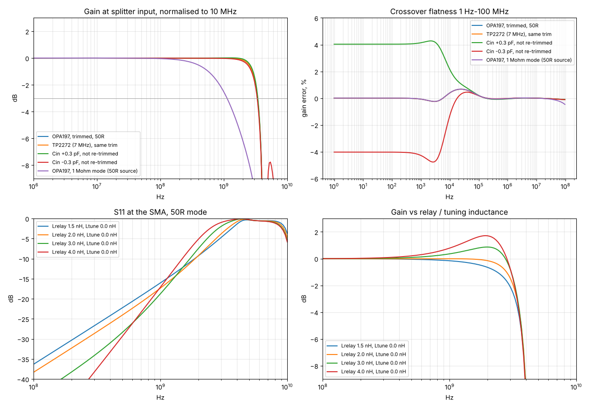 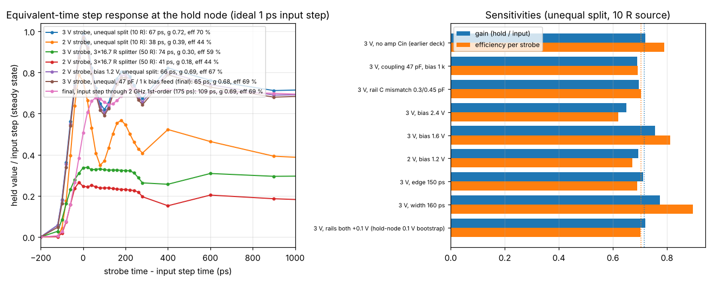
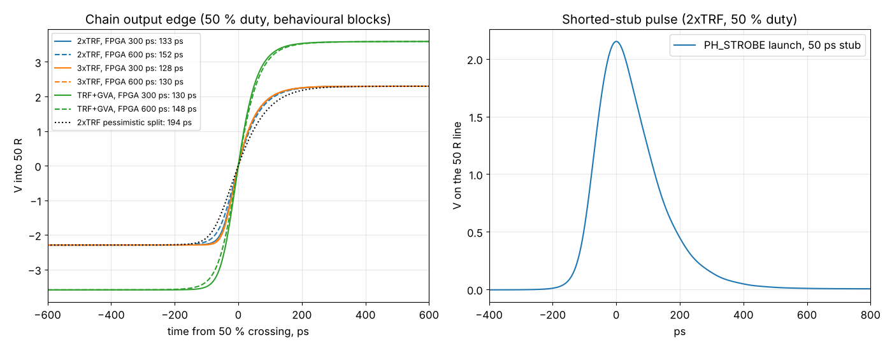 
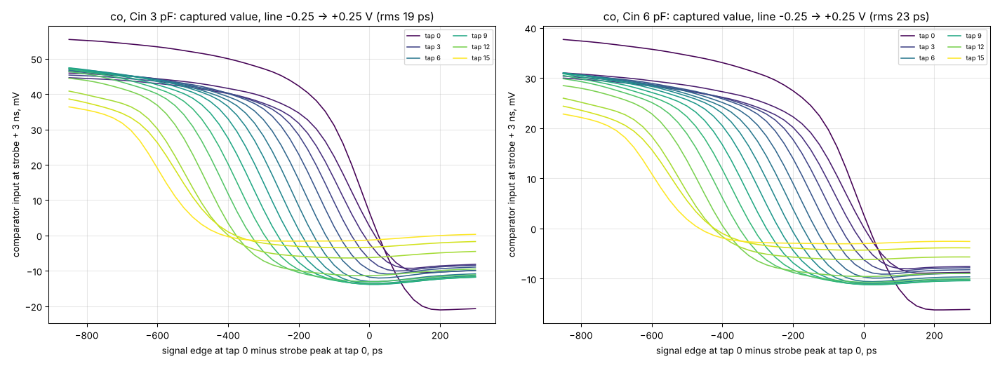 

Schematic sheets (`../kicad/export/`, PDF: `scope-fe.pdf`) and layout fragments:

 
 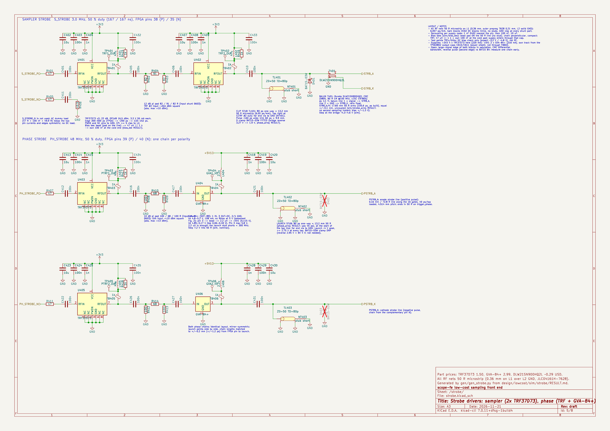
 
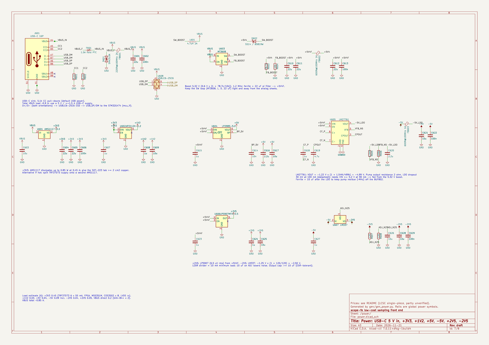 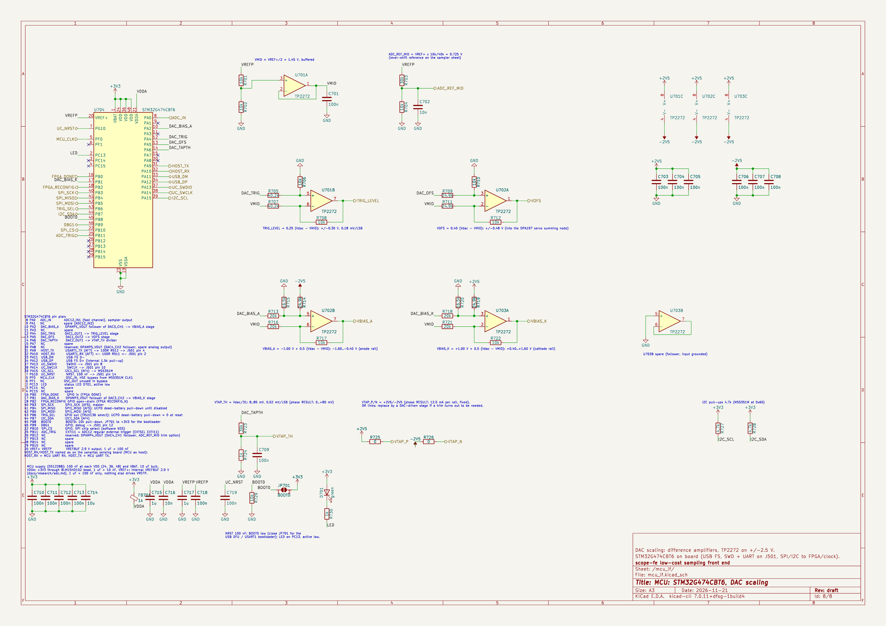
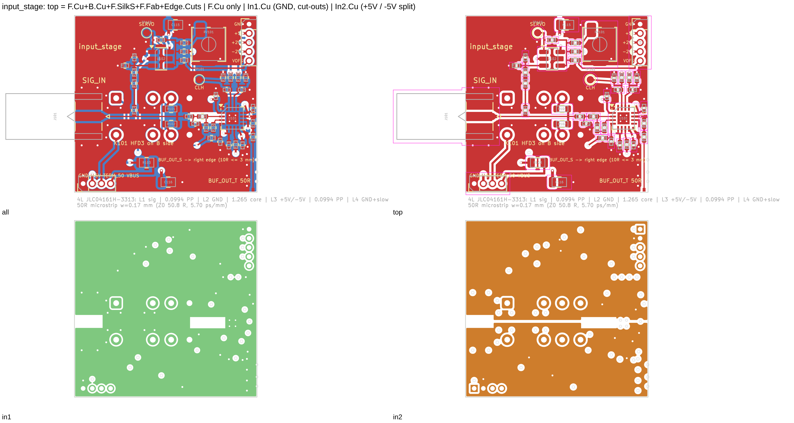 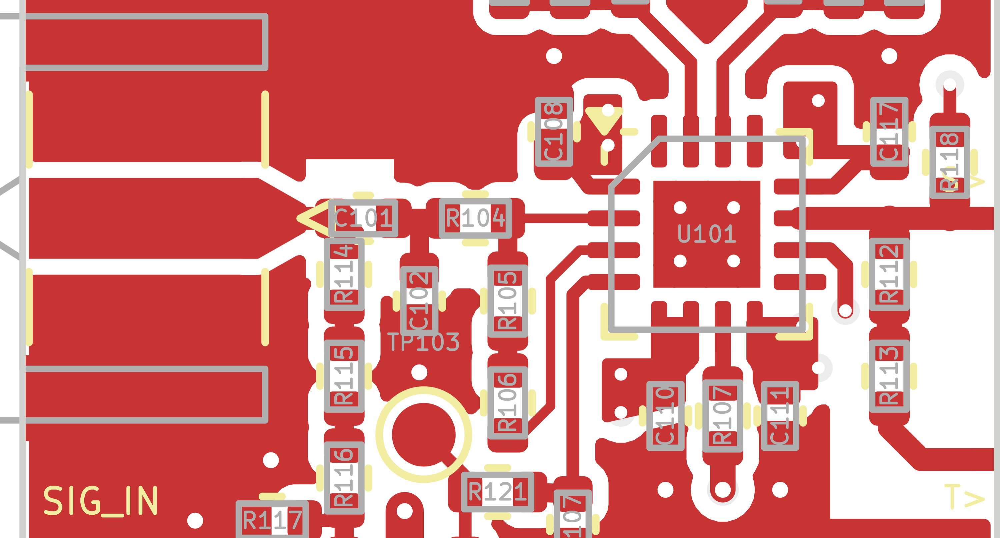
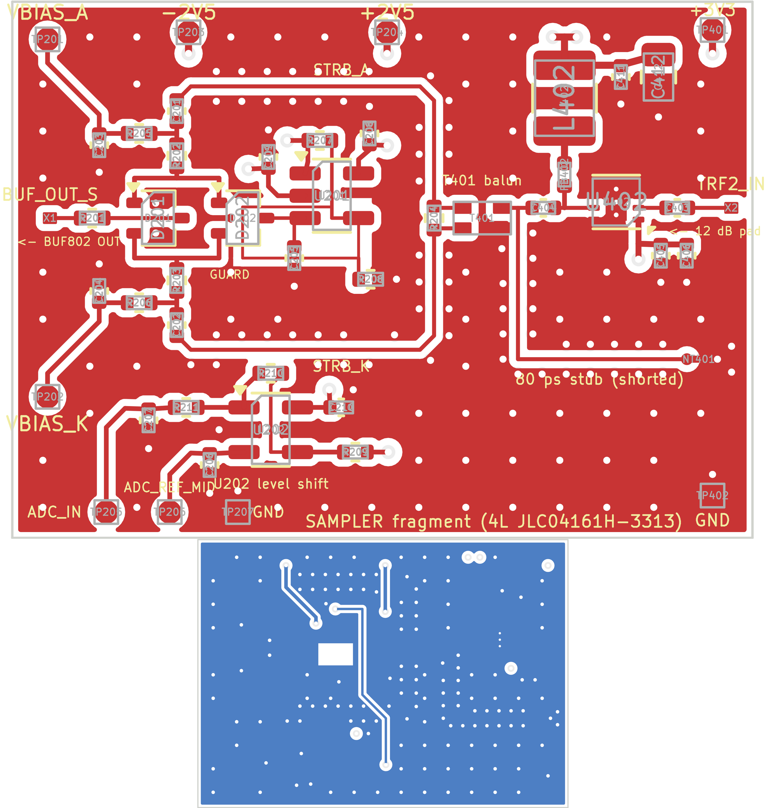 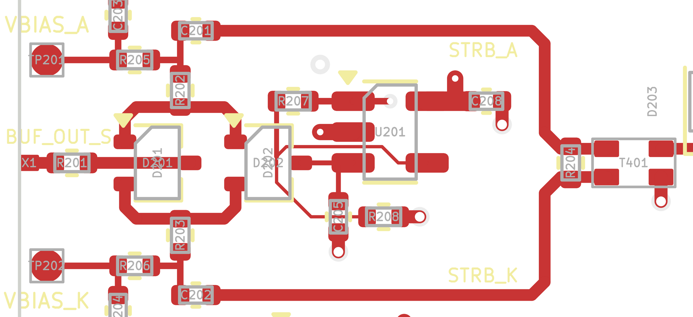
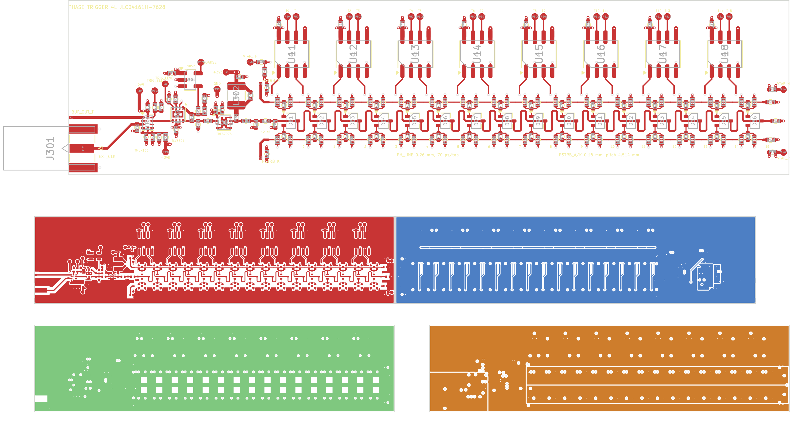 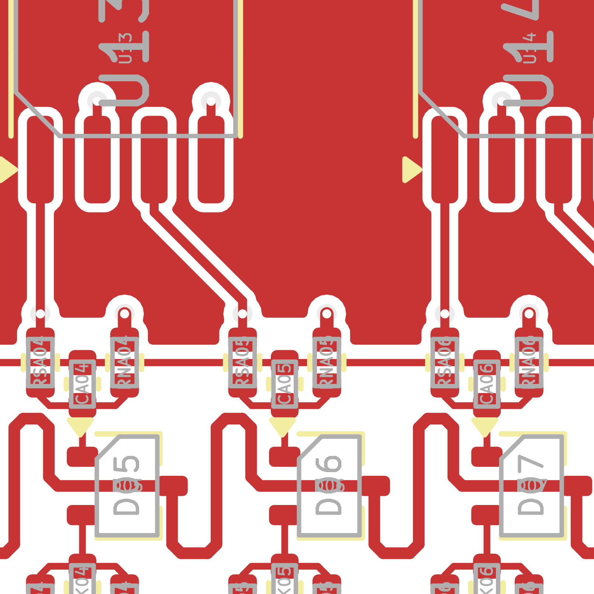

## 10. Bring-up order

1. **Power, no RF parts powered**: check every rail, ripple, the -2V5 noise and the TMUX136 ramp; total current
   against 0.85 A.
2. **Clock, MCU and FPGA**: flash the STM32 over SWD (or USB DFU / USART1 with JP701 closed), MS5351M over I2C, FPGA
   configuration (DONE), JTAG; check FPGA_CLK and MCU_CLK.
3. **DAC stages**: all five DAC outputs over their range; confirm VBIAS_A negative and VBIAS_K positive before any
   strobe runs.
4. **Strobe chains**: S_STROBE and PH_STROBE patterns; measure step, edge and stub pulse of one chain each (risk 1);
   check the reverse pulse with the clamp.
5. **Input stage**: 1 Mohm input and with an external 50 ohm feed-through terminator, servo, RV101 trim, offset range, overload behaviour.
6. **Sampler**: hold chain and ADC timing (ADC_TRIG at +40 ns), bias sweep, pedestal, efficiency.
7. **Trigger path**: TMUX136 both inputs, TLV3801 level, line driver output, COARSE.
8. **Delay line**: VTAP_TH sweep, code density, tap positions, latch timing (+12 ns).
9. **System**: tracking loop, dither, equivalent-time records; compare with a known edge and a 3 Gbps pattern.
