# Low-cost sampling front end: theory of operation

(State of 25 Nov 2026: clock plan of SPEC decision 18, sampler strobe arms and bias of SPEC decision 21, the BOM
reduction round of SPEC decisions 27-35 (diode-bridge trigger selector, COS3502 coarse receiver, input servo without
trimmer, 1 % power dividers, simplified USB input), board as rebuilt for it; `docs/VALIDATION.md`.)

Equivalent-time sampling front end for 2 GHz / 3 Gbps signals, built around a 4-diode sampling bridge, a 16-tap
delay-line phase detector and a small FPGA. An on-board STM32G474CBT6 supplies the ADC, the DACs and the calibration
(it replaced the earlier header to a user STM32 board on 21 Nov 2026).
Every number in this document is a simulation result or a design value; no board has been built. Sources: `../SPEC.md`
(Decisions section), `../sim/*/RESULT.md`, `../kicad/README.md`, `bom.md`, `../layout/board/README.md`,
`../../../docs/research/`.

## 1. Overview

```
              (no termination)  5:1 C/R divider, 1 Mohm
SIG_IN SMA ──┬─────────────────── Ctop/Cbot + 900k/100k ── BUF802 (G 0.98) ── OUT pin
             │                  OPA197 integrator servo ◄─ VOFS (DAC)        │
             │                                                     ┌─────────┴──────────┐
             │                                                  10 R (sampler)   49.9 R + 50R line (BUF_OUT_T)
             │                                                     │                    │
             │   S_STROBE ─ TRF37D73 ─ 12 dB ─ TRF37D73 ─ 80 ps stub ─ balun ─ 2x 106 ps arms ─► BRIDGE
             │                              (half BAT15-04W clamp)          2x BAT15-04W     │
             │                                                     2.2 pF hold          │
             │                                          TPH2501 G=+3 ─ TPH2501 shift ─► ADC_IN (PA0)
             │                                                                          │
EXT_CLK SMA ─┴─ 49.9 R ─ diode bridge 2 ──┬── diode bridge 1 ◄───────────────────────────┘
                (Q301 / Q302 from TRIG_SEL)│ Y
                                TRIG_LEVEL (DAC) ─► TLV3801 ─ LVDS ─┬─ 2x 470 R ─ COS3502 (U313) ─► COARSE
                                                                    │ CMP_P
                                            TRF37D73 ─ 11.5 dB pad ─► signal line, 16 x 69 ps ─► 49.9 R
                                                                    ║ 16 gates (BAT15-04W, 2x 0.5 pF)
  PH_STROBE_P/N ─ 2x (TRF37D73 ─ 10.7 dB ─ GVA-84+ ─ 80 ps stub) ─► PSTRB_A/K, 16 x 39 ps ─► 49.9 R
                                                                    │ 2.2 k / 2x 1 k readout
                                             VTAP_TH (DAC) ─► 8x COS3502 ─► TAP[15:0]
   MS5351M ─ FPGA_CLK 24 MHz ─► GW1NZ-1 FPGA: PH_STROBE 48 MHz, S_STROBE 3.0 MHz, latch TAP, SPI
           └ MCU_CLK 24 MHz ──► STM32G474CBT6 (on board): ADC, 5 DACs, I2C, USB FS, ADC_TRIG frame mark
```

The sampler takes one sample per S_STROBE (3.0 MHz). The phase path measures, on every 48 MHz phase strobe, where a
rising edge of the trigger signal lies inside a window of about 500 ps (16 taps of about 34 ps as built). Because both strobes come from the same FPGA
serializer, every edge found in a snapshot is a time stamp on the strobe grid. Software fits the signal phase and
frequency to those stamps and assigns each sample its equivalent time. No trigger divider or programmable delay is
needed.

Key figures (simulated, behavioural amplifier models; see section 10):

| Item | Value |
|---|---|
| Input | 1 Mohm // 2.0 pF (sim; about 3 pF apparent at 2 GHz; the built pad and node copper adds about 0.8 pF more, not re-simulated), no on-board termination: for 50 ohm use an external SMA feed-through terminator; fixed 5:1; linear range +/-2.5 V around the offset; +/-50 V rating (C101 sees at most 47.7 V) |
| LF / HF flatness | no trimmer: raw mismatch -7.1 ... +6.0 % per board, firmware-corrected to 0.29-0.55 % (1 Hz-100 MHz) |
| Input -3 dB | external 50 ohm terminator: 3.3 GHz with the ideal BUF802 model (a real BUF802 is expected to give about 2 GHz); unterminated from a 50 ohm source: 1.7 GHz |
| Input S11, external 50 ohm terminator | -16 dB at 0.5 GHz, -10 dB at 1 GHz, -3.4 dB at 2 GHz (ideal terminator, 3 mm SMA-divider line) |
| Step at the splitter (20 ps input) | external terminator 130 ps 10-90 %, 13 % overshoot; unterminated 191 ps, 0.5 % |
| Sampler aperture | 100 ps at the nominal +/-1.3 V bridge bias (as-built strobe arms, efficiency 105 %, bridge gain 0.55); 148 ps with the BUF802 model behind a 2 GHz edge (`sim/strobe_arms`) |
| Noise, referred to the input tip | input stage 0.57 mV rms; sampler + ADC 0.35 mV rms at the bridge = about 1.75 mV at the tip in the ideal-3 V-strobe case (efficiency 0.69, deconvolved, factor 2.2); with the final strobe (efficiency about 1, no deconvolution) about 0.22 mV at the bridge for gain 0.74, not re-derived for the as-built gain 0.55 |
| Sample rate | 3.0 MS/s (S_STROBE = PH_STROBE / 16) as a burst rate into MCU SRAM; sustained over USB FS about 0.25 MS/s (section 6); 2.4 MS/s in the two-ADC variant |
| Phase detector | 16 taps, as-built array simulated (`sim/bom2_taps`): 33.7 +/- 5.1 ps per tap (26.9-46.6; taps 3-11 29.8-31.7 ps), window 506 ps, 16.8 ps rms per snapshot (19.3 ps with 6.5 mV comparator offsets), threshold midpoint 16.7 mV |
| Trigger | down to 200 mVpp at the tip (+/-20 mV at the comparator); TRIG_LEVEL -0.33 ... +0.47 V guaranteed; selector -3 dB 1.26 GHz (signal) / 1.13 GHz (EXT_CLK), isolation about 46-49 dB at 100 MHz, 22 dB at 1 GHz |
| Power | USB-C 5 V, 0.75 A typical / 0.97 A maximum: needs a 1.5 A USB-C source |
| Parts cost | 70.39 USD per board (MCU included, PCB excluded; `bom.md`); 81 fitted lines, 53 JLC basic / 27 extended part numbers, no 0.1 % part |

## 2. Input stage

SIG_IN goes over a short (3 mm, as short as possible) 50 ohm line straight to VIN. There is no on-board termination
(SPEC decision 10): the input is 1 Mohm // about 2-3 pF, and a user who needs 50 ohm plugs an external SMA feed-through
terminator onto SIG_IN. With an ideal terminator the board load behind the SMA gives S11 -10 dB at 1 GHz and -3.4 dB
at 2 GHz, +1.2 dB peaking at the BUF802 input and 13 % step overshoot at the output (`sim/input/RESULT.md`).

The HF path is a C0G divider: Ctop C101 1.5 pF +/-0.05 pF (50 V; at the +/-50 V input rating it sees at most 47.7 V)
from VIN to the gate node, Cbot 3.3 pF to ground, then Rg 10 ohm into the BUF802. With the BUF802 input capacitance
(2.4 pF typical) the ratio is 0.206 and the HF gain 0.200. The LF path is a 1.000 Mohm resistive divider (3 x 300k
0603 + 100k, alpha 0.100) into an OPA197 differential integrator that drives the BUF802 auxiliary input
(composite-loop mode). The servo sums the BUF802 output (Rf1 4.7k), the offset DAC (Rofs 10k), a mid-scale current
from VNEG_REF (Rmid 15k) and Rf2 22k to ground around Cint 1 nF C0G, so that the LF gain is 0.1997, equal to the
nominal HF gain; the loop crossover is about 8.6 kHz and does not depend on the op-amp GBW. An 18 pF capacitor at the
divider tap cancels the integrator feed-through. The gate is biased from the BUF802 In_Bias pin through R105 1 M
(0402, at the gate) and R106 10 M (0603, bottom side).

**LF / HF match without a trimmer.** The HF gain depends on the BUF802 input capacitance, which has only a typical
value (a +/-0.3 pF spread moves the HF gain by +/-4 %); with all part tolerances the LF / HF mismatch eps is
-7.1 ... +6.0 % over 60 simulated boards. It shows as a pole-zero doublet near the servo crossover: a step jumps to
the HF gain and settles to the LF gain over about 2-150 us. No DAC can trim a gain ratio on this bipolar node (a PWM
shunt, a FET or a diode would be polarity dependent or nonlinear), so it is measured once and corrected in firmware
(section 9): the step response to any 0.2-2 kHz square wave is fitted with six first-order terms at fixed time
constants (2-300 us), and the inverse filter (unity at DC, so the result carries the resistor-ratio LF gain) is
applied as an IIR to the real-time stream or, for short equivalent-time records of periodic signals, as
x = (1 + eps) y - eps m with m the record mean. Simulated flatness after correction 0.29-0.55 % (1 Hz-100 MHz), step
deviation 0.13-0.26 %; boards with a fitted |eps| below 1 % are left uncorrected (0.46 %). The bias resistor values
matter: with 2 x 1 M the bias network adds a third time constant next to the servo doublet and the correction leaves
1.4-2.8 %, hence R106 = 10 M (`sim/bom2_input/RESULT.md`).

**Offset.** VOFS is the raw STM32 DAC1_OUT2 (0.2-2.7 V) through Rofs; the mid-scale is cancelled by Rmid from
VNEG_REF (-1.933 V = -0.667 x VREF+, made by U701 TPH2501 on mcu_if). Simulated OUT offset = 0.606 - 0.470 Vdac:
VOFS 0.2 / 1.289 / 2.7 V gives +0.512 / 0.000 / -0.663 V at the BUF802 output, i.e. at least +/-2.5 V at the input.
Resistor tolerances (1 % thick film everywhere) go into the firmware offset calibration. VNEG_REF is ratiometric to
the DAC reference, so the mid-scale does not move with VREF+ or the -2V5 regulator.

CLH/CLL = +/-1.5 V limit the BUF802 output and so the bridge input. Protection is the BUF802's internal clamps; Ctop
limits the current. Recovery from a +20 V, 10 us overload takes about 50 us (servo wind-up).

The BUF802 output pin feeds two legs: 10 ohm directly into the sampler bridge (bridge within about 3 mm), and 49.9 ohm
plus a 0 ohm series position (ferrite or 100 ohm option against strobe kick-out) into the 50 ohm line BUF_OUT_T to the
trigger selector (section 5). The selector's on bridge loads the line end with about 500 ohm, which costs 0.8 dB.

## 3. Sampler and hold chain

The bridge is two BAT15-04W (four diodes). The strobe balun T401 drives the anode rail STRB_A and the cathode rail STRB_K
over two uncoupled 50 ohm arms of 17.8 mm (105.6 ps) each, then 47 pF C0G and 22 ohm; R204 (1 k) sits across the arms
on the bridge axis, at the same distance from the balun on both. VBIAS_A and VBIAS_K (nominal -1.3 / +1.3 V, trimmed per
board) reverse-bias the bridge through 1 k. A strobe pulse forward-biases all four diodes for about 100 ps and the input
charges the 2.2 pF hold capacitor. The hold node
drives U201 (TPH2501, non-inverting, G = +2.96, 1.00 k / 510 ohm, +/-2.5 V; was 499 ohm, the gain is calibrated). U202 (TPH2501 on 3.3 V) inverts and shifts:
Vadc = 1.44 V - U201out, giving 0.40-2.48 V at PA0 for +/-0.5 V at the bridge. 33 ohm + 100 pF C0G at the pin absorb
the ADC kick-back (settling to the pin as with 220 pF, 0.21 LSB).

With the as-built strobe chain and arms (`sim/strobe_arms/RESULT.md`, with the earlier 24.9 ohm arm resistors; 22 ohm
gives 103 ps and 107.6 % at +/-1.3 V, inside the bias trim) the bias sets the operating point:

| Bias | Aperture | Efficiency | Bridge gain | Pedestal | Kick-out bridge / BUF802 pin / trigger end (mVpp) |
|---|---|---|---|---|---|
| +/-1.0 V | 126 ps | 122 % | 0.60 | +31 mV | 180 / 97 / 21.5 |
| **+/-1.3 V (nominal)** | **100 ps** | **105 %** | **0.55** | **+36 mV** | **187 / 102 / 22** |
| +/-1.4 V (VBIAS_K limit) | 91 ps | 98 % | 0.53 | +38 mV | 185 / 106 / 22 |

At +/-1.3 V the full system (BUF802 model, 2 GHz edge) gives 148 ps, efficiency 100 % and gain 0.49. There is no second
sampling instant from the arm reflections (held value flat to 1.6 % before the edge). The pedestal moves with the rail
common mode and is nulled through the two bias DACs. Droop with the model leakage is 1.25 % of the hold voltage per
320 ns; it is deterministic at a fixed ADC delay.

**Efficiency correction.** With efficiency e < 1 the hold node remembers the previous sample: v_k = (1-e) v_(k-1) + e
(g x_k + ped). With e = 0.69 and g = 0.69 (ideal 3 V strobe, `sim/sampler`): x_k = (v_k - 0.31 v_(k-1)) / 0.48 after
pedestal removal. v_(k-1) is the previous strobe in time order, not in equivalent-time order, so the MCU keeps the raw ADC
stream for this step. The coefficients are calibrated per board (section 9) because they move with strobe amplitude,
bias and temperature; at the nominal bias the efficiency is about 1 and the correction is small (e > 1 means the bridge
over-corrects and is handled by the same formula). A rail bootstrap was rejected: it raises gain but not the weight of
the new sample. For independent readings the deconvolution multiplies the noise by sqrt(1 + 0.31^2) / 0.48 = 2.2 in the
e = 0.69 case; the ADC (0.48 mV rms at the pin) dominates.

## 4. Strobe generation

The GW1NZ-1 has no true LVDS output, so each strobe is a complementary LVCMOS33 pin pair driven by a
serializer (768 Mbit/s DDR, section 6). The gain blocks are AC coupled and saturating.

**Why 50 % duty.** A low-duty pulse lets the AC-coupled chain idle in its linear range, so the output step is only one
saturation level (about 2.4 V for TRF37D73). A 50 % square wave saturates both levels and the step is 2 Vsat: 4.59 V
for 2x TRF37D73, 7.18 V for TRF37D73 + GVA-84+ (4.30 V for S_STROBE with the 47 uH chokes, real 3.125 MHz pattern). A
shorted stub at the launch point differentiates the step into a pulse of twice the stub delay. The other edge produces
a reverse pulse half a period later.

**Sampler strobe.** S_STROBE_P -> 49.9 ohm -> TRF37D73 -> 12.5 dB pi pad (100/120/100) -> TRF37D73 -> 80 ps shorted
stub -> common-mode-choke balun (DLW21SN) -> 105.6 ps arms -> STRB_A/STRB_K. S_STROBE_N is terminated in 49.9 ohm. The
bias tees are a bead plus a choke (47 uH with a 1k damper for the first stage, 1 uH DFE252012F for the others). Edge 133-152 ps
(FPGA edge 300-600 ps), aperture 100 ps at the nominal bias (section 3).

The S_STROBE falling edge makes a negative pulse at the stub. The shunt clamp D401 (half a BAT15-04W: pin 2 on the stub
node, pins 1 and 3 to GND, so the unused diode is shorted) clips it at about -1.3 V; the bridge goes further into reverse and does not conduct, so there is no spurious sample. The
falling edge shifts the held value by -9.6 mV independent of the input, so **the ADC must finish sampling before the
S_STROBE falling edge, 166.7 ns after the strobe at 3.0 MHz**; the next sampling edge leaves less than 0.5 mV of the
shift. Without D401 the diodes would see 4.5 V reverse in overload, so D401 is required. With D401 the reverse voltage
per bridge diode is at most 3.1 V over the full-scale input, but 3.93 V at the BUF802 output clamp (+/-1.5 V) and
+/-1.3 V bias, against the 4 V BAT15 rating; hence the firmware limit |VBIAS_A|, |VBIAS_K| <= 1.30 V (section 9).

**Phase strobes.** PH_STROBE_P and PH_STROBE_N each drive TRF37D73 -> 10.7 dB pad (120/100/120) -> GVA-84+ (+5V1 from
the TPS63802, 1 uH choke) -> 80 ps shorted stub -> PSTRB_A resp. PSTRB_K. With the 80 ps stub the pulse is about
+4.1 V / 221 ps at tap 0; the as-built array simulation gives 3.36 V at tap 15 with 43 ohm ends and 3.59 V with the
fitted 49.9 ohm ends, against the 2.0 V a gate needs. At the lowest +5V1 corner (GVA-84+ drain 4.71 V) the swing drops
about 12 %, still at least 2.4 V. The reverse pulse
reaches at most 2.95 V on a tap diode (74 % of BV) and moves the comparator inputs by less than 0.5 mV, so the PSTRB
clamps are not fitted (footprints kept). Each stub (TL401-TL403) is 13.503 mm of 0.16 mm, 50 ohm microstrip at
5.925 ps/mm, 80.0 ps including the GND via in the shorting pad.

**Bias adjustment.** The sampler bridge only conducts if the strobe overcomes the reverse bias, so the bias sets
aperture and efficiency. At a fixed +/-1.3 V a strobe 25 % below nominal gives only 56 ps and 59 % efficiency;
re-trimmed to +/-0.9 V it gives 103 ps and 103 %. A strobe more than about 10 % above nominal cannot be trimmed back
fully (aperture 104-108 ps at the bias limit). VBIAS_A and VBIAS_K are therefore DAC-driven (VBIAS_A -1.46 ... -0.50 V,
VBIAS_K +0.10 ... +1.40 V, firmware limit 1.30 V) and set at calibration for an efficiency of about 100 %.

## 5. Trigger path and phase recovery

**Source selector.** The TLV3801 IN+ node Y is fed by one of two four-diode bridges (2 x BAT15-04W each). Bridge 1
(D317 / D318) connects the BUF_OUT_T line end, bridge 2 (D319 / D320) the EXT_CLK input (49.9 ohm termination R301 at
the SMA). Each bridge is biased through four 1k feeds (R391-R394) from two steering nodes: S, the collector of Q301
SS8550 (emitter +2V5, base 10k from TRIG_SEL, 1k to -2V5), and SB, the collector of Q302 MMBT3904 (emitter -2V5, base
10k from S and 3.3k to -2V5, 1k to +2V5). TRIG_SEL low (also the MCU reset state, R737 3.3k pull-down) saturates both
transistors: S +2.43 V, SB -2.32 V, bridge 1 conducts with 2.1 mA, bridge 2 is reverse biased by the hard rails.
TRIG_SEL high turns both off: the 1k pull-ups bias bridge 2 with 1.1 mA and hold bridge 1 at -1.38 / +1.38 V.
Simulated (`sim/trig_switch/RESULT.md`): -3 dB 1.26 GHz on the signal path (-1.1 dB at 100 MHz, of which 0.8 dB is
the bridge load on the line end) and 1.13 GHz from EXT_CLK; offset +6.4 mV, 7 uV/K (calibrated with item 9); switching
about 0.5 us; rail current 12.5 mA (signal) / 1.1 mA (EXT). Isolation of the off path: -49 / -22 / -19 dB at 100 MHz /
1 GHz / 2 GHz (EXT into Y, signal selected), -46 / -23 / -20 dB the other way. A 200 mVpp trigger needs about 48 dB
against a full-scale EXT_CLK, so the **operating rule is: remove EXT_CLK when triggering on small signals.** The off
bridge passes no DC: an overloaded signal (BUF802 clamp +/-1.5 V) moves Y by less than 0.2 mV in EXT mode.

**Comparator.** The TLV3801 (+/-2.5 V) compares Y against TRIG_LEVEL and drives an LVDS pair with 100 ohm across the
outputs. TRIG_LEVEL is a passive sum: R383 5.1k from the DAC, R384 10k from -2V5, R385 3.3k to GND, 10 nF at the pin:
TRIG_LEVEL = 0.327 Vdac + 0.167 x V(-2V5), guaranteed -0.332 ... +0.466 V over all tolerances, 0.23 mV per LSB.

**Delay line.** CMP_P -> 1 uF -> TRF37D73 -> 1 uF -> 11.5 dB pad (100/100/100) -> signal line; CMP_N sees an equal
dummy load. The line carries +/-0.21 V for data, 0.42 V steps for isolated edges, and its edge is about 230 ps 10-90 %
at tap 0 and 320 ps at tap 15. Each of the 16 taps is a BAT15-04W pair: the common pin sits on the signal line, the
anode and cathode hold nodes are coupled through C314-C345 (0.5 pF +/-0.05 pF C0G) to the strobe lines PSTRB_A and
PSTRB_K. These capacitors are the only path from the strobe into the gate (without them no tap ever captures; at
least about 0.35 pF is needed, and a 0.25 pF part corner already fails). The strobe forward-biases the pair for its
width (about 220-320 ps FWHM) and the hold nodes take the line voltage at that instant.

**Co-propagating geometry.** A 30-35 ps tap spacing cannot be made with a strobe that reaches all gates at once.
Instead the strobe lines run along the taps and the signal line, launched from the same end, takes about twice as long
per tap (meander), so a signal edge and a strobe that start together separate by the difference per tap. As built on
the six-layer board: PSTRB_A/K are 0.10 mm (62 ohm) lines at a 4.514 mm tap pitch, 26.25 ps unloaded and 39.3 ps per tap
loaded, ending in 49.9 ohm (R378 / R379); PH_LINE is a 0.10 mm meander of 9.707 mm per cell, 69.4 ps per tap.

The as-built array simulation (`sim/bom2_taps`: the extracted line sections, pad excess capacitances and a hold-node
capacitance of 0.40 pF to ground taken from the board) gives **33.7 +/- 5.1 ps per tap** (26.9-46.6 ps), a window of
506 ps and **16.8 ps rms** per single snapshot (19.3 ps with 6.5 mV comparator offsets). Taps 3-11 are 29.8-31.7 ps
apart; the end taps 12-15 are irregular (pulse widening) and, like all tap positions, calibrated by code density
(section 9). The 0.45 pF corner of the coupling capacitors gives 17.1 ps rms. Counter-propagation gave 69.8 ps and
weak far taps in the earlier study.

**Readout.** Each hold node goes through 2.2 k to VTAP_N / VTAP_P (-/+2.5 V), and 2 x 1 k sum the two nodes into the
IN+ of one COS3502 comparator half (8 dual parts, 3.3 V). IN- is VTAP_TH. The comparator input peaks 1-2 ns after the
strobe and is down to 5 % of the previous snapshot after 20 ns.

**Threshold and rising edges only.** The hold nodes also see the line moving after the strobe (feed-through through
the diode capacitance), so a tap the edge has not reached does not read 0. The as-built array gives a swing of
47-56 mV at 3 ns after the strobe (35-41 mV at 5 ns, when the latch at +12 ns sees the comparator input) and a
decision midpoint of **VTAP_TH = 16.7 mV** (13.5 mV at 5 ns; tap-to-tap spread 1.3-2.4 mV) for 3 pF comparator input
capacitance. The threshold sign follows the edge polarity, so only rising edges are used; falling edges read as all
zeros. This also handles the AC coupling: on a slow clock the line idles at 0 V, which reads 0. VTAP_TH is re-found
per signal class by a threshold sweep.

**Latch and coarse stamp.** COS3502 outputs are valid from strobe + 9 ns (worst case) until the next snapshot's outputs
change, at the earliest 9 ns after the next phase strobe (20.83 ns period). The FPGA latches TAP[15:0] at **strobe +
12 ns**, inside the usable window of about 10-20.8 ns. A ninth COS3502
(U313, unit A; unit B tied off), bridged onto CMP_P/CMP_N by 2 x 470 ohm, gives COARSE to FPGA pin 27 (GCLKT_3; the
GW1NZ-1 has no differential input and its LVCMOS33 thresholds do not bracket the LVDS levels). Its input common-mode
range (-0.2 ... 3.5 V) covers the TLV3801 output (0.92-1.29 V). The FPGA deserializes COARSE at 768 Mbit/s (1.302 ns
bins). The bridge RC limits it to about 100 MHz and the COS3502 toggle rate is specified only at 5 V (90 MHz), so
firmware uses COARSE only for trigger frequencies up to 60 MHz; above that the aimed-strobe history (below) replaces it.

**From snapshots to sample times.** A snapshot with a rising edge is a thermometer code: taps the edge has passed read
1. The transition position k gives the edge time t = t_PH(n) - d_k, where t_PH(n) is the known phase strobe time
(serializer grid plus the known dither offset) and d_k the calibrated position of tap k. The coarse stamp only
identifies which edge this was (cycle count); the check is
|t_fine - t_coarse - latency| < one bin. A type-2 tracking loop (phase and frequency, so it follows
spread-spectrum clocks) fits the signal phase to the stamps. Each S_STROBE sits a fixed number of serializer bits plus
a calibrated board constant from a phase strobe, so the fitted phase at that instant is the equivalent time of the ADC
sample. The FPGA reduces each snapshot to (strobe index, k, valid) so that only one phase value per sample (3.0 M/s)
has to reach the MCU.

**Minimum signal levels.** The delay line always sees a saturated comparator output, so its amplitude does not depend
on the input. The trigger needs about 200 mVpp at the tip (+/-20 mV at the TLV3801). The sampler strobe kick-out reaches
the trigger end of BUF_OUT_T with 22 mVpp for about 100 ps at the nominal bias (`sim/strobe_arms`), comparable to the
smallest trigger signal. Because the S_STROBE sits at a fixed bit offset from one phase strobe, a comparator toggle it
causes lands at a fixed tap position, i.e. a systematic stamp error; the FPGA should discard stamps from the phase
strobe that coincides with S_STROBE (planned, not implemented). The phase strobes must deliver at least 2.0 V at every
gate (1.5 V gives 3.5 mV, a failure).

**Minimum trigger rates.** With the as-built window of about 506 ps, 48 MHz strobes and rising edges only, a
free-running clock of frequency f gives about 0.024 f stamps/s (window x 48 MHz): 10 k/s from about 410 kHz, and gaps
over 100 us become rare (< 1e-3) from about 3 MHz (arithmetic, not simulated). 3 Gbps data gives about 14 M/s. Below
that, the FPGA aims phase strobes at the predicted edge (coarse plus fine history, 1.302 ns bits plus output-delay
steps); for crystal sources this works down to the kHz range at one stamp per period. Non-periodic single events get a
random hit with probability about 2.4 %. Strobe phase must be
swept so that commensurate signals (a simple ratio of the strobe rate, for example 12 MHz against 48 MHz) do not land on
a fixed set of phases (section 6).

**External clock mode.** TRIG_SEL high selects EXT_CLK; the comparator, delay line and coarse path are unchanged.
EXT_CLK may swing -0.9 ... +1.0 V into 50 ohm (Y follows to +/-0.87 V over 0-70 C; the lower limit sits on the TLV3801
common-mode edge), and its crossing must lie inside the TRIG_LEVEL range (-0.33 ... +0.47 V), where TRIG_LEVEL is set
to the clock midpoint. Return loss -26 dB at 100 MHz, -13 dB at 1 GHz.

## 6. Time base and FPGA functions

**Synchronous frequency plan** (SPEC decision 18). One MS5351M PLL (Si5351A-compatible, 25 MHz crystal, I2C from the
MCU) with integer dividers gives 24 MHz on FPGA_CLK (pin 33, rPLL input) and MCU_CLK (STM32 HSE bypass, PF0), so strobes,
ADC and firmware timers count the same clock:

| Quantity | Value | Relation |
|---|---|---|
| FPGA serialiser | 768 Mbit/s DDR, 1.302 ns per bit | rPLL IDIV 1 / FBDIV 16 / ODIV 2: VCO 768 MHz, FCLK 384 MHz (<= 400), OSER10 / IDES10 with PCLK = FCLK / 5 = 76.8 MHz (SPEC decision 18) |
| Phase strobe PH_STROBE | 48 MHz, 20.83 ns | 16 bits (8 high, 8 low) |
| Sampling strobe S_STROBE | 3.0 MHz, 333.3 ns | 256 bits = 16 phase strobes; falling edge (reverse pulse) at +166.7 ns |
| MCU system clock | 120 MHz | PLL from the 24 MHz HSE (x 5) |
| ADC clock | 60 MHz, synchronous mode (HCLK / 2) | one strobe period = 20 ADC clocks; 12-bit conversion with 6.5-cycle sampling = 19 clocks (316.7 ns) |
| Two-ADC variant | ADC 48 MHz, S_STROBE 2.4 MHz (416.7 ns) | 20 ADC clocks = 320 bits; for the case that two ADCs together have a lower clock limit (about 52 MHz, unverified) |

**Frame alignment.** An MCU timer triggers the ADC internally (fixed, deterministic latency) and drives its output on the
ADC_TRIG wire (MCU PB11 -> FPGA pin 18), which marks the frame start. The FPGA aligns its strobe counter to that edge
once, with serialiser bit slips (1.302 ns) plus the GW1NZ output delay block (about 30 ps per step, 128 steps). The same
delay block trims the phase-strobe to sampling-strobe delay and provides the slow fine sweep that keeps a signal at a
simple ratio of the strobe rate from always or never hitting the tap window. The ADC samples from strobe + 40 ns for
6.5 cycles: 40-148 ns at 60 MHz, which ends 18.6 ns before the reverse pulse at 166.7 ns (variant: 40-175 ns against
208.3 ns). Because the reverse pulse shifts the held value, this window must stay fixed relative to the strobe, which is
why the whole plan is phase-locked rather than free-running.

Not verified: MS5351M output-to-output phase repeatability after a PLL reset; the PB11 timer output function (EXTI11 is
the ADC12 trigger input; which timer channel PB11 carries is not checked); whether the output delay block can be used on
a serialiser (OSER10) pin; serialiser and input-capture placement on the permuted FPGA pins.

| Function | FPGA pins (as built) | Behaviour |
|---|---|---|
| PH_STROBE_P/N | 39/40 (IOT16B/A) | 48 MHz, 50 % (which output is P is a firmware matter) |
| S_STROBE_P/N | 38/35 (IOT17A/B) | 3.0 MHz, fixed bit offset from a phase strobe, trimmed by the output delay |
| TAP0..7 | 28, 29, 30, 31, 32, 41, 47, 6 | latched at phase strobe + 12 ns |
| TAP15..8 | 9, 10, 11, 13, 14, 15, 16, 17 | (reversed for the board fan-out) |
| COARSE | 27 (GCLKT_3) | IDES10 at 768 Mbit/s, 1.302 ns bins |
| ADC_TRIG | 18 <- MCU PB11 | frame start from the MCU timer |
| SPI slave SCK / MISO / MOSI / CS | 20 / 21 / 22 / 24 | per-strobe records with sequence numbers to the MCU; plain user I/O: SPI no longer uses the configuration SPI, the FPGA is configured by JTAG or from its internal flash only |
| DBG2, JTAG TCK / TMS / TDI / TDO | 8, 3 / 4 / 5 / 7 | to J501 |
| FPGA_DONE / RECONFIG | 46 / 48 | MCU PB6 / PB13 |

The pin numbers above replace the original plan (TAP on 9-11 / 13-24 / 27, COARSE 47, ADC_TRIG 41, SPI 28-31): they were
permuted so that the six-layer fan-out has no crossings (`kicad/README.md`, FPGA section).

**Programming header J501** (Würth WR-WST 490107671612, Redfit IDC direct-to-board footprint, no part fitted) has
the yanartas sensing board J3 pinout: 1 VBUS, 3 +3V3, 6/15/16 GND, FPGA JTAG on 7/9/11/13 (TCK/TMS/TDI/TDO), DBG2 on 5
(FPGA pin 8), and for the STM32 SWDIO 8, SWCLK 10, NRST 14, DBG1 12 (PF1) and the USART1 console on 2 (HOST_RX = MCU RX,
PA10) and 4 (HOST_TX = MCU TX, PA9), each through 100 R. One cable debugs both chips.

The ratio 16 sets the sample rate below the G474 ADC limit (4 MS/s) while keeping the phase strobe at the 48 MHz the
COS3502 and the readout allow. Snapshot reduction, coarse/fine combination and the tracking loop run in the FPGA
fabric (1152 LUT; the fit is not checked).

**Data rate.** 3.0 MS/s is a burst rate. One 12-bit ADC word plus a phase record of at least 16 bits per sample is
about 12 MB/s into the 128 KB SRAM of the G474CB, i.e. a burst of about 8-10 ms; SPI1 needs at least 48 of its
60 Mbit/s. USB FS bulk (about 1 MB/s) sustains about 0.25 MS/s, and the 40 CPU cycles per sample at 120 MHz allow the
pairing, efficiency correction and calibration only off-line, between bursts. Packing records in the FPGA (send only
valid stamps) raises the burst length. None of this is implemented.

The MS5351M runs from a 12 pF crystal (Y501); firmware sets XTAL_CL = 10 pF, its largest setting, and the board adds
about 2 pF.

**MCU (STM32G474CBT6, LQFP-48, on board, U704; pin table in `kicad/README.md`).** ADC12_IN1 on PA0, 6.5-cycle sampling
(108 ns) at 60 MHz with the synchronous ADC clock, VREFBUF 2.9 V, triggered internally by the frame timer; DMA into SRAM. Five DAC outputs (since 21 Nov 2026 without difference
amplifiers: the DACs drive passive networks, and one op-amp, U701 TPH2501, makes VNEG_REF = -0.667 x VREF+ for the
offset network only). Vdac usable 0.2-2.7 V on the buffered pins:

| DAC | Network | Net | Range, resolution |
|---|---|---|---|
| PA4 DAC1_OUT1 | 5.1k from DAC, 10k from -2V5, 3.3k shunt, 10 nF at the TLV3801 pin | TRIG_LEVEL = 0.327 Vdac - 0.167 x 2.44 V | -0.33 ... +0.47 V guaranteed, 0.23 mV/LSB |
| PA5 DAC1_OUT2 | Rofs 10k into the servo node, Rmid 15k from VNEG_REF | VOFS (raw DAC) | +0.51 ... -0.66 V at OUT (>= +/-2.5 V input), 1.7 mV/LSB at the input |
| PA2 OPAMP1 (DAC3_CH1) | 33k / 1k divider, 100 nF | VTAP_TH = Vdac / 34 | 6-79 mV, 0.02 mV/LSB |
| PA6 DAC2_OUT1 | 5.1k from DAC, 3.3k to -2V5 | VBIAS_A = 0.393 Vdac - 0.607 x 2.44 V | -1.40 ... -0.42 V, 0.28 mV/LSB |
| PB1 OPAMP3 (DAC3_CH2) | R735 4.7k series, R736 5.1k to GND (24 Nov, PARTS-4) | VBIAS_K = 0.520 Vdac | +0.10 ... +1.40 V, 0.37 mV/LSB |

TRIG_LEVEL and VBIAS_A follow the -2V5 rail (0.167 and 0.607 V/V; -2V5 is -2.44 V +/-2.5 % since 24 Nov 2026); the effects (LM27762 -2V5 tolerance, drift, noise) are
listed in `kicad/README.md` and are calibrated or negligible. Reset state (DACs and OPAMPs off, pins high-Z, VREFBUF
off): VBIAS_K 0 V (pull-down), VBIAS_A about -1.64 V (PA6 clamps at about -0.4 V), so the bridge is reverse-biased;
VNEG_REF 0 V; TRIG_LEVEL about -0.41 V (PA4 high-Z); TRIG_SEL low, i.e. the signal is selected. Firmware should enable VREFBUF, the DACs
and the OPAMPs together, keep |VBIAS_A| and |VBIAS_K| at or below 1.30 V (section 4), and set UCPD_DBDIS before
enabling USART1 (the UCPD dead-battery pull-down on PB6 would otherwise load FPGA_DONE).

GPIOs drive TRIG_SEL (PA1, 3.3k reset pull-down R737, base drive of Q301 through R386 10k), read FPGA_DONE (PB6) and pull FPGA_RECONFIG (PB13); SPI1 master on
PB3/PB4/PB5 with CS on PB9, I2C1 on PA15/PB7, MCU_CLK into PF0 (HSE bypass), ADC_TRIG out on PB11 (frame mark), USB FS on
PA11/PA12 to the USB-C receptacle (USBLC6-2SC6 ESD). The MCU pairs ADC results
with FPGA records by count, applies the efficiency correction and all calibration tables, and builds the
equivalent-time record. ADC_REF_MID (0.720 V) is VREF+ x 3.3k / 13.3k by divider.

## 7. Power

**Input.** USB-C 5 V through a 0 ohm link F601 (the PTC footprint, JLC basic), the ferrite FB601 (BLM18PG121SN1D,
2 A, 0.05 ohm) and the bulk / damper network = VBUS, 0.75 A typical / 0.97 A maximum: a 1.5 A USB-C supply is needed
(no PD negotiation; CC1 / CC2 carry only the 5.1k pull-downs and are not sensed). There is no fuse and no TVS fitted
(D601 SMAJ5.0A footprint left DNP: its 9.2 V clamp would not protect the 6.0 V converters anyway). The plug-in ringing
of the cable inductance against the converter input capacitors is damped by four 1 ohm + 47 uF (X5R 1206) branches
instead of a tantalum capacitor: simulated peak 5.3 V with realistic MLCC derating, 5.8 V if each 47 uF keeps only
12 uF at 5 V, against the TPS63802's 6.0 V absolute maximum (8.6 V undamped). A 5.5 V source (the vSafe5V maximum)
in that worst corner reaches 6.05 V; this is measured on the first board, and a fifth branch is the fallback.

**Rails** (`docs/research/power-tree.md` section 13; all dividers 1 % JLC basic resistors):

| Rail | Regulator | Set point min / nom / max | Load |
|---|---|---|---|
| +3V3 | U601 TPS62A01A buck from VBUS, 2.4 MHz FPWM, 1 uH | 3.22 / 3.327 / 3.43 V | 0.51 / 0.67 A: TRF37D73 x5, FPGA IO, MS5351M (via FB608, +3V3_CLK), 9 COS3502, MCU |
| +1V2 | U602 TPS62A01A buck from +3V3, 1 uH | | FPGA core, 30 mA |
| +5V1 | U603 TPS63802 buck-boost from VBUS, 0.47 uH | 4.904 / 5.045 / 5.191 V (<= 5.20 V) | GVA-84+ x2 (drain 4.71 / 4.92 / 5.19 V), U604 input; 0.34 A |
| +5V / -5V | U604 LM27762 (charge pump + LDOs) from +5V1 via FB602 | +4.812 / +4.960 / +5.111 V, -4.206 / -4.331 / -4.459 V; BUF802 total 9.008 / 9.29 / 9.57 V at the pins | BUF802, OPA197 |
| +2V5 / -2V5 | U605 LM27762 from +3V3 via FB605, enabled by the TPS63802 power good | +2.456 / 2.520 / 2.585 V, -2.380 / -2.440 / -2.500 V | TLV3801, trigger selector (12.5 mA in signal mode), hold amps, U701, VTAP rails (12.5 mA each), DAC networks; about 59-70 mA each |

The buck-boost makes the GVA-84+ drain voltage independent of the USB voltage. At the low +5V1 corner the drain is
4.71 V, 0.09 V below the GVA-84+'s characterised range (P1dB about 1.2 dB lower, phase-gate swing about 12 % lower,
still >= 2.4 V). The BUF802 needs 9-13 V in total and allows any split, so U604 runs asymmetric rails: the worst-case
total is 9.008 V, which leaves no room for added series drop (FB603 / FB604 are 0.05 ohm beads; keep the rail tracks as
built). The OUT+ set point (up to 5.111 V) can exceed what the LDO can deliver from +5V1 (4.877 V minimum after FB602),
so on about one board in six the positive LDO runs in dropout and the BUF802 +5 V ripple is filtered only by FB604 and
the capacitors (about -50 dB at 2 MHz); the 9.0 V total holds either way. The negative LDO keeps 0.227 V headroom. The
-2V5 LDO headroom fell to about 0.35 V with the trigger selector and the TPH2501 (+20 mA): measure it on the first board.
The -2V5 rail feeds VTAP_N and the passive TRIG_LEVEL and VBIAS_A networks: its initial tolerance is calibrated, its
drift moves the trigger level by 0.17 V/V and the bridge pedestal by about 0.09 V/V.

All regulators are in the power block (top right). Every decoupling capacitor sits at its pin on the IC's side, with
the plane or rail vias behind the capacitor, not at the pin. The TPS63802 input and output capacitors touch the chip's
courtyard and return to PGND on L1 (hot loops 1.9 x 2.8 mm without a via); the TPS62A01A output capacitor sits under
the input capacitor; the LM27762 output capacitors are on top at OUT+ / OUT- (0.6-1.1 mm pad to pin). The switch and
pump nodes lie over solid GND on L2 and L5, at least 12 mm from ADC_IN and 30 mm from VREF+. Switching frequencies are
free-running: the TPS62A01A's 20th and the LM27762's 24th harmonic fall on 48.0 MHz at nominal frequency, so slow beat
spurs against the phase strobe are possible (check on bring-up with a flat input). `layout/board/decap_audit.py` lists
every decoupling capacitor's pin distance and nearest vias.

Distribution on the six layers: +3V3 is one solid plane on L4 that every +3V3 pin reaches through a via behind its
decoupling capacitor (exceptions without room: U704 pins 1 / 48, U502 pin 7); the minor rails (+5V, -5V, +2V5, -2V5,
+5V1 to the GVA-84+ chokes, VBUS, VTAP_P / VTAP_N) are routed tracks on L3 (and short L6 sections), mostly 0.6-1.5 mm
wide, down to 0.25-0.3 mm on short parts of +/-2V5 (the +2V5 feed of the trigger column carries up to about 40 mA,
about 5 mV drop), kept at least 0.2 mm from the column's slow lines and 0.3 mm from fast, clock and strobe nets; the FPGA
+1V2 is an L4 island. Widths per rail: `layout/board/README.md`.

## 8. Board layout

One six-layer board, 100 x 57 mm, JLCPCB JLC06161H-3313 (1.6 mm), four M3 holes, generated by
`layout/board/gen_board.py` from six blocks (analog, phase, pstrobe, fpga, power, mcuif). Layer use:

| Layer | Use |
|---|---|
| L1 F.Cu | all components on top, RF and analog routing; 50 ohm microstrip 0.16 mm over the 0.0994 mm prepreg to L2 |
| L2 In1 | solid GND; cut only under the hold node, the divider node and the SMA pads (deliberate windows) |
| L3 In2 | slow bias / control lines (VBIAS_A/K, VOFS, VNEG_REF, DAC_TRIG, TRIG_SEL, VTAP_TH, ADC_REF_MID, ADC_IN) and the minor-rail tracks; remaining area GND pour, stitched to within about 6 mm of a GND via |
| L4 In3 | one solid +3V3 plane |
| L5 In4 | solid GND, reference for L6 |
| L6 B.Cu | inter-block digital buses (TAP0..15, COARSE, FPGA_CLK / MCU_CLK, SPI, I2C, JTAG, ADC_TRIG, USB section) over L5; bottom-side decoupling, bulk and slow parts |

Routing plan (`layout/board/TOPOLOGY.md`): every inter-block route is drawn with explicit coordinates (no auto-router).
The RF paths (input, sampler strobe, BUF_OUT_T, the PH_STROBE pair) stay on L1 over L2; the TAP outputs, COARSE and the
MCU / JTAG group leave the FPGA's south edge on L6 as two staircases (TAP0..7 west to the comparator vias, TAP8..15 and
the MCU group down a drop column and east along a highway under the tap row, then south in the gaps between tap cells
to the MCU block); the nine slow lines leave the MCU block on L6, change to L3 north of the tap row and run in a bundle
under the comparators and up a reserved channel to the analog block's south edge, with ADC_IN 1 mm from its neighbours;
the minor rails are maze-routed around them on L3 / L6. KiCad DRC (jlc4 rules, schematic parity): 0 errors, 0 unconnected
(450 library, field and parity warnings).

Fabrication: a standard JLCPCB six-layer order with ordinary tented vias (no plugged or filled vias). No via lies in or
touches a soldered pad (layout rule 12, checked on every board run); only the exposed pads of the BUF802, the TRF37D73s,
the GVA-84+ tabs and the FPGA keep small 0.2 mm vias inside the pad, as their datasheets ask (list in
`layout/board/README.md`). The KiCad 7 board format has no
DNP flag: the five DNP parts (C631, D402, D403, D601, R122) are excluded from the placement file by the generator.
The 10 M gate-bias resistor R106 and R107 are bottom-side 0603 parts (static bias, layout rule 8).

Renders: [L1](../layout/board/scope-fe-L1.png), [L2](../layout/board/scope-fe-L2.png), [L3](../layout/board/scope-fe-L3.png),
[L4](../layout/board/scope-fe-L4.png), [L5](../layout/board/scope-fe-L5.png), [L6](../layout/board/scope-fe-L6.png),
[L1 + L6](../layout/board/scope-fe-all.png), details: [analog](../layout/board/scope-fe-detail-analog.png),
[FPGA south edge](../layout/board/scope-fe-detail-fpga-south.png), [MCU and J501](../layout/board/scope-fe-detail-mcu.png),
[power](../layout/board/scope-fe-detail-power.png); net-coloured crops in `../layout/board/blocks/*/*_netview_*.png`.

## 9. Calibration

1. **LF/HF match** (once, in production, and after a BUF802 replacement): any 0.2-2 kHz square wave with flat tops at
   SIG_IN (amplitude does not matter, eps is a ratio), 64 edges averaged from the 3.0 MS/s ADC stream; least-squares
   fit of the six fixed-time-constant terms of section 2; store the six amplitudes. Firmware applies the correction
   when |sum| > 1 %. Re-check after large temperature changes (BUF802 Cin).
2. **Bridge bias**: start at +/-1.3 V and sweep the VBIAS_A/K magnitude against a DC step for an efficiency of about
   100 % (expected span +/-0.9 ... 1.3 V; firmware limit 1.30 V); set the rail common mode to null the pedestal. VBIAS_A
   codes include the actual -2V5 value and the rectified strobe current (about 21 mV on VBIAS_A, 26 mV on VBIAS_K through
   the feed resistors); recalibrate when the strobe rate or amplitude changes.
3. **Gain, offset, efficiency coefficients**: DC reference steps through VOFS; fit gain, pedestal and the (1-e) memory
   term of section 3. Re-check against temperature and strobe amplitude.
4. **DAC and op-amp self-calibration** in the G474 at every start (DAC3 -> OPAMP outputs need it).
5. **Tap threshold**: sweep VTAP_TH with the actual signal class and take the midpoint of the code-density plateau
   (about +17 mV).
6. **Tap positions**: code density with an uncorrelated signal gives d_k for each tap, including skew, comparator
   offsets and the irregular end taps 12-15. Repeat for the output-delay sweep steps.
7. **Coarse latency**: from signals below 60 MHz that produce both fine and coarse stamps; repeat at operating
   temperature (the COS3502 delay drift at 3.3 V is not specified and must stay inside one 1.302 ns bin).
8. **Sampler-to-phase-strobe offset**: measure the same edge with the sampler and the phase detector; one board
   constant.
9. **Trigger level**: comparator plus selector offset against the TRIG_LEVEL code, per input (signal path +6.4 mV
   typ through bridge 1; EXT_CLK path about 0 mV). The code-to-level map includes the -2V5 term (0.167 V/V) and the
   TLV3801 bias current x 1.67k (up to 17 mV).
10. **50 ohm use**: the board cannot detect an external feed-through terminator. The voltage at SIG_IN is the same
   either way (the gain calibration holds), but the firmware should let the user state that a terminator is fitted
   (displayed source EMF x2, 50 ohm input limits).

## 10. Verification status

| Area | Simulated with | Verified | Not verified |
|---|---|---|---|
| Input stage (`sim/input`, `sim/bom2_input`) | ngspice; BUF802 behavioural (3.1 GHz two-pole, aux path simplified), gm-C op amps, ideal external 50 ohm terminator; 60-board tolerance spread; firmware fit on 4 boards | network, LF/HF spread, firmware correction, offset range, noise, S11, clamp levels | real BUF802 bandwidth, slew, THD, Cin spread (assumed +/-0.3 pF), overload recovery, real feed-through terminator |
| Trigger selector (`sim/trig_switch`) | diode bridges with the BAT15 model, generic transistor models, 1.2 pF at Y | bandwidth, isolation, offset, switching, EXT range, return loss | TLV3801 kick-back charge (50 fC assumed), layout parasitics at Y, SS8550 model |
| Sampler | Infineon BAT15 model + SOT323 package; TPH2501 behavioural | gain, efficiency, settling, droop, kick-out, noise | real diode leakage and mismatch, TPH2501 vendor model, 1/f noise |
| Strobes | behavioural gain blocks (tanh limiter, nominal and pessimistic filter split); FPGA pin as ramp | 50 % duty, amplitudes, edges, aperture | saturated edge speed of TRF37D73/GVA-84+, clipping asymmetry |
| Strobe arms (`sim/strobe_arms`) | sampler deck with the 2x TRF37D73 chain, stub, D401, balun (lumped), as-built 105.6 ps arms and R204, rising and falling edge | aperture, efficiency and kick-out vs bias and strobe amplitude, reverse voltage per diode, falling-edge shift | balun as a real DLW21SN, chain amplitude on hardware |
| Bias tees (`sim/bias_tee`) | bead + choke tees with four-layer pad and via parasitics | droop, 48 MHz dip, choke resonance | six-layer tee parasitics (2-4x larger as built; small dip, possible 4-7 GHz notches) |
| Phase array (`sim/phase_array`, `sim/bom2_taps`) | full 16-tap deck with both strobe chains, signal chain, gates and readout; as-built line sections, pad excess and extracted hold-node capacitance | co-propagation, spacing, threshold, single-shot rms, coupling-capacitor tolerance, reverse pulse | 49.9 ohm strobe ends in the array deck (3.59 V from the strobe deck only); COS3502 Cin, delay and hysteresis at 10-30 mV (Cin 3 pF assumed), field-solver node capacitance, 3 Gbps data |
| FPGA, firmware | none | - | tracking loop, dither, aiming, LUT fit, OSER10/IDES placement, data path |
| Schematic | generated netlist, 275 nets, 482 references, own checks (no single-node nets, no shorted two-pin parts) | connectivity; ERC 0 errors | - |
| Layout | integrated six-layer board `layout/board/scope-fe.kicad_pcb` (100 x 57 mm, 482 parts plus 4 holes); the fragments are superseded | fully routed; netlist parity 0 mismatches, 0 courtyard overlaps, 0 clearance; nightly DRC jlc4 + schematic parity 0 errors, 0 unconnected; L2 / L5 under every L1 / L6 fast trace except via antipads and the node windows | RF widths and delay-line sections not re-simulated for the six-layer stack-up |

Open risks, most severe first:

1. **Strobe amplitude.** All gain blocks are behavioural. The pessimistic GVA-84+ case gives 2.0-2.3 V at the phase
   launch, which leaves tap 15 near the 2.0 V it needs; the low +5V1 corner (drain 4.71 V) takes about 12 % more. The
   sampler needs its bias re-trimmed for a strobe 25 % below nominal and cannot be trimmed back fully above +10 %.
   Measure one chain of each kind first.
2. **BUF802 model and 50 ohm input.** The 3.3 GHz bandwidth, the 13 % overshoot and the kick-out all rest on an
   idealised model; the real part is expected at about 2 GHz. The input deck uses smaller SMA and node capacitances than
   built (about 0.8 pF more), so S11 and the unterminated bandwidth are optimistic.
3. **LF / HF correction instead of a trimmer.** The BUF802 Cin spread is assumed (+/-0.3 pF, only a typical value is
   published); the six-term correction was simulated on four boards and no firmware exists. If the real spread is much
   larger the raw step error grows proportionally; the correction still applies but must be checked on hardware.
4. **Trigger selector.** Isolation is about 46-49 dB at 100 MHz but only about 22 dB at 1 GHz: EXT_CLK must be removed
   when triggering on small signals. The TLV3801 kick-back charge is not specified (the bridge node is 1.8x more
   sensitive than the TMUX136 node was). In signal mode with the line end at the BUF802 clamp and +2V5 at its maximum,
   an off-bridge diode sees up to 3.9 V against its 4.0 V rating (transient overload only; setting CLH/CLL to about
   +/-1.3 V would add margin).
5. **Strobe kick-out into the trigger** (22 mVpp with the final chain) is as large as the smallest trigger signal and
   phase-locked to the strobe grid; the FPGA stamp rejection and the series ferrite / 100 ohm option are unproven.
6. **Bridge diode reverse voltage in overload.** On the S_STROBE falling edge with the input at the BUF802 clamp the
   BAT15-04W see 3.93 V at +/-1.3 V bias (4 V rating); the firmware bias limit keeps it just below the rating.
   Lowering CLH/CLL to +/-1.2 V would add 0.3 V of margin.
7. **Tap comparator and feed-through.** COS3502 Cin, delay and hysteresis at small overdrive are unknown; the hold-node
   capacitance (0.40 pF) is an extraction without a field solver. The COARSE comparator's toggle limit and delay drift at
   3.3 V are not specified (firmware ignores COARSE above 60 MHz).
8. **Unverified pin and clock features**: OSER10 + IODELAY on both pins of each strobe pair and IDES on pin 27 (no
   place-and-route run); TAP0-3, TAP8-11 and ADC_TRIG on IOR6 pins without I/O logic (fabric capture); CLK2_FPGA on a
   pin that is not a clock pin; MS5351M output-to-output phase repeatability after a PLL reset; the PB11 timer output;
   the ADC clock limit with two ADCs; MS5351M register equivalence.
9. **No firmware or FPGA logic exists**; frame alignment, the fine sweep, aiming, the tracking loop, the LF/HF
   correction and the data path (burst rate only, section 6) are arithmetic only, and the 1152-LUT budget is tight.
10. **Power**: 0.75 / 0.97 A needs a 1.5 A USB-C supply (CC pins not sensed); no fuse and no TVS (user decision); USB
   hot-plug 5.3-5.8 V for 5.25 V sources, up to 6.05 V for a 5.5 V source in the worst corner against the 6.0 V abs max
   of U603 (measure; fifth damper branch as fallback); BUF802 total 9.008 V worst case (8 mV margin); U604 OUT+ in LDO
   dropout on about one board in six; -2V5 LDO headroom about 0.35 V; buck and pump harmonics on 48 MHz; minor rails are
   tracks (+/-2V5 down to 0.25 mm).
11. **Assembly**: 31 small open vias inside the listed exposed pads (BUF802, TRF37D73, GVA-84+, FPGA) take some solder;
   no other via touches a soldered pad; T401 on a Coilcraft 0805USB land outside Murata's DLW21SN limits; DNP status
   only in the placement file, not in the board.
12. **Sourcing** (25 Nov 2026): BAT15-04W 865 at LCSC / JLC = 37 boards at 23 per board; TRF37D73 25 = 5 boards (Mouser
   has stock); GVA-84+ 99, TLV3801 113, BUF802 146, MS5351M 122 at JLC. Buy the diodes and the TRF37D73 before the order
   or consign them. Every fitted line has a verified LCSC number and JLC class (53 basic, 27 extended part numbers).

Simulation plots:

| Plot | Shows |
|---|---|
| [input_ac.png](../sim/input/input_ac.png) | input stage frequency response, S11 |
| [input_steps.png](../sim/input/input_steps.png) | input step response, LF/HF crossover |
| [bridge_step.png (sampler)](../sim/sampler/bridge_step.png) | bridge step response and sensitivities |
| [chain.png](../sim/sampler/chain.png) | hold amp, level shift, ADC settling |
| [chain_edges.png](../sim/strobe/chain_edges.png) | strobe chain edges, stub pulse |
| [baseline.png](../sim/strobe/baseline.png) | AC-coupling droop over real strobe patterns |
| [bridge_step.png (strobe)](../sim/strobe/bridge_step.png) | bridge with the simulated strobe |
| [arms.png](../sim/strobe_arms/arms.png) | bridge with the as-built strobe arms: held value, bias sweep, falling edge |
| [line_drive.png](../sim/phase/line_drive.png) | delay-line driver waveforms |
| [gate50.png](../sim/phase/gate50.png) | one tap gate at 50 MHz, readout recovery |
| [strobe_spacing.png](../sim/phase_array/strobe_spacing.png) | strobe along the loaded lines, tap spacing |
| [capture.png](../sim/phase_array/capture.png) | captured value per tap vs edge time |
| [reverse.png](../sim/phase_array/reverse.png) | wrong-polarity pulse, tap diodes and bridge |

 
 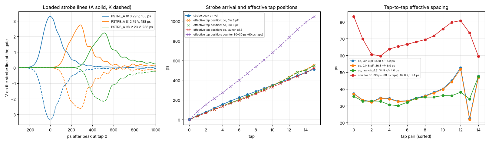
 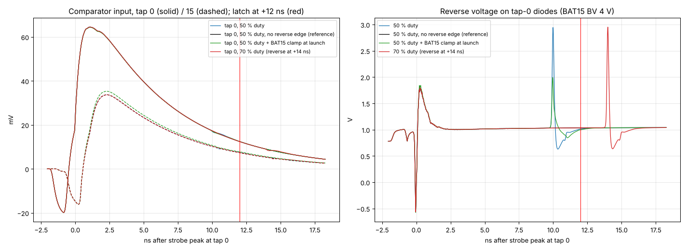

Schematic sheets (`../kicad/export/`, PDF: `scope-fe.pdf`) and the integrated board:

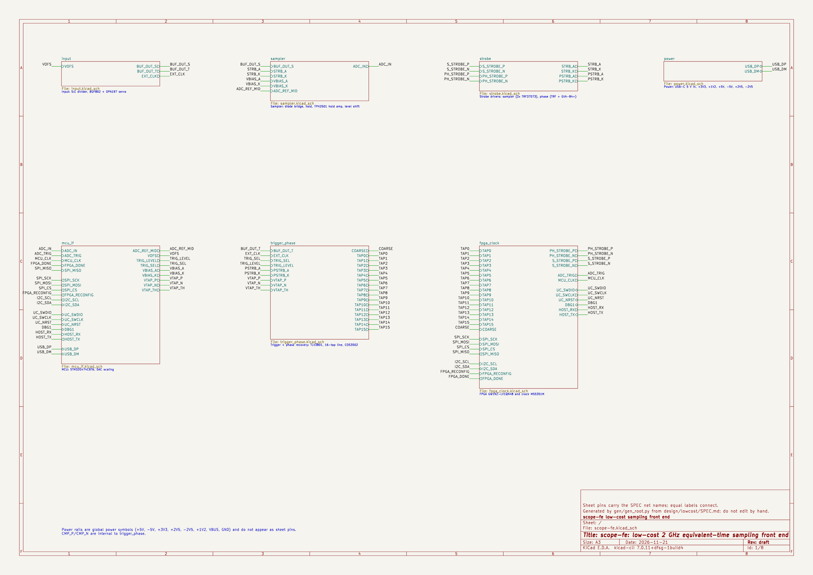 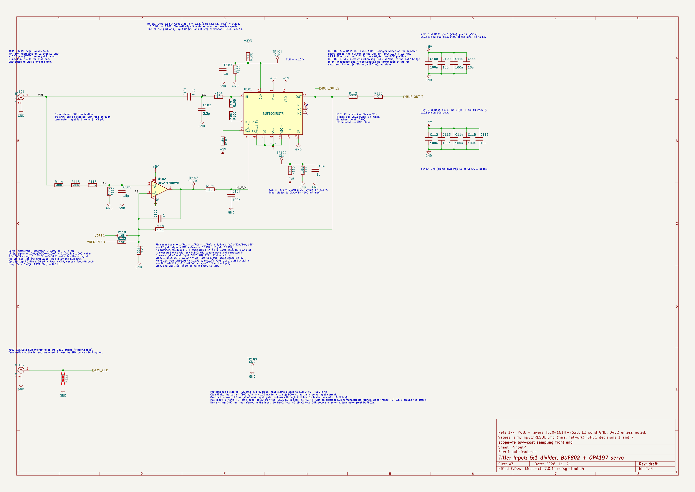
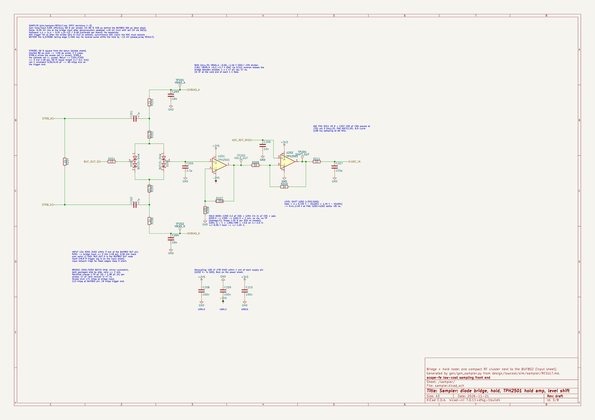 
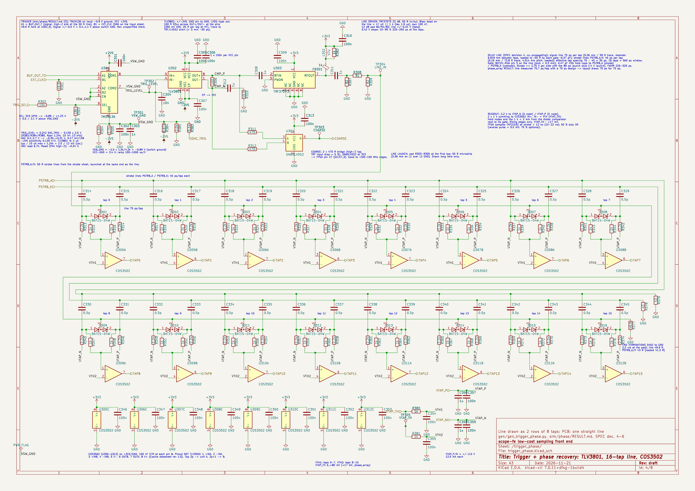 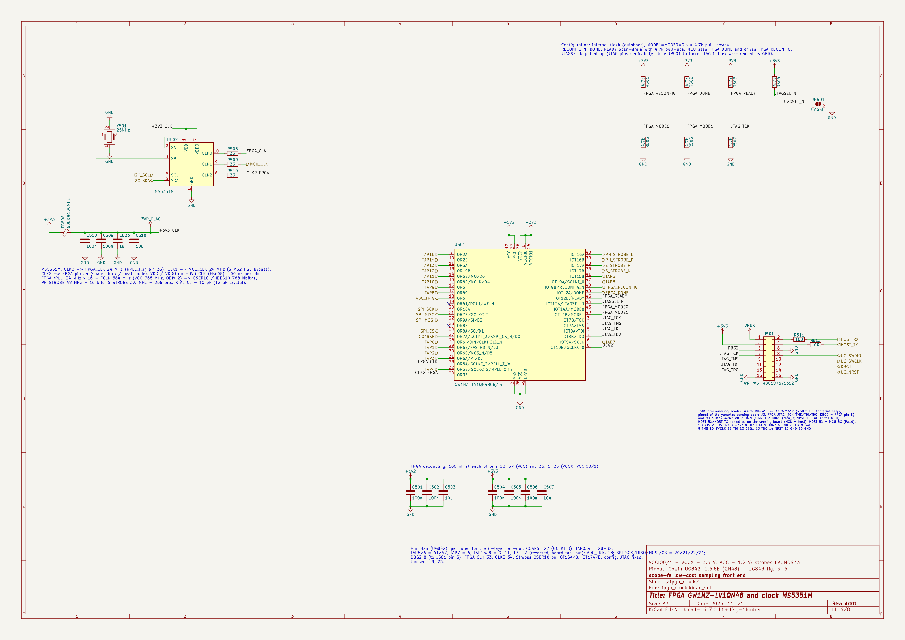
 
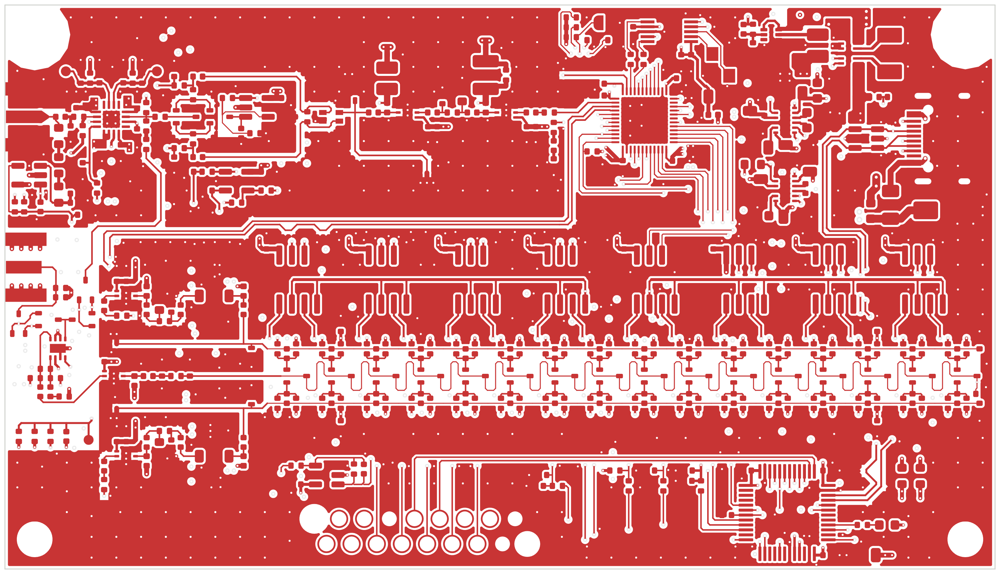 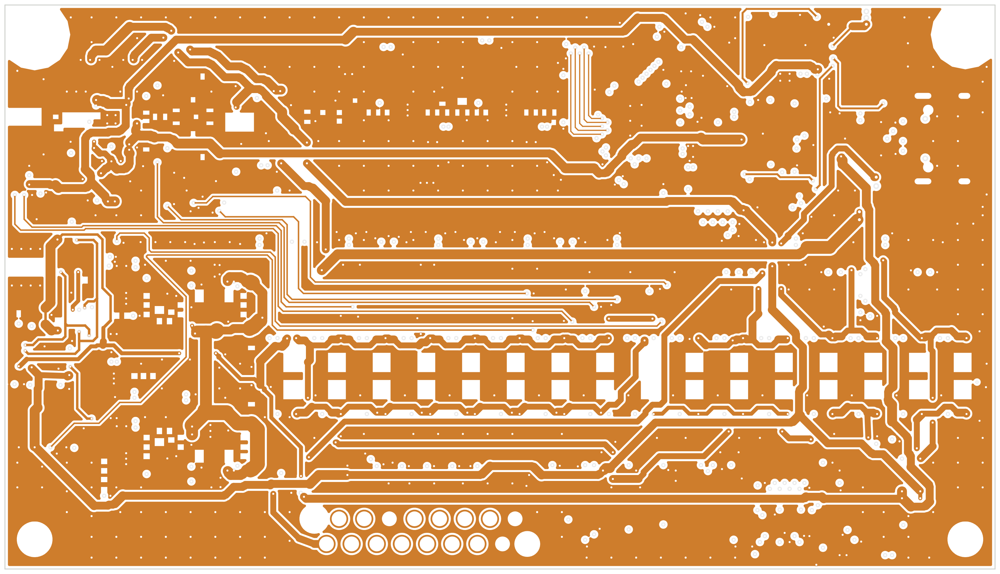
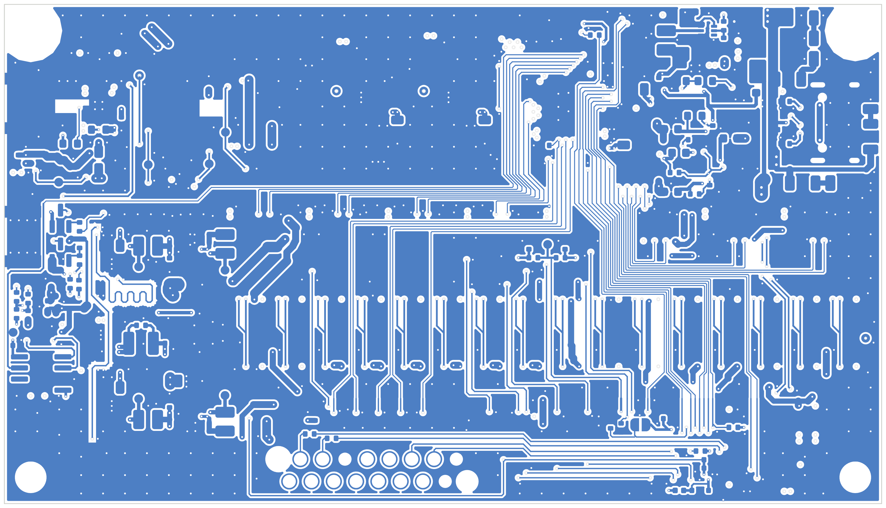 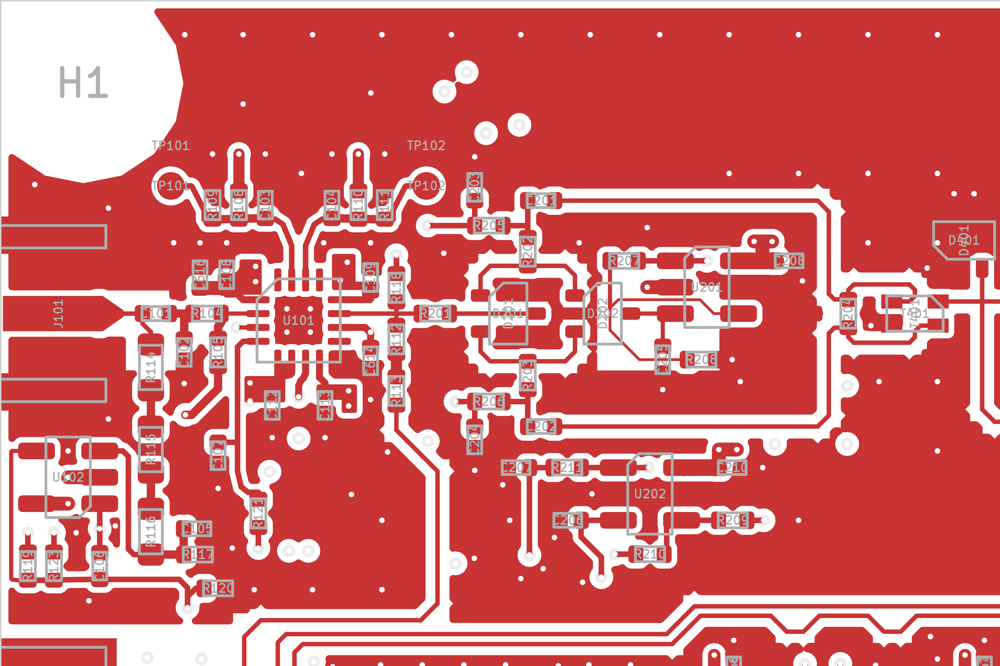

## 11. Bring-up order

1. **Power, no RF parts powered**: from a 1.5 A USB-C source; check every rail, ripple, the -2V5 noise and LDO
   headroom, U604 OUT+ dropout, and the VBUS plug-in transient at U603 (5.25 V and 5.5 V sources); total current
   against 0.75 A typical.
2. **Clock, MCU and FPGA**: flash the STM32 over SWD (or USB DFU / USART1 with JP701 closed), MS5351M over I2C, FPGA
   configuration (DONE), JTAG; check FPGA_CLK and MCU_CLK.
3. **DAC stages**: all five DAC outputs over their range, VNEG_REF (-1.93 V); confirm VBIAS_A negative and VBIAS_K
   positive before any strobe runs.
4. **Strobe chains**: S_STROBE and PH_STROBE patterns; measure step, edge and stub pulse of one chain each (risk 1);
   check the reverse pulse with the clamp D401, with the bridge bias at or below +/-1.30 V.
5. **Input stage**: 1 Mohm input and with an external 50 ohm feed-through terminator, servo, square-wave LF/HF
   calibration and correction, offset range, overload behaviour.
6. **Sampler**: hold chain and ADC timing (sampling 40-148 ns after the strobe, frame alignment on ADC_TRIG), bias sweep, pedestal, efficiency.
7. **Trigger path**: selector in both states (S / SB levels, isolation with EXT_CLK connected), TLV3801 level, line
   driver output, COARSE toggle limit and latency against temperature.
8. **Delay line**: VTAP_TH sweep, code density, tap positions, latch timing (+12 ns).
9. **System**: tracking loop, dither, equivalent-time records; compare with a known edge and a 3 Gbps pattern.
