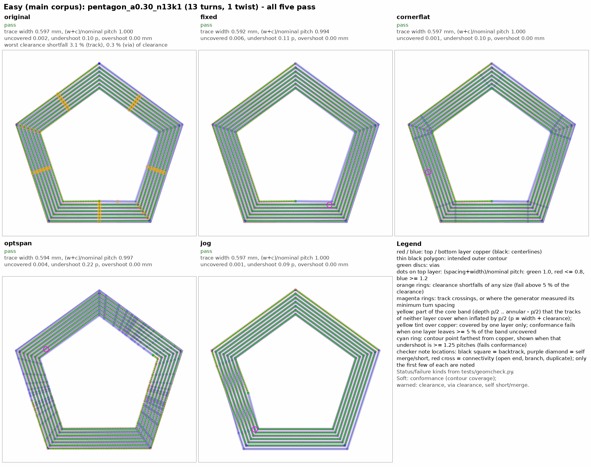
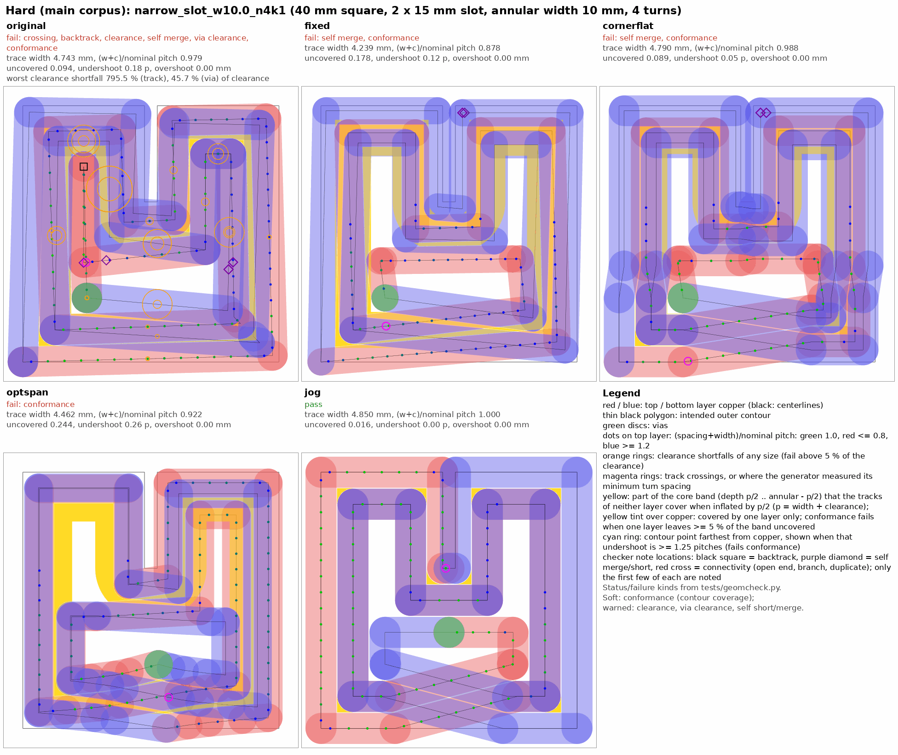
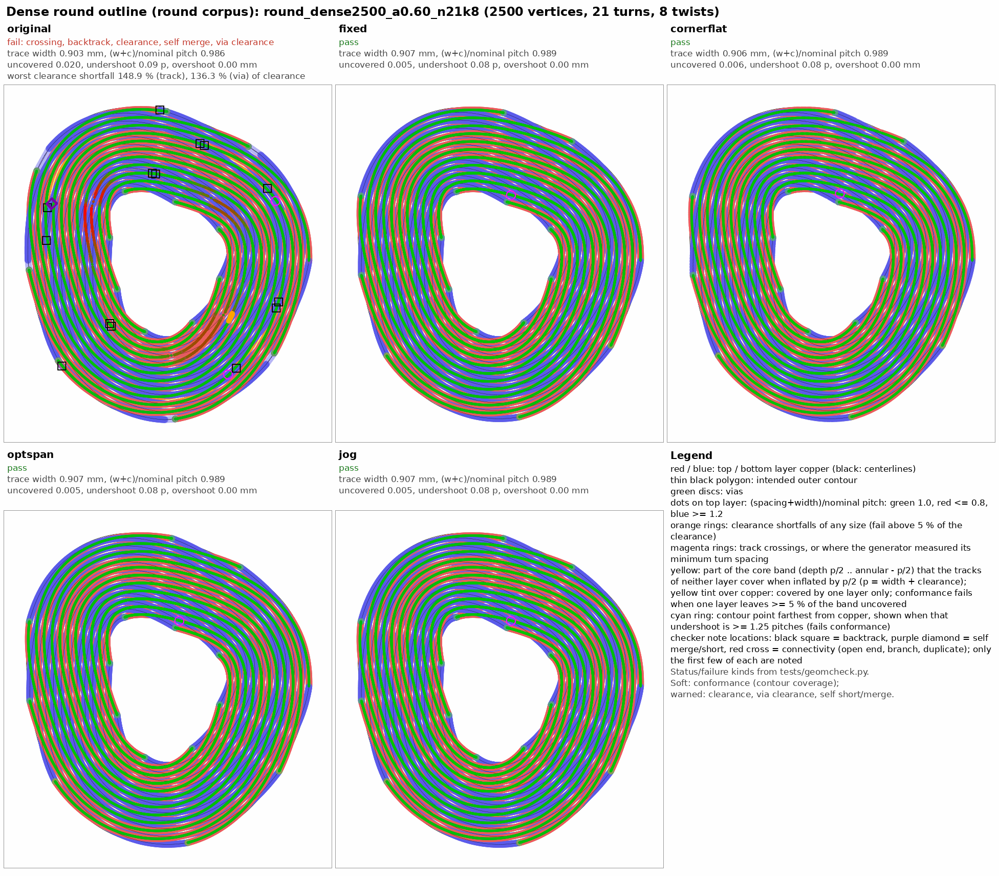
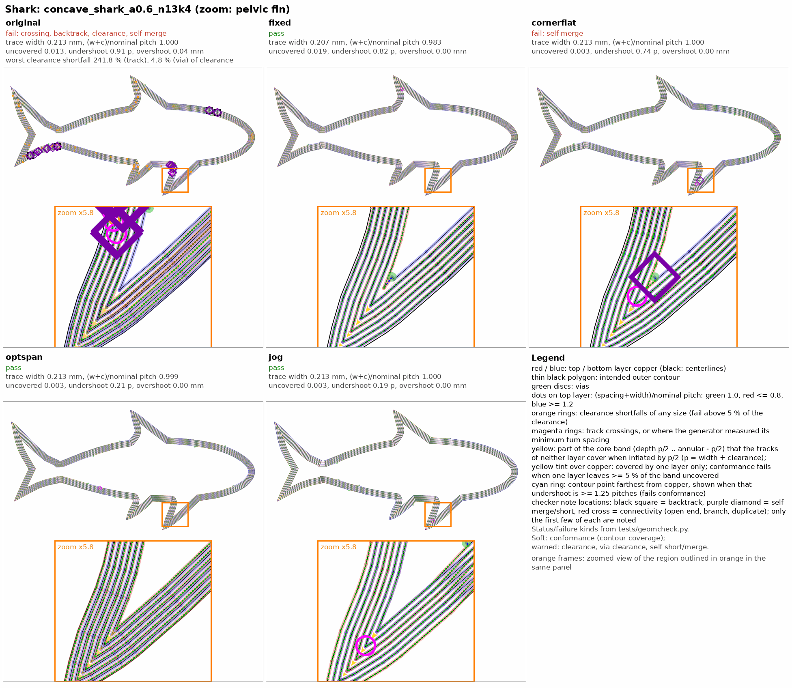
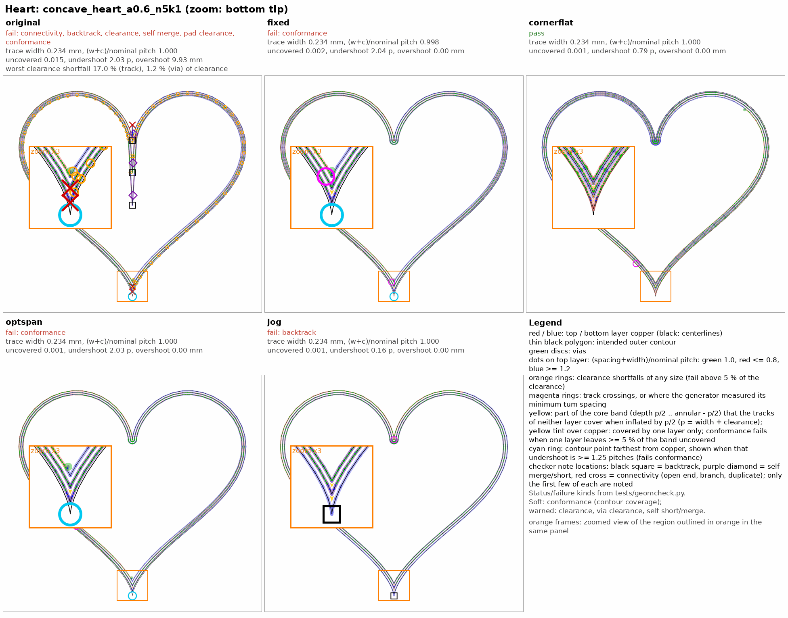
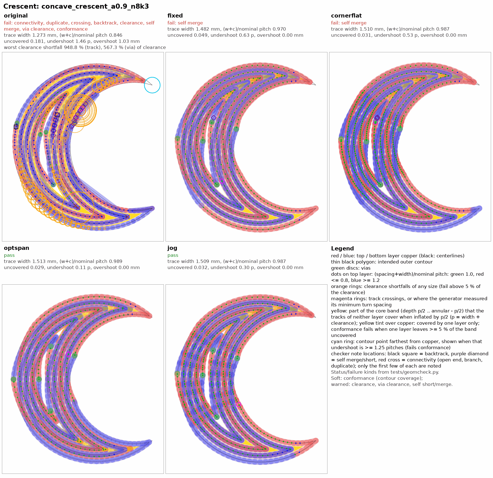

# Comparison of the kicoil layout implementations

Five layout implementations are compared on the same 1008-case corpus, checked by the same checker
(`tests/geomcheck.py`). Every number in this report was produced by a script in `docs/comparison/scripts/` (results bundled in `docs/comparison/results/`); see
[How to reproduce](#11-how-to-reproduce). Section 8 covers tapering on top of fixed and cornerflat.

## 1. Verdict

**Cornerflat is the best single implementation, but only by a small margin over jog.** We recommend it as the default.

| goal | what the corpus shows |
|---|---|
| End-to-end connectivity | Fixed, cornerflat, optspan and jog have **no** connectivity, crossing, duplicate, winding or short failures on any of the 1008 cases. The original has 370 connectivity failures. |
| No crossovers | Same: 0 crossings for all four new implementations, 154 for the original. |
| No or minimal clearance violations | The four are close to each other. Cases with a clearance-class failure (clearance, via clearance, self short or self merge) and no hard failure: fixed 25, cornerflat 28, optspan 32, jog 26. Most are at 90 % annular depth (22, 22, 30 and 24 of them). The commonest mechanisms are a self short where a wide innermost turn touches itself (17, 11, 25 and 18 cases) and, mainly in cornerflat, copper that comes back to its own via (0, 7, 2 and 4); see section 5. The original has 741 cases with a hard or clearance-class failure. |
| Covered area conforms to the contour | **This is where the four differ.** Cases that fail on conformance alone: fixed 427, cornerflat 160, jog 173, optspan 266. |

Pass counts (all 1008 cases / the 989 cases that are not thin):

- cornerflat 777 / 768
- jog 763 / 756
- optspan 667 / 661
- fixed 514 / 508
- original 50 / 50

**Trade-offs:**

- **Cornerflat against jog.**
  - Cornerflat passes 45 cases that jog fails, and jog passes 31 that cornerflat fails. The whole lead is in the main
    corpus. On round cases they are tied (136 each). On non-thin concave cases jog leads 113 to 110.
  - On the 732 cases both pass, jog spaces the turns slightly better: its pitch ratio is better on 155 cases, cornerflat's
    on 13 (medians 1.000 and 0.999). This does not give jog a lower DC resistance: its conductors are slightly longer,
    and the resistance proxy length / trace width has a jog-to-cornerflat median ratio of 1.000 (jog lower by more than
    0.5 % on 88 cases, higher on 107).
  - Jog has more hard failures: 11 against 8. All of them are on cases the corpus declares as known issues, but only 5 of
    jog's 11 fail with a kind the corpus declares for that case, against 7 of cornerflat's 8.
  - Jog is slower. Raw `gen_time` medians are 0.88 s against 0.16 s per case and p90s 5.01 s against 1.56 s. The jog
    run, however, timed a module import of about 0.21 s into every case and the cornerflat run did not (section 9).
    Without that overhead, jog's median is about 0.67 s (about 4× cornerflat's) and its p90 about 4.8 s (about 3×).
- **Cornerflat against fixed.** When both pass, cornerflat is never worse than fixed by more than 0.005 in pitch ratio
  or 0.002 in uncovered fraction (raw differences remain: a lower pitch ratio on 6 of the 511 cases and a higher
  uncovered fraction on 31, at most 0.0003 and 0.0008). It passes 266 cases that fixed fails, and fixed passes 3 that
  cornerflat fails. Fixed is the simplest and fastest of the four (median 0.05 s), and it remains cornerflat's built-in
  fallback layout.
- **Optspan** is dominated: cornerflat passes 119 cases optspan fails, and optspan passes 9 that cornerflat fails.
  Optspan is also slower than cornerflat and has the only timeout.
- **What the rest of the corpus leaves:**
  - The four new implementations reject exactly the same 35 cases: 26 annular widths too deep for the outline, 7 pitches
    below the clearance (thin), and 2 vias that cannot fit.
  - 165 laid-out cases fail in all five implementations. 108 of them are at 0.90 annular depth.
  - Picking the best implementation per case would pass 808 cases, 31 more than cornerflat alone. Cornerflat and jog
    together already reach that 808.
  - A combined "cornerflat, else jog" mode is the only clear headroom left. It has not been implemented or measured.

This agrees with the user's impression that cornerflat looks best. The margin over jog is modest and it is not uniform
across shape families.

## 2. Method

**Corpus.** `corpus('full')` in `tests/corpus.py` defines 1008 cases in three families, with the family taken from the
case name and checked against the tags:

- **main**, 698 cases: convex and star polygons, rectangles, sectors, `narrow_*` outlines (slots, fingers, keyholes,
  branches), `sweep_*` and `dense_*`;
- **round**, 167 cases (`tests/corpus_round.py`): ellipses, blobs and densely sampled or SVG-like outlines;
- **concave**, 143 cases (`tests/corpus_concave.py`): heart, heartdeep, crescent, shark, sharksvg, comb, cross,
  U and L shapes and others.

Most cases vary the annular depth (a0.30, 0.60 or 0.90 of the depth limit), the turns and the twists (`nNkK`);
circles and the `narrow_*`, `sweep_*` and `dense_*` cases have no depth token. All
five result files have the same 1008 case names and identical nominal pitches (`same_specs.py`). The concave split
depths come from a committed file, so the original code runs on exactly the same requests.

**Checker.** `geomcheck.check_layout` looks only at the emitted copper and the intended geometry. It checks
connectivity (a single path from pad 1 to pad 2), winding, backtracks (reversals over 170°) and crossings. It checks
clearance between different turns, with copper at least half a turn apart in winding angle counting as different turns.
It checks self shorts: a turn touching itself at least 0.18 turns further on in winding angle, or copper that leaves
its own via and comes back to touch it (a rule bounded by the distance along the conductor, not by winding angle). It
also checks self merges, and via and pad geometry.
Finally it checks conformance: uncovered core band under 5 %, contour undershoot under 1.25 pitches and overshoot under
0.05 mm. See `tests/README.md`.

**Pass and fail.**

- A case **passes** when the checker reports no failure kind.
- Failures are grouped as in `tests/test_layout.py`:
  - *hard*: connectivity, crossing, backtrack, winding, duplicate, via offset, pad clearance and the other structural
    checks;
  - *clearance-class*, also called *warnable*: clearance, via clearance, self short and self merge. The pytest suite
    tolerates these only when the generator warned about them. The result files do not record warnings, so warned and
    unwarned cases cannot be told apart here.
  - *soft*: conformance.
- `rejected` means the generator raised a `ValueError` for the request. `error` means any other exception. `timeout`
  means the case took more than 600 s.

**Thin cases.** A thin case is one whose nominal trace is under 0.1 mm, computed as annular width × layers / turns −
clearance. That gives 19 cases: 2 main, 6 round and 11 concave. These are not manufacturable, so headline figures are
given both with them and without them (989 cases).

The corpus tag `thin` does not match this definition:

- On 14 `rect60x12` cases in the main corpus, `thin` is a shape tag, and their nominal traces are 0.13–3.45 mm.
- Eight thin cases have no tag: `circle20x18_n11k5`, `circle20x18_n16k5` and six slender 10:1 and 20:1 ellipses.

Excluding by tag instead (983 cases) changes little: cornerflat 756, jog 745, optspan 649, fixed 497, original 49
(`stats.md`).

**Metrics.**

- `pitch_ratio` is (narrowest emitted trace + clearance) / nominal pitch: how much of the available pitch becomes copper.
- `uncovered_fraction` is the share of the core band that neither layer covers.
- Percentiles use one rule throughout: linear interpolation between the sorted values (numpy's default), so the median
  is the standard one (the mean of the two middle values for an even count). They are taken over the cases that were
  laid out (pass or fail), unless a narrower set is named.

## 3. Headline results

### All 1008 cases (in brackets: the 989 non-thin cases)

| | original | fixed | cornerflat | optspan | jog |
|---|---:|---:|---:|---:|---:|
| **pass** | 50 (50) | 514 (508) | **777 (768)** | 667 (661) | 763 (756) |
| fail | 742 (733) | 459 (454) | 196 (194) | 305 (300) | 210 (206) |
| rejected | 198 (196) | 35 (27) | 35 (27) | 35 (27) | 35 (27) |
| error | 18 (10) | 0 | 0 | 0 | 0 |
| timeout | 0 | 0 | 0 | 1 (1) | 0 |
| any hard failure | 539 (531) | 7 (6) | 8 (7) | 7 (6) | 11 (8) |
| clearance-class, no hard failure | 202 (201) | 25 (23) | 28 (27) | 32 (30) | 26 (26) |
| conformance only | 1 (1) | 427 (425) | 160 (160) | 266 (264) | 173 (172) |
| pitch ratio p10 / median | 0.847 / 0.992 | 0.822 / 0.969 | 0.902 / 0.998 | 0.885 / 0.986 | 0.903 / 1.000 |
| uncovered median / p90 | 0.0179 / 0.1401 | 0.0363 / 0.1758 | 0.0060 / 0.1045 | 0.0175 / 0.1305 | 0.0050 / 0.1210 |

**Cases per failure kind** (all cases; one case can count under several kinds):

| kind | original | fixed | cornerflat | optspan | jog |
|---|---:|---:|---:|---:|---:|
| connectivity | 370 | 0 | 0 | 0 | 0 |
| duplicate | 362 | 0 | 0 | 0 | 0 |
| crossing | 154 | 0 | 0 | 0 | 0 |
| backtrack | 329 | 7 | 8 | 7 | 9 |
| winding | 23 | 0 | 0 | 0 | 0 |
| pad clearance | 59 | 0 | 0 | 0 | 0 |
| via offset | 2 | 0 | 0 | 0 | 2 |
| clearance | 715 | 2 | 0 | 7 | 4 |
| via clearance | 565 | 3 | 1 | 9 | 3 |
| self short | 99 | 17 | 18 | 27 | 22 |
| self merge | 259 | 10 | 12 | 8 | 7 |
| conformance | 192 | 445 | 177 | 291 | 194 |

### Per family: pass / any hard failure / conformance only

| family (cases) | original | fixed | cornerflat | optspan | jog |
|---|---|---|---|---|---|
| main (698) | 36 / 374 / 0 | 286 / 0 / 369 | **524** / 0 / 129 | 434 / 0 / 216 | 510 / 0 / 140 |
| round (167) | 11 / 99 / 0 | 126 / 3 / 30 | **136** / 3 / 21 | 131 / 3 / 21 | **136** / 3 / 21 |
| concave (143) | 3 / 66 / 1 | 102 / 4 / 28 | **117** / 5 / 10 | 102 / 4 / 29 | **117** / 8 / 12 |
| main non-thin (696) | 36 | 285 | **523** | 433 | 509 |
| round non-thin (161) | 11 | 125 | **135** | 130 | 134 |
| concave non-thin (132) | 3 | 98 | 110 | 98 | **113** |

- In the main corpus none of the four new implementations has a hard failure.
- All hard failures are in the round and concave families: heart, heartdeep and the 20:1 ellipse.
- Fixed's low main-corpus pass count is almost all conformance. Its main-corpus median uncovered fraction is 0.068
  (cornerflat 0.008), and its p10 pitch ratio is 0.750.

## 4. What each approach does

**Original** (upstream `7fe1f45`).

- Computes a straight skeleton of the outline and runs each spiral arm with its depth linear in an angle coordinate
  between the polygon's vertices.
- Sizes the trace from a circle formula.
- Its defects are listed in `docs/DEFECTS.md`. In this corpus they show up as broken connectivity, crossings,
  duplicated segments, clearance deficits and crashes.

**Fixed** (`geometry.py`, `skeletonator.py`).

- Keeps the same linear spiral, with defects D1–D44 fixed.
- Measures the actual minimum spacing between neighbouring turns and sizes the trace as that spacing minus the
  clearance, so clearance between neighbouring turns holds by construction in most cases. It is not a guarantee: fixed
  still has 2 cases with a track-clearance failure and 3 with a via-clearance failure (`24gon_a0.90_n3k1` and
  `octagon_a0.90_n3k1`, two wide 3-turn layouts at 90 % depth, have both; `round_ellipse10to1_a0.60_n21k8` has via
  clearance only).
- Because the spiral slopes across sharp corners, neighbouring turns pinch there. The measured minimum is often well
  below the nominal pitch, which gives a narrow trace and uncovered band area (conformance failures).

**Cornerflat** (`geometry_alt_cornerflat.py`, `skeletonator_alt_cornerflat.py`).

- Warps the angle coordinate per polygon edge so that every turn runs at constant depth around the corners ("flat
  zones") and changes depth only in a ramp in the middle of each edge.
- Ramps are placed so that corners only meet flat stretches of the neighbouring turns. The depth change per revolution
  is spread over the edges to maximise the smallest spacing; for few turns a "lattice" allocation is also tried.
- `PlanarInductor` measures several candidates and keeps the widest: the shape's modes, the plain linear layout of
  `geometry` and rotations of the arms. It falls back to the next candidate when the vias cannot be placed. The trace
  is sized from the measured spacing, as in fixed.
- Large or noisy outlines are simplified by 1–20 µm before the skeleton is computed.

**Optspan** (`geometry_alt_optspan.py`, `skeletonator_alt_optspan.py`).

- Keeps the linear spiral but chooses each edge's angle span and a phase shift of the arms to maximise the measured
  turn spacing. It uses an analytic weighting by corner angle, optional "virtual vertices" inside edges that make the
  depth profile piecewise linear, and iterative reweighting by the measured per-edge spacing.
- The reference spans are always among the candidates, so by its own spacing measure it is never worse than fixed.

**Jog** (`geometry_alt_jog.py`).

- Lays out every turn as a concentric ring at constant depth along the straight-skeleton offset. All radial steps
  happen in short crossover "jogs", placed on straight edges or near-straight runs, where all traces step in unison.
- Between jogs the turn spacing is exactly the pitch, including around sharp corners.
- Jog sites are planned per edge, with shear and drift, and allocated by a binary search with a DP over the edges.
- The final choice is by measurement among many candidates (jog counts, phases, label rotations, both planners) plus
  the plain linear spiral. The trace is sized from the measured spacing.

**Taper** (`taper.py`, not evaluated here).

- Post-processes a finished layout: it treats the centre lines as zero-width conductors and grows each short piece as
  wide as the local free space allows, under linear clearance constraints between pieces of different turns, to
  minimise DC resistance.
- Emits the pieces as pairs of diverging tracks ("V") or as trapezoid polygons.

## 5. Failure analysis

### Rejected requests (the same 35 cases in all four new implementations)

| reason | n | thin | assessment |
|---|---:|---:|---|
| `Annular width (…) is too large` | 26 | 0 | Real limits: the band is deeper than the outline's straight skeleton allows (star5, star8, `l_shape` and `u_shape` at a0.90, 10 neck cases). Correct to reject. |
| Clearance larger than the projected pitch | 7 | 7 | The request leaves no room for copper. Correct to reject. |
| `OverlappingViasError` (`round_ellipse10to1/20to1_a0.90_n16k5`) | 2 | 1 | The innermost turn of a 90 % slender ellipse has no room for two vias (D33). Correct to reject. |

**The original's 198 rejections and 18 errors** (`reject_sites.py`, which re-raises each one on the original code):

- **85 are a crash, not a rejection.** `math.asin` raises "math domain error" in the via-ring check (D9). Fixed lays out
  83 of these 85.
- **70 of 96 "annular width too large" rejections are false.** The original underestimates the depth limit.
- **17 are "r out of bounds"** in `project_arc` or `render_footprint`.
- **11 are skeleton failures** on the clockwise shark SVG (D26/D42).
- **7 are a `NameError`** inside the original's own pitch-below-clearance message (D11).

### Hard failures that remain

Every remaining hard failure is a backtrack, apart from 2 via-offset failures in jog. Every one of them is on a case
that the corpus marks as a known issue (`known_issue` or `known_failures`). The corpus also lists the failure kinds it
expects for each such case; "declared" below means that the failure kind is among them. Each implementation's cases
(`rev2/hard_lists.py`):

- **fixed (7, all with a declared kind):** `concave_heart_a0.9_n13k4`, `concave_heartdeep_a0.3/0.6/0.9_n13k4`,
  `round_ellipse20to1_a0.60_n7k3_cw`, `round_ellipse20to1_a0.60_n8k3` and `round_ellipse20to1_a0.90_n5k1`.
- **cornerflat (8):** the same 7, plus a backtrack on `concave_heartdeep_a0.9_n8k3`, a kind the corpus does not declare
  for that case.
- **optspan (7):** 6 of fixed's cases (on `heartdeep_a0.6_n13k4` it fails conformance only), plus a backtrack on
  `concave_heartdeep_a0.6_n8k3`, which is not a declared kind for that case.
- **jog (11, 6 with an undeclared kind):**
  - backtracks at the heart's bottom tip on `heart_a0.3_n5k1`, `heart_a0.6_n5k1`, `heart_a0.6_n8k3` and
    `heartdeep_a0.6_n6_1layer`;
  - via offset on `heart_a0.6_n7k3_cw` (a via centre 0.56 mm beyond the intended via offset of 0.24 mm) and on
    `heartdeep_a0.3_n13k4` (0.34 mm beyond 0.15 mm);
  - and 5 with a declared kind: the 3 `round_ellipse20to1` backtracks, `heart_a0.9_n13k4` and
    `heartdeep_a0.9_n13k4`.

**Why the backtracks happen.** Each one is at a sharp convex tip: the heart's bottom tip (about 10°) or the ends of a
20:1 ellipse. Where an arm starts at the tip, the outer turn runs into it and turns back by more than 170°. D43 records
this as **not fixed**: it is a limitation of spirals that follow the skeleton offset at sharp convex tips, not a bug of
one implementation. Fixing it would need special handling of arm starts at such tips, for example moving the arm phase
away from the tip, at the cost of contour undershoot there. This does not explain jog's 2 via-offset failures, which
this report has not analysed.

### Clearance-class failures (cornerflat 28 cases; fixed 25; optspan 32; jog 26)

**Self shorts** (fixed 17 cases, cornerflat 18, optspan 27, jog 22; `selfshort.py`, `rev2/rev_numbers.py`). The checker
reports two different mechanisms as a self short:

- **Wrap-around (turn-type) self short.** A wide innermost turn wraps around a hole smaller than the trace and touches
  itself 0.18–0.50 turns later in winding angle, according to the checker notes.
  - All 17 of fixed's cases are of this type: 15 are 3-turn cases at a0.90, 2 are 5-turn cases at a0.90, and the
    narrowest trace among them is 3.64 mm.
  - Cornerflat has 11 such cases, optspan 25 (4 of them also with an own-via contact) and jog 18 (1 also with an own-via
    contact).
- **Own-via short.** Copper leaves its own via and later comes back to touch it. The checker bounds this rule by the
  distance along the conductor, not by winding angle.
  - Cornerflat has 7 such cases and no other self-short contact in them: `ellipse3to2_a0.90_n5k3`,
    `star5_a0.60_n7k3`, its `_cw` twin, `sector180_a0.90_n5k3`, `d_shape_a0.90_n5k3`, `rconvex0_a0.90_n9k4` and
    `rconvex2_a0.90_n5k3`. Fixed has none, optspan 2 and jog 4.
- Cornerflat's self-short cases are therefore more varied than fixed's: 9 of its 18 are 3-turn cases (the others have
  5, 7 or 9 turns), 16 of the 18 are at a0.90, and its traces go down to 1.66 mm (`rconvex0_a0.90_n9k4`) and 1.92 mm
  (the two `star5_a0.60_n7k3` cases).
- 15 of fixed's 17 and 15 of cornerflat's 18 also fail conformance. Cornerflat's three exceptions,
  `star5_a0.60_n7k3`, its `_cw` twin and `sector180_a0.90_n5k3`, are all own-via shorts.
- These are the subject of the policy question in section 10.

**Self merges** (fixed 10, cornerflat 12).

- Both: `narrow_slot_w10.0_n4k1` (the 2 mm slot, render 2), four slender ellipses (`round_ellipse10to1_a0.90_n5k1`,
  `round_ellipse20to1_a0.90_n5k1`, `round_ellipse20to1_a0.60_n8k3` and `_n7k3_cw`), and concave
  `crescent_a0.9_n8k3` and `cshape`, `uround` and `comb` at `a0.9_n5k1`.
- Fixed only: `concave_heart_a0.3_n5k1`.
- Cornerflat only: `concave_shark_a0.6_n13k4` and `concave_sharksvg_a0.6_n13k4` (a fold next to the via in the fin,
  render 4) and `concave_crescent_a0.9_n5k1`.

**Track clearance and via clearance.** Cornerflat has 0 track-clearance cases and 1 via-clearance case; fixed has 2
and 3.

### Conformance-only failures (cornerflat 160, fixed 427)

These come from `fail_breakdown.py` and `h2h.py`.

- 91 of cornerflat's 160 are at a0.90 depth. 154 of the 160 leave at least 5 % of the band uncovered; the median
  uncovered fraction is 0.119.
- **Most of them fail everywhere.** Of cornerflat's 231 non-passing cases, 200 pass in no implementation: 35 rejected
  and 165 laid out but failed.
  - Even taking the best of the four new implementations per case, those 165 have a median uncovered fraction of 0.108
    and a median pitch ratio of 0.896.
  - The best still leaves at least 20 % uncovered in 33 cases, and in 35 cases its pitch ratio stays below 0.8.
  - This points to a limit of uniform-width spiral layouts in deep, sharp or narrow outlines rather than to bugs. It is
    not proven.
- Shapes with many cases that fail in all five: `star8` (23 of 28 cases), `neck` (10 of 14, all rejected), `star5`
  (9 of 14), `round_ellipse20to1` (6 of 7), `noisy_l` (5 of 7), `comb` (5 of 11), `narrow_branch` (5 of 12).
- **Fixed's extra 267 conformance failures are not a geometric limit.** On the 266 cases cornerflat passes and fixed
  fails, fixed's median uncovered fraction is 0.094 against 0.008. Cornerflat's flat corners remove the corner pinch
  that narrows fixed's trace.

## 6. Head-to-head and per-case oracle

**Pairwise wins** (`h2h.py`). Each cell counts the cases where the row implementation passes and the column one does
not. All 1008 cases:

| row \ column | fixed | cornerflat | optspan | jog |
|---|---:|---:|---:|---:|
| cornerflat | 266 | – | 119 | 45 |
| jog | 262 | 31 | 116 | – |
| optspan | 157 | 9 | – | 20 |
| fixed | – | 3 | 4 | 13 |

- The original beats only jog, on 1 case.
- Non-thin cases: cornerflat against jog is 42 to 30, and cornerflat against fixed 263 to 3.

**Cornerflat passes, jog fails: 45 cases, across 28 shapes.**

- Jog's failures on these: 35 conformance only, 5 clearance-class and 5 hard.
- They include 7 concave heart cases, 5 `star6_shallow` cases and 8 narrow-shape cases.
- Jog's median uncovered fraction on these 45 cases is 0.063, cornerflat's 0.026. On the 36 of them where jog's
  failures include conformance, the medians are 0.071 and 0.028.

**Jog passes, cornerflat fails: 31 cases, across 21 shapes.**

- Cornerflat's failures on these: 22 conformance only, 7 clearance-class and 2 hard.
- They include 13 narrow-shape cases (lfinger, finger, branch, slot and others), 3 comb cases, self merges on crescent,
  shark, sharksvg and uround, and 2 heartdeep backtracks.
- Cornerflat's median uncovered fraction on these 31 cases is 0.057, jog's 0.023. On the 23 of them where cornerflat's
  failures include conformance, the medians are 0.066 and 0.025.

**Only cornerflat fails: 3 cases.** On these fixed, optspan and jog all pass:

- `concave_heartdeep_a0.9_n8k3` (backtrack);
- `concave_shark_a0.6_n13k4` (self merge);
- `concave_sharksvg_a0.6_n13k4` (self merge).

For comparison, the same count is 144 for fixed, 13 for jog and 4 for optspan.

**Quality where both pass.** A case counts as better for one side when the difference exceeds 0.005 in pitch ratio or
0.002 in uncovered fraction.

| pair | common passes | pitch ratio better (A / B) | uncovered better (A / B) | median pitch ratio A / B |
|---|---:|---|---|---|
| cornerflat / jog | 732 | 13 / 155 | 63 / 107 | 0.999 / 1.000 |
| cornerflat / fixed | 511 | 311 / 0 | 350 / 0 | 1.000 / 0.989 |
| jog / fixed | 501 | 302 / 1 | 324 / 5 | 1.000 / 0.989 |
| fixed / original | 50 | 0 / 17 | 5 / 20 | 0.995 / 1.000 |

- Jog's spacing edge over cornerflat is mostly in the main corpus: 143 cases to 10. The largest gap is
  `sweep_hexagon_a0.740_n9k4`, at 0.939 against 1.000.
- The spacing edge does not give jog a lower DC resistance. On the 732 common passes, the resistance proxy
  total length / trace width has a jog-to-cornerflat ratio with median 1.000 (p10 0.994, p90 1.007). Jog is lower by
  more than 0.5 % on 88 cases and higher on 107. Its conductors are slightly longer (length ratio median 1.002, p90
  1.012), which offsets its slightly wider traces.
- Fixed's slightly lower pitch ratio than the original's on their common passes is the price of sizing the trace from
  the measured minimum spacing instead of a formula.

**Oracle (best implementation per case).**

- The oracle passes 808 cases (798 non-thin), against 777 for cornerflat alone.
- Only cornerflat (25 cases) and jog (22 cases) pass anything that no other implementation passes. Cornerflat and jog
  together reach the full 808.

**Known-issue cases (39: 25 concave, 14 round).**

The last column applies the rule of `tests/test_layout.py`: a failure is explained when its kind is declared for the
case or is clearance-class, and conformance is not counted.

| impl | known-issue cases passed | failures not explained by the declared kinds or a clearance-class kind |
|---|---:|---:|
| fixed | 10 | 0 |
| cornerflat | 21 | 1 (`heartdeep_a0.9_n8k3`, backtrack) |
| optspan | 9 | 1 (`heartdeep_a0.6_n8k3`, backtrack) |
| jog | 16 | 6 (4 heart and heartdeep backtracks, 2 via offsets) |

Outside the known-issue cases, none of the four new implementations has a hard failure.

## 7. Renders

- Every panel's status comes from a fresh `run_corpus.py` run, and all 30 match the benchmark JSON.
- Extra layers (`overlay.py`):
  - **yellow fill**: band area that neither layer covers;
  - **yellow tint over copper**: band area covered by one layer only;
  - **cyan ring**: the worst contour undershoot, drawn only when it is at least 1.25 pitches;
  - **black square**: a backtrack;
  - **purple diamond**: a self merge;
  - **red cross**: an open end, branch or duplicate.
- **Orange rings** mark any clearance shortfall, including ones under the 5 % tolerance.
- **Magenta rings** mark crossings, or, in the newer code only, where the generator measured its smallest spacing.
- The line under each panel title gives the trace width, (w+c)/nominal pitch, the uncovered fraction, the undershoot,
  the overshoot and the worst clearance shortfall.



**1. `pentagon_a0.30_n13k1` (main, easy).**

- All five pass and look almost the same.
- The original passes with a 3.1 % clearance shortfall. That is within the 5 % tolerance, and the orange rings show
  where: 66 of their 69 positions are in the middle 40 % of an outline edge, and only 3 are within 15 % of the edge
  length from a corner (`rev2/pentagon_rings.py`). The shortfall is at mid-edge, not at the corners.
- Fixed narrows the trace slightly, to 0.592 mm against 0.597 mm. Cornerflat and jog keep the full width.



**2. `narrow_slot_w10.0_n4k1` (main, hard).** A 40 mm square with a 2 × 15 mm slot.

- **original:** crossings, a backtrack, clearance shortfalls and self merges.
- **fixed:** a self merge across the slot mouth. It also narrows the trace to 4.24 mm (pitch ratio 0.878), which
  leaves 17.8 % of the band uncovered.
- **cornerflat:** the same self merge, with 8.9 % uncovered.
- **optspan:** no merge, but 24.4 % uncovered.
- **jog:** the only pass. It keeps the full 4.85 mm by running both layers' outer arms down the slot's centre line.



**3. `round_dense2500_a0.60_n21k8` (round, a 2500-vertex outline).**

- The original fails with crossings, about a dozen backtracks and turns pinched to 0.8 of the pitch or less.
- All four new implementations pass with nearly identical layouts.
- Both optspan and jog fall back to the linear layout here. Optspan's SVG is byte-identical to fixed's. Jog's has the
  same geometry and differs from it only by floating-point rounding of the trace width (relative differences up to
  2.4e-16; `rev2/svg_compare.py`).
- They still took much longer to generate. In the benchmark run optspan took 45.8 s, jog 87.7 s and fixed 4.7 s (in
  the render run: 40.9 s, 87.5 s and 5.2 s).



**4. `concave_shark_a0.6_n13k4` (concave; the strip zooms in on the pelvic fin).**

- The original fails with crossings, backtracks and self merges.
- Fixed, optspan and jog pass.
- Cornerflat fails on one self merge: its innermost turn touches itself next to the via in the fin. This is one of the
  three cases that only cornerflat fails.



**5. `concave_heart_a0.6_n5k1` (concave; the inset zooms in on the bottom tip).**

- The original sends a spike of track into the heart's middle (9.93 mm overshoot).
- Fixed and optspan stop about 2 pitches short of the tip, so they fail conformance.
- Cornerflat reaches into the tip (undershoot 0.79 pitches) and passes.
- Jog reaches the tip but backtracks there.



**6. `concave_crescent_a0.9_n8k3` (concave; the band almost fills the outline).**

- The original fails on 8 kinds.
- Fixed and cornerflat both fail on a self merge of the innermost bottom-layer turn near a via at the sliver's end.
- Optspan and jog place their arm ends and vias differently and pass.

## 8. Tapering (fixed+taper, cornerflat+taper)

`src/kicoil/taper.py` takes a finished layout, shrinks its traces to zero-width centerlines and grows each piece as
wide as the clearance to every other piece allows (linear constraints, solved per layout). The result is emitted either
as pairs of overlapping round-capped lines in a V shape (exports cleanly to Gerber) or as trapezoid polygons (these
lose their fill in gerbonara 1.6.0). Both are re-checked by the checker in variable-width mode. Numbers from
`docs/comparison/scripts/taper_final.py` on `taper_kicoil_full.json` and `taper_cornerflat_full.json` (all 1008
cases).

**Conductance relative to fixed with constant width** (1/R, the 948 non-thin cases both tapered runs laid out):

| | all: median (mean) | main | round | concave |
|---|---:|---:|---:|---:|
| cornerflat, constant width | ×1.026 (×1.068) | ×1.041 | ×1.000 | ×1.012 |
| fixed, tapered | ×1.037 (×1.104) | ×1.064 | ×1.006 | ×1.008 |
| cornerflat, tapered | ×1.044 (×1.114) | ×1.076 | ×1.006 | ×1.015 |

**Gain of tapering over the same implementation's constant-width layout:**

| | fixed+taper | cornerflat+taper |
|---|---:|---:|
| laid out / rejected / timeout / error | 970 / 35 / 2 / 1 | 972 / 35 / 0 / 1 |
| median gain (p90, max) | ×1.036 (×1.341, ×2.379) | ×1.003 (×1.136, ×1.656) |
| cases gaining > 5 % / > 10 % | 423 / 266 | 161 / 119 |
| cases losing more than 1 % | 1 (`concave_crescent_a0.9_n5k1`, ×0.978) | 1 (`rconvex0_a0.90_n3k1`, ×0.962, a neck) |
| taper time, median (p90) | 0.22 s (1.53 s) | 0.30 s (2.75 s) |

- Tapering is worth most where the constant-width layout wastes the most copper: on fixed, whose single trace width is
  set by its tightest spot, and on the main corpus's polygons with sharp corners. Cornerflat already recovers most of
  that with its per-corner geometry, so tapering it adds a median of 0.3 %; on round and concave outlines tapering
  adds about 1 % to either implementation. **For cornerflat, tapering is a marginal improvement in the typical case**,
  with occasional large gains (119 cases above 10 %: polygons, stars and sweeps of the main corpus, and 16 round
  outlines).
- **Checker results change in a few cases (V emission; the polygon emission agrees except where noted).**
  - fixed+taper: 507 pass/pass, 449 fail/fail, 9 fail→pass, 5 pass→fail. The 9 that newly pass are mostly concave
    cases (crescent, shark, heartdeep) whose wider tapered copper now covers enough of the band. The 5 that newly fail
    are three slender ellipses (`round_ellipse10to1_a0.60_n8k3`, `round_ellipse10to1_a0.60_n6_1layer`,
    `round_ellipse20to1_a0.30_n5k1`: backtrack and self merge at the sliver tip) and two shark cases (self merge).
    Six further cases that already failed conformance gain a self short or self merge (stars, T, keyhole, stepped,
    comb); four lose one or more (the hexagon, octagon and 24-gon at a0.90 n3k1, and `narrow_slot_w10.0_n4k1`).
  - cornerflat+taper: 772 pass/pass, 193 fail/fail, 3 fail→pass, 4 pass→fail: the same three ellipses, and
    `narrow_stepped_w4.0_n5k2` (self merge in the V emission only; the polygon emission passes). Two cases that
    already failed conformance gain a self short; `narrow_slot_w10.0_n4k1` loses its self merge.
  - An earlier, sample-based evaluation had reported no new checker failures; that was before the checker's self merge
    and own-via rules (D36–D38), which are what catch these.
- Failures of the taper step itself: `round_squircle_a0.90_n5k1` raises a `ZeroDivisionError` in both runs, and fixed's
  two densest round outlines (`round_dense2500_a0.60_n21k8`, `round_dense2500_a0.90_n16k5`) exceed the 900 s timeout.
  These are taper bugs that have not been investigated.

**Bottom line:** tapering on top of cornerflat gives a median ×1.044 conductance over today's fixed code against
×1.026 for plain cornerflat. It is a cheap post-processing step, but it is not free of regressions yet (the ellipse
tips, a division by zero, slow dense outlines). It should stay an opt-in until those are fixed.

## 9. Runtime

`gen_time` is the per-case layout time, measured by `tests/run_corpus.py` from the start of `run_case`, taken over
cases that were laid out (pass or fail). The runs were made on a 4-core machine that was also running other jobs, so
absolute times are only roughly comparable.

**Two timing regimes.** The runs did not all time the same work (section 11 gives the provenance):

- The original, optspan and jog runs used `--timeout`. With a timeout, `run_corpus.py` starts a fresh process for every
  case, and `build_model()` imports the layout module inside the timed window. That process has imported only
  `corpus` and `geomcheck`, not `kicoil`, so every case pays the module import.
- The fixed and cornerflat runs were made without `--timeout`, with a worker pool. Each worker pays the import once, so
  their per-case times hold almost no import cost.
- `rev2/case_overhead.py` measures the difference: it runs the same case twice in a fresh process. The first run is
  0.21–0.25 s slower than the second (medians per implementation and case; for example 0.214 s for the original and
  0.212 s for jog on `circle50x25_n5k1`). This matches the floors in the data. The fastest laid-out case takes 0.207 s
  in the original run, 0.238 s in optspan's and 0.226 s in jog's, against 0.007 s in fixed's and 0.010 s in
  cornerflat's.

The table gives the raw figures. For the three runs with `--timeout`, the lower rows subtract the measured per-case
overhead (original 0.216 s, optspan 0.227 s, jog 0.214 s) from every case. That is an estimate, not a re-timing.

| | original | fixed | cornerflat | optspan | jog |
|---|---:|---:|---:|---:|---:|
| timing regime | fresh process per case | pool | pool | fresh process per case | fresh process per case |
| median [s] | 0.26 | 0.05 | 0.16 | 0.71 | 0.88 |
| p90 [s] | 0.66 | 0.52 | 1.56 | 1.84 | 5.01 |
| max [s] | 121.79 | 4.82 | 67.05 | > 600 (timeout) | 166.34 |
| max, non-thin [s] | 121.79 | 4.82 | 19.00 | > 600 (timeout) | 166.34 |
| sum [s] | 510 | 260 | 665 | ≥ 1948 (1348 + the timeout) | 2235 |
| cases > 10 s | 2 | 0 | 4 | 20 (19 + the timeout) | 23 |
| main / round / concave median [s] | 0.24 / 0.57 / 0.51 | 0.03 / 0.31 / 0.28 | 0.11 / 1.14 / 0.61 | 0.59 / 1.43 / 1.22 | 0.69 / 4.90 / 2.84 |
| *without per-case overhead:* median [s] | 0.05 | | | 0.49 | 0.67 |
| p90 [s] | 0.44 | | | 1.61 | 4.79 |
| sum [s] | 339 | | | ≥ 1728 | 2027 |
| main / round / concave median [s] | 0.03 / 0.35 / 0.30 | | | 0.37 / 1.20 / 0.99 | 0.48 / 4.69 / 2.62 |

- The original's raw median of 0.26 s is almost all import overhead. Without it, the median is about 0.05 s, like
  fixed's.
- Without the overhead, jog's median is about 4.3× cornerflat's (0.67 s against 0.16 s), its p90 about 3.1× and its sum
  about 3.0×. Optspan's median is about 3.1× cornerflat's. The ranking (fixed, then cornerflat, then optspan and jog)
  is the same as in the raw figures; the raw ratios overstate the gap at the median.
- Cornerflat costs about 3.4× fixed's median and 2.6× its sum (same regime). It stays well below optspan and jog.
- Cornerflat's slowest case is `round_ellipse10to1_a0.60_n21k8` at 67 s, which is thin. Its slowest non-thin case is
  `round_poly1024_a0.90_n16k5` at 19 s.
- **Timeout:** optspan on `round_dense2500_a0.90_n16k5` was killed at 600 s. The same case took 16.4 s for the
  original, 4.65 s for fixed, 7.44 s for cornerflat and 166 s for jog, which is jog's slowest case. All four that laid
  it out failed.
- For the timings and the cusp-cut cost, see section 10.

## 10. Open issues and decisions for the user

1. **Self-short policy.**
   - **What the checker does.** It has two self-short rules (section 5). The turn-type rule fires when a turn touches
     itself 0.18 turns or more further along in winding angle, whatever the conductor length skipped. Wide innermost
     turns at 90 % depth meet it, 0.18–0.50 turns later in the checker's notes. The own-via rule fires when copper
     leaves its via and comes back to touch it, and it is already bounded by the distance along the conductor.
   - **Affected cases.** Fixed has 17 self-short cases (all turn-type) and cornerflat 18 (11 turn-type, 7 own-via). 15
     of each also fail conformance, so for them the verdict would not change.
   - **Upper bound on the change.** A conductor-length version of the turn-type rule would leave own-via shorts as
     they are. Among the cases whose only failure is a self short, only those without an own-via contact could pass:
     fixed 2, cornerflat 0 (its 3 such cases are all own-via), optspan 3 and jog 5. (Optspan's
     `round_dshape_a0.90_n5k1` and jog's `roundrect_a0.90_n3k1` also have an own-via contact and would still fail.) At
     most that would take fixed to 516, optspan to 670 and jog to 768, while cornerflat stays at 777. The ranking would
     stay the same, but the gap between cornerflat and jog could shrink from 14 to 9.
   - **Warnings.** The result files do not record warnings. D38 states that every self short was warned in its run.
   - **Recommendation:** decide turn-type self shorts by the conductor length bypassed, as the self-merge rule does
     (6·(w+c) along the conductor). The current turn-type rule is by winding angle alone.
2. **The heart's convex bottom tip.**
   - This is not fixed (D43). Fixed and optspan stop short of the tip (contour undershoot). Arms that start at the tip
     backtrack there.
   - Heart and heartdeep cases account for most of the remaining hard failures: cornerflat 5 of 8, jog 8 of 11.
   - Fixing it needs special handling of arm phases at sharp convex tips.
3. **The cusp cut makes the skeleton 3–5× slower.**
   - D43 rounds sharp reflex cusps, which the heart's top is, with a 0.01 mm arc.
   - The skeleton of the cut heart takes 0.35 → 1.9 s at 80 vertices and 6 → 28 s at 360. These figures are from
     D43, not re-measured here.
   - In this corpus only the heart is affected. Outlines with many cusps fall back to mitered corners, with a warning.
4. **Cornerflat on the rotated crescent.**
   - `crescent_rot.py` ran cornerflat on `concave_crescent_a0.9_n5k1` rotated by 0°, 90° and 270°.
   - At 0°, as in the corpus, the result is a self merge. At 90° it is conformance plus a self short, and at 270°
     conformance only. The uncovered fraction is 0.042 both times, so the conformance failure presumably comes from
     undershoot; the script did not capture the undershoot.
   - The result depends on orientation, and the regression test (`test_cornerflat_round.py`) allows conformance and
     backtrack here.
   - The rotated variants are not part of the corpus.
5. **SVG page frame.**
   - SVG import takes the largest closed contour as the outline (D41). If the file has a page or border frame, the frame
     becomes the outline.
   - The other contours are dropped with a warning that says the frame has to be deleted from the file.
   - Decision: keep the warning, or detect a frame.
6. **Fixed only warns about a via overlapping a neighbouring turn.**
   - `PlanarInductor` in `geometry.py` (around lines 1245–1269) moves the vias inwards as far as it can. If a via still
     overlaps a neighbouring turn, it warns "overlaps a neighboring turn" and emits the layout anyway.
   - Cornerflat and jog reject such fallback candidates only after an overlapping-vias error
     (`reject_shorting_fallback`, D33).
   - Decision: make it an error, as for overlapping vias.
7. **TURN_SEP = 0.5.**
   - The checker counts copper at least half a turn apart in winding angle as different turns. The layout measurement
     (`SAME_TURN_SEPARATION`) and taper (`TURN_SEP`) use the same convention.
   - Self-short contacts at 0.46–0.50 turns sit right at this boundary, so their classification depends on this
     constant.
8. **KiCad output not checked in KiCad itself.**
   - `--format kicad-pcb` is parsed back with gerbonara in a test.
   - It has not been opened in KiCad (D22).
   - The footprints are checked only by `geomcheck`.
9. **`thin` corpus tag.**
   - It is used for two meanings: a shape tag on `rect60x12`, and "trace under 0.1 mm".
   - It is also missing from 8 thin round cases.
   - This report uses a computed definition. Renaming the tag, or setting it from the computed trace, would remove the
     ambiguity.
10. **Combining cornerflat and jog.** The oracle shows 31 more passes if each case could use whichever of the two
    passes. A combined mode would need a selection criterion: the generator's own spacing and coverage measurement, not
    the checker. It would add jog's runtime on top of cornerflat's. This is untested.

## 11. How to reproduce

Python: `/home/user/temp-workspace/kicoil/.venv/bin/python` (`$PY` below). Run from the worktree
`/tmp/claude-0/wt/next`.

**Benchmark runs: how `/tmp/claude-0/bench/final/` was produced.**

- `original_full.json`: `run2.sh`, with `-j 2 --timeout 600`, on the upstream code (`PYTHONPATH=/tmp/claude-0/orig/src`).
  `run.sh` had run it first with `-j 3`; `run2.sh` (written at 12:19, the time of commit `03d6d26`, which commits the
  concave split depths) reran it, and the file dates from 12:32.
- `geometry_alt_optspan_full.json` and `geometry_alt_jog_full.json`: `run.sh`, with `-j 3 --timeout 600`.
- `taper_kicoil_full.json`: `run.sh`, `tests/run_taper.py` with `-j 3 --timeout 900`. `taper_cornerflat_full.json`:
  `run2.sh`, with `-j 2 --timeout 900` (5453 s).
- `kicoil_full.json` (fixed) and `cornerflat_full.json` are byte-identical copies of `/tmp/claude-0/bench/r4/`
  `kicoil_full.json` and `cornerflat_full.json` (md5 `a450b5a9…` and `80ee0da3…`). Those were written at 08:47 and
  09:23, before `--timeout` existed (commit `5d5c1c8`, 10:16), so they ran in pool mode without a timeout. Their worker
  count is not recorded. Both ran on the merged r4 tree (merge `76d0bfa`, 08:26); between that and HEAD, `src/` and
  `tests/geomcheck.py` changed only in comments (`git diff 76d0bfa HEAD -- src tests/geomcheck.py`), and the corpus
  is unchanged (`same_specs.py`).
- `same_specs.py` checks that all five files describe the same 1008 cases with identical nominal pitches.
- Because of these two regimes, the `gen_time` figures are not directly comparable between the two groups (section 9).

To rerun everything in one regime, use one command per implementation, with `-j 1` (other jobs share the machine) and
the same timeout for all:

```sh
PYTHONPATH=/tmp/claude-0/orig/src $PY tests/run_corpus.py --impl kicoil --kind full -j 1 --timeout 600 --out original_full.json
PYTHONPATH=src $PY tests/run_corpus.py --impl kicoil                  --kind full -j 1 --timeout 600 --out kicoil_full.json
PYTHONPATH=src $PY tests/run_corpus.py --impl geometry_alt_cornerflat --kind full -j 1 --timeout 600 --out cornerflat_full.json
PYTHONPATH=src $PY tests/run_corpus.py --impl geometry_alt_optspan    --kind full -j 1 --timeout 600 --out geometry_alt_optspan_full.json
PYTHONPATH=src $PY tests/run_corpus.py --impl geometry_alt_jog        --kind full -j 1 --timeout 600 --out geometry_alt_jog_full.json
PYTHONPATH=src $PY tests/run_taper.py  --impl kicoil                  --kind full -j 1 --timeout 900 --out taper_kicoil_full.json
```

With `--timeout`, every case still pays the module import (about 0.21–0.25 s); subtract it, or run without
`--timeout`, for layout-only times.

**Analyses.** Most of these read only the result JSON and run in seconds; the exceptions say so. The scripts are in
`docs/comparison/scripts/` (results bundled in `docs/comparison/results/`).

```sh
S=docs/comparison/scripts       # run from the repository root
export KICOIL_BENCH=/tmp/bench   # the unpacked results, see docs/comparison/scripts/README.md
PYTHONPATH=src:tests $PY $S/stats.py           # stats.md / stats.json: sections 3 and 5
PYTHONPATH=src:tests $PY $S/h2h.py             # h2h.md: section 6
PYTHONPATH=src:tests $PY $S/selfshort.py       # self-short cases (sections 5 and 10)
PYTHONPATH=src:tests $PY $S/fail_breakdown.py  # failures by annular depth (section 5)
PYTHONPATH=src:tests $PY $S/runtime.py         # generation-time sums (section 9)
$PY $S/same_specs.py                           # all result files describe the same cases
$PY $S/taper_final.py $KICOIL_BENCH            # section 8 (tapering)
PYTHONPATH=/tmp/claude-0/orig/src:tests $PY $S/reject_sites.py   # where the original rejects or crashes (about 40 s)
PYTHONPATH=src:tests $PY $S/crescent_rot.py    # rotated crescent with cornerflat (about 5 s)
PYTHONPATH=src:tests $PY $S/rev2/rev_numbers.py   # review fixes: percentiles, runtime, self-short mechanisms, known issues
PYTHONPATH=src:tests $PY $S/rev2/hard_lists.py    # hard-failure cases per implementation (section 5)
$PY $S/rev2/case_overhead.py                      # per-case import overhead of --timeout runs (about 3 min)
PYTHONPATH=src:tests $PY $S/rev2/pentagon_rings.py  # where the original's clearance rings are on render 1
python3 $S/rev2/svg_compare.py                    # render 3: SVG differences and render-run times
```

**Metric tables and renders.**

- `tests/compare_results.py original=… fixed=… cornerflat=… --by-tag` prints per-tag metric tables.
- The renders come from `$S/make_pngs.sh`. It calls `render_cases.sh` (`RENDER_ALL=1 tests/run_corpus.py … -j 1
  --svg-dir … --filter CASE`), then `overlay.py` and `compose.py`. `compose.py` needs cairosvg, which is installed in
  `$S/pylib`; run it with the system `python3`.
