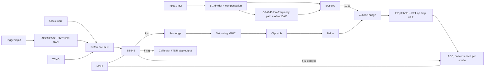

# Sampling oscilloscope front end derived from the yanartas-sensors sampler

A proposal, written by an LLM (Claude). It reuses the diode-bridge sampler of the
yanartas-sensors sensing board and replaces what the first study showed to limit it.
Nothing here has been built. Part data marked *unverified* could not be read from a
manufacturer datasheet.

## Summary

| Block | Proposal |
|---|---|
| Input | 1 MΩ, 10:1 divider into a BUF802 in composite-loop mode with an OPA140, after the [jmw active probe](https://jmw.name/projects/active-probe/) |
| Sampler | Same four-diode BAT15-04W bridge, driven from the buffer through 10 Ω, fixed reverse bias, 2.2 pF hold capacitor, gain made up by an op amp after the hold node |
| Strobe | A limited edge (35 ps comparator or CML gate), amplified to about 3 V by a saturating MMIC, clipped to a 100–160 ps pulse, then a balun |
| Timebase | One Si5345: strobe and signal clock from two fractional dividers of the same PLL, offset by the beat frequency |
| Trigger | Synchronous clock input and comparator trigger input (ADCMP572) share one path into the PLL reference; a time-to-digital converter is an optional third mode |
| Expected speed | About 2 GHz, 175 ps rise time, set by the BUF802; the simulated sampler alone is 73 ps |

The strobe driver is the main open risk: no part was confirmed to deliver 3 V with an
edge under 80 ps at low repetition rates.

A concept schematic of this proposal is in [`schematic/scope-frontend.kicad_sch`](../schematic/scope-frontend.kicad_sch)
([PDF](../schematic/scope-frontend.pdf)), generated by `schematic/gen_scope_frontend.py`.
Its input stage reuses the circuit of the jmw active probe, which is licensed CERN-OHL-S v2.

## What the first study changes

| Finding on the yanartas board | Consequence here |
|---|---|
| The sampler is as fast as the edge that reaches the clip line; a linear redriver does not sharpen it | The strobe comes from a limiting stage with a fast edge |
| A 0.2–0.75 V strobe cannot turn the bridge on against a real reverse bias | The strobe is about 3 V, so the bridge sits at 2 V reverse bias |
| The signal at the bridge was larger than the bias | The buffer's clamp pins limit the signal to less than the bias |
| 91 Ω feeds with 6 mm of trace behind them | Series resistors at the diodes, 25 Ω each |
| The hold node had 31 mm of trace to its amplifier | Hold capacitor and amplifier next to the bridge |
| Held voltage is a fraction of the input | Accepted and corrected by the gain stage and a DC calibration, as you suggested |

## Input stage

The reference design is taken over with two changes.

- **Topology.** 1.6 MΩ / 422 kΩ divider (5:1) with 0.6 pF compensation built from fixed
  capacitors. The low-frequency path goes through an OPA140 into the BUF802 auxiliary
  input, 5.6 kΩ + 100 pF between them, and a trimmer in the feedback network to match
  the two paths.
- **Parasitics.** High-value 0402 resistors carry 50–100 fF each, which peaked the
  reference design between 10 kHz and 10 MHz. Split them into series strings, including
  the 10 MΩ bias resistor.
- **Change 1: output.** The BUF802 drives the bridge through 10 Ω instead of a doubly
  terminated 50 Ω line. Its output impedance is 1.2 Ω at 100 MHz. In simulation this
  raises the sampler gain from 0.30 to 0.46 and cuts the settling tail from 30 % to
  12 %. It also absorbs the kick-out (29 mV peak-to-peak at the bridge), which never
  reaches the input connector.
- **Change 2: offset.** A DAC sums into the OPA140 path for vertical position.
- **Clamps.** CLH and CLL are set so the bridge input stays within ±0.5 V, inside the
  ±1 V bias.
- **Limits.** BUF802: 3.1 GHz at 1 Vpp and 1.6 GHz at 2 Vpp, 0.16 ns rise time for a
  1.2 V step, 2.3 nV/√Hz, ±4.5 to ±6.5 V supplies, 34 mA. The reference reached just
  over 2 GHz at 10:1 with 1.1 pF input capacitance on FR-408HR.

A direct 50 Ω input without the buffer would be faster (the sampler alone is 73 ps) but
puts the kick-out on the device under test and loses the 1 MΩ input.

## Sampler

Simulated with `sim/scope_sampler.py`; results in `results/scope-sampler.json`.
Strobe 3 V step with a 40 ps edge, 100 ps pulse, bias 2 V, 25 Ω per rail, 2.2 pF hold
unless stated.

| Variant | 10–90 % | Gain | Efficiency per strobe | Tail after 1 ns |
|---|---|---|---|---|
| Fixed bias, 50 Ω source | 78 ps | 0.30 | 63 % | about 30 % |
| **Fixed bias, 10 Ω source (proposed)** | 73 ps | 0.46 | 72 % | about 12 % |
| Same, 0.15 pF instead of 0.3 pF per rail to ground | 76 ps | 0.53 | 67 % | about 10 % |
| Bias bootstrapped from the hold buffer, 10 Ω source | 75 ps | 1.07 | 33 % | about 11 % |

Sensitivities, simulated on the bootstrapped variant only:

| Change | Effect |
|---|---|
| Strobe edge 80 ps instead of 40 ps | efficiency falls from 33 % to 12 %, 47 % overshoot |
| Strobe edge 150 ps | the bridge no longer turns on |
| Pulse 160 ps instead of 100 ps | efficiency 66 %, overshoot 2 %, rise time 79 ps |
| Step 2 V with bias 1.2 V | 72 ps, efficiency 26 % |
| Hold 10 pF / 1 pF | efficiency 10 % / 46 %, rise time unchanged |

Design points:

- **Gain stage.** A FET-input op amp at the hold node with a gain of about 2.2. The
  sampler gain depends on diode resistance during the strobe, so it moves with strobe
  amplitude and temperature. A switchable DC reference at the input calibrates gain and
  offset.
- **Offset.** Strobe imbalance leaves tens of millivolts on the hold node. Keep the two
  bias rails separately adjustable, as on the yanartas board.
- **Tail.** The held value sags by about 12 % over the nanosecond after an edge, because
  the rails' common-mode voltage follows the signal and then relaxes through the bias
  resistors. It is linear and can be removed in software if layout does not cure it.
- **Pulse width.** 160 ps is the better starting point: nearly the same speed, twice the
  efficiency and almost no overshoot.
- **Balun.** I did not establish that it is needed. A ground-referenced complementary
  drive also worked in the bootstrapped simulation. A differential driver without a
  balun is worth a test coupon.
- **Droop.** BAT15 reverse current is up to 5 µA at 1 V; on 2.2 pF that is up to
  2 V/µs for a mismatch of that size. The ADC must convert a fixed, short time after
  each strobe. At strobe rates below about 1 MHz a larger hold capacitor is needed.
  This estimate is from the datasheet maximum, not simulated.

## Strobe driver

Required: about 3 V into 50 Ω, edge 40–80 ps, from 10 kHz to 25 MHz repetition.

| Option | Data | Assessment |
|---|---|---|
| ADCMP572 or NB7L86M edge, then GVA-84+ driven into saturation | Edge 35 ps / 30 ps at 0.4 V. GVA-84+: DC–7 GHz, P1dB +20 dBm, gain 24 dB at 0.1 GHz and 12.5 dB at 6 GHz, 5 V 108 mA | Recommended first try. +20 dBm is 6.3 Vpp, so about 3 V of step. The output edge is not known; build a coupon |
| HMC870LC5 modulator driver | 2.5–8 Vpp, 20 ps (20–80 %), from a mirrored datasheet | Fast enough; low-frequency behaviour and availability unverified |
| ONET1151M | 1.5 Vpp, 26 ps, rated 1–11.35 Gbps, AC-coupled | Too small, and not rated for low rates |
| MAX3941 / MAX3942 | 3 Vpp / 6 Vpp | Obsolete |
| Fast CMOS logic | no edge data published | Not a basis for a design |

The step is clipped by a shorted stub after the amplifier, so the amplifier's coupling
capacitors only have to pass the edge. Balun candidates: TCM1-83X+ (10 MHz–8 GHz,
1.3 dB) or Marki BAL-0006SMG (0.5 MHz–6 GHz, 30 dB common-mode rejection).

## Timebase: two outputs of one PLL at a beat frequency

The strobe runs at f_s, slightly below the signal repetition rate f_sig. Each strobe
lands Δt later on the waveform:

- Δt = 1/f_s − 1/f_sig ≈ Δf / f_s², with Δf = f_sig − f_s
- one trace takes 1/Δf and holds f_s/Δf points
- the held voltage is the waveform slowed by f_s/Δf, so 3 GHz appears at 3 GHz · Δf/f_s

| f_s | Δf | Step | Points per period | Trace time | Bandwidth after the sampler |
|---|---|---|---|---|---|
| 10 MHz | 100 Hz | 1 ps | 100 000 | 10 ms | 30 kHz |
| 10 MHz | 1 kHz | 10 ps | 10 000 | 1 ms | 300 kHz |
| 1 MHz | 10 Hz | 10 ps | 100 000 | 100 ms | 30 kHz |

- **Efficiency is harmless in this mode.** The hold node averages about 1/efficiency
  strobes. Keep the step below about a third of rise time × efficiency: under 15 ps
  here.
- **ADC.** One conversion per strobe, clocked from a third PLL output at f_s with a
  fixed delay. The data is then low-pass filtered and decimated; the table shows how
  little bandwidth is left.
- **Part.** Si5345: each output has its own fractional divider, so two outputs at an
  arbitrary small ratio come from one VCO. Outputs 100 Hz–1028 MHz, jitter 120 fs in
  fractional mode, loop bandwidth 0.1 Hz–4 kHz. Divider word lengths were not checked,
  so the exact Δf grid is open.
- **Time zero.** A flip-flop that samples the signal clock with the strobe clock gives
  one edge per trace. With exact divider ratios a counter does the same.
- **Not recommended.** Si5351: 40–70 ps peak-to-peak period jitter against a 73 ps
  sampler. Two LMX2571/2572 would work but need two chips and I found no jitter figure.

A second output at f_sig drives a calibrator or a TDR step, which is the yanartas use
case with the FPGA removed.

## Trigger architectures

| | How | Works for | Limits |
|---|---|---|---|
| A. Internal | PLL on its TCXO, f_sig output drives the device | TDR, calibration | Only signals the instrument generates |
| B. Synchronous clock input | User clock is the PLL reference; strobe = clock × ratio − Δf | Clocked systems, 8 kHz–750 MHz | Needs a clock. Loop is at most 4 kHz wide, so faster clock jitter shows on the trace |
| C. Trigger input with phase recovery | ADCMP572 with threshold DAC and hysteresis squares the signal; its output is the PLL reference | Any periodic signal | Not data or bursts: the PLL wants 40–60 % duty, or pulses over 1.6 ns, and tolerates only 2 missing cycles in 8 above 10 MHz. The MCU must count the frequency first. Lock takes seconds at narrow bandwidth |
| D. Free-running strobe with time measurement | Strobe on the TCXO; a TDC measures trigger-to-strobe time for every sample | Repetitive but not periodic signals, and it shows time before the trigger | TDC-GPX2 or AS6501: 10–20 ps rms. TDC7200: 35–50 ps, marginal. Samples arrive in random order, so the hold-node memory must be undone with the calibrated efficiency |
| E. Triggered delay line | Trigger starts a programmable delay (SY89297U: 5 ps steps, 5 ns range) | Low repetition rates | 5 ns window, nothing before the trigger, 2 ps rms plus comparator dispersion |

Recommendation: build B and C. They are the same hardware, a comparator and a mux in
front of the PLL reference, and C degrades to B when the user has a clock. Leave a
footprint for D. Skip E.

ADCMP572 for the trigger path: 150 ps delay, 35 ps edges, 8 GHz equivalent input
bandwidth, 0.2 ps rms random jitter, 15 ps overdrive dispersion, input range −0.2 to
+1.2 V on 3.3 V. These are from a mirrored Rev. 0 datasheet. The input needs an
attenuator or clamp to stay in that range. The trigger source is an SMA; an internal
pick-off after the BUF802 through about 450 Ω is an option.

## Open items, in the order I would resolve them

1. Strobe driver coupon: comparator edge, GVA-84+, clip stub. Measure edge and amplitude.
2. Bridge coupon with that strobe, with and without a balun. Measure gain, offset, tail.
3. BUF802 stage driving the bridge through 10 Ω: stability and flatness with that load.
4. Hold-node droop against strobe rate with real diodes; choose the hold capacitor.
5. Si5345 divider resolution and the lock behaviour on a comparator output.

## Model limits

The sampler simulation uses ideal sources for the strobe and the buffer, a
common-mode choke as the balun, lossless traces, and the BAT15 chip model with
estimated package parasitics. The 12 % tail and the offsets depend on parasitics that
are guesses. The figures show that the approach works and what it is sensitive to; they
are not predictions of a built board.

## Cost-down

Schematic of this variant: [`schematic/scope-frontend-lowcost.kicad_sch`](../schematic/scope-frontend-lowcost.kicad_sch)
([PDF](../schematic/scope-frontend-lowcost.pdf)).

Prices are single-unit distributor prices in USD from search snapshots (November 2026),
good to about ±15 %. Only the parts that differ are counted; passives, PCB, connectors,
MCU, ADC and DACs are left out.

| Function | Baseline | Price | Low-cost | Price |
|---|---|---|---|---|
| Timebase | Si5344 | about 30 | Si5351C | 5.01 |
| Strobe edge | ADCMP572 + GVA-84+ | 26.81 + 3.10 | 2 × GVA-84+ driven from the PLL output | 6.20 |
| Balun | TCM1-83X+ | 8.70 | USB 3 common-mode choke (DLW21S type) | 0.29 |
| Trigger comparator | ADCMP572 | 26.81 | TLV3601 | 4.54 |
| Hold amplifier | OPA656 | 14.45 | OPA810 | 3.29 |
| Low-frequency amplifier | OPA140 | 4.29 | OPA197 | 0.82 |
| Trigger clamp | BAT15-04W | 0.74 | BAT54S | 0.02 |
| Split-rail supply | LTC3261 + TPS7A39 | 13.40 | TPS60403 with LC filters | 1.04 |
| Unchanged | BUF802, 2 × BAT15-04W | 8.25 | same | 8.25 |
| **Total of these parts** | | **about 137** | | **about 29** |

Also removed: the 1.8 V rail, the separate clock connector and the calibrator connector
(left as an option).

### What the saving costs

| Change | Consequence |
|---|---|
| Si5351C instead of Si5344 | Locks only to 10–100 MHz references; no lock below 10 MHz. It follows reference jitter instead of cleaning it. Period jitter is 40 ps typical and 95 ps maximum peak-to-peak, which adds little to a 175 ps system |
| No comparator in the strobe path | The PLL output has about 1 ns edges. Two saturating amplifier stages have to sharpen it to about 120 ps. This is the least certain part of the variant |
| Lower strobe amplitude and slower edge | Simulated with a 2 V step: 68–81 ps, gain 0.42–0.66. With a 120 ps edge, a 160 ps pulse and 1.6 V bias: 71 ps, gain 0.68, 90 % per strobe |
| Common-mode choke as balun | Simulated with 150 nH and 1 nH leakage: 46 ps, but overshoot rises from 12 % to 26 %. The real part's differential bandwidth is not in its listing |
| TLV3601 trigger comparator | 2.5 ns delay and CMOS output instead of 150 ps and CML. Adequate for a 10–100 MHz PLL reference; its jitter was not checked |
| OPA810 hold amplifier | About 30 MHz at a gain of 2.2 instead of several hundred. Settles within a 10 MHz strobe period, with little margin |
| OPA197 in the low-frequency path | Similar bandwidth to the OPA140 (10 MHz against 11 MHz). The crossover flatness must be re-trimmed; not simulated |
| Charge pump without the low-noise regulator | More supply ripple at the buffer. The reference design estimated 5 mV of ripple on its pump before the regulator |

Simulated with everything combined (choke, 2 V step, 80 ps edge, 160 ps pulse, 10 pF
hold): 68 ps, 27 % overshoot, gain 0.71, 23 % per strobe. The system stays at about
175 ps because the BUF802 sets it.

### Further steps, not drawn

- **No external trigger at all** (an instrument that only measures its own stimulus,
  as on the yanartas board): drop the TLV3601 and use an Si5351A at 2.11, or the
  MS5351M clone at about 1. Saves about 7 more.
- **50 Ω input only**: drop the BUF802 and the OPA197, saving 7.60. The sampler alone is
  faster than the buffer, but its kick-out (tens of millivolts) reaches the device
  under test and the 1 MΩ input is lost.
- **Not worth changing**: the BAT15-04W diodes and the GVA-84+. Cheaper gain blocks
  found were obsolete or thinly stocked.

## FPGA options (GW1NZ-1)

Two questions: can the FPGA's input delay primitives recover the trigger phase, and can
the FPGA replace the clock generator. Figures are from Gowin DS841-2.8E, UG286 and UG289.

| Resource | GW1NZ-1, LV, C6/I5 | Consequence |
|---|---|---|
| IODELAY | every I/O; 30 ps typical per step, no minimum or maximum given; 128 steps; 450–550 ps offset; static or dynamic, input or output but not both on one pin | 3.8 ns range per pin; the step has to be calibrated |
| Serialisers | IDES10 / OSER10 up to 1100 Mbps | 0.9–1 ns coarse bins in and out |
| PLL | one rPLL; input 3–400 MHz, VCO 400–800 MHz; IDIV and FBDIV 1–64, ODIV even values to 128, all integer; phase in 22.5° steps, fine delay 0.125 ns steps | No small frequency offset between two outputs |
| PLL jitter | not specified. The on-chip oscillator is 0.012 UI peak-to-peak typical | Unknown; must be measured |
| I/O standards | no LVDS input, no true LVDS output | Comparator and strobe path must be CMOS |

### Trigger phase recovery with IODELAY

This is workable as a time-to-digital converter, and it gives the "free-running strobe
with time measurement" mode (D in the trigger table) without a TDC chip.

- **Circuit.** The trigger comparator output is fanned out to N input pins. Each pin has
  a different static IODELAY code and feeds an IDES10 at 1 Gbps. The N pins form a
  thermometer code that divides each 1 ns bin into N parts. A single pin is useless for
  this: it gives one bit per event.
- **Precision** (`sim/fpga_tdc.py`, Monte Carlo with a ±20 % unknown step, 40 ps rms
  pin skew and 10 ps rms jitter, all three my assumptions):

  | Pins | Nominal bin | rms error, uncalibrated | rms error, calibrated | Scope rise time |
  |---|---|---|---|---|
  | 4 | 250 ps | 95 ps | 78 ps | 265 ps |
  | 8 | 125 ps | 64 ps | 48 ps | 215 ps |
  | 16 | 62 ps | 48 ps | 31 ps | 192 ps |
  | 24 | 42 ps | 40 ps | 24 ps | 186 ps |

  For comparison: a TDC7200 (35 ps rms) gives 197 ps, the Si5351C beat mode about
  177 ps, both on the 175 ps set by the BUF802.
- **Calibration** is a code-density test: triggers that are asynchronous to the FPGA
  clock land in each bin in proportion to its width. It runs continuously on the
  measurement data, so drift of the delay step with temperature is tracked. Re-tuning the
  codes afterwards for even bins would improve on the table; I did not simulate that.
- **PLL jitter mostly cancels.** The strobe and the TDC sampling clock come from the
  same clock, so only the jitter accumulated between trigger and strobe counts.
- **Costs.** 16 pins of the 48-pin package, a fan-out that does not slow the comparator
  edge (5 pF per pin), and the hold-node memory has to be undone because samples arrive
  in random time order.
- **Not evaluated:** a carry-chain TDC in the logic fabric, which would need one pin.

### FPGA instead of the clock generator

Yes for the low-cost variant, but as a different timebase, not as a drop-in.

- **The beat-frequency scheme is not possible.** One PLL with integer dividers cannot
  make two outputs a few parts per million apart.
- **What it does instead.** Either delay stepping (strobe placed by OSER10 in 1 ns steps
  plus IODELAY in 30 ps steps), as the yanartas board does, or a free-running strobe
  with the TDC above.
- **30 ps steps are enough.** That is about six points on a 175 ps edge.

| | Si5344 (baseline) | Si5351C (low cost) | GW1NZ-1 |
|---|---|---|---|
| Own stimulus (TDR, calibrator) | beat, 1 ps steps | beat, 1 ps steps | delay stepping, 30 ps steps; PLL jitter is common to both edges |
| External periodic signal | locks 8 kHz–750 MHz, cleans jitter | locks 10–100 MHz, follows jitter | free-running with TDC: any rate; or PLL lock from 3 MHz with unknown jitter |
| Non-periodic repetitive signal | no | no | yes, with the TDC |
| Timing error, rms | 0.1 ps class | about 10 ps (estimate) | 31 ps with 16 pins (simulated, assumptions above) |
| Time axis accuracy | exact divider ratios | exact divider ratios | calibrated delay steps; needs self-calibration |
| Strobe output | differential, needs a limiter | CMOS, about 1 ns edge | CMOS; edge rate not published |
| Extra needs | 1.8 V rail | none | 1.2 V core rail, an external crystal oscillator, configuration |

Recommendation: for the low-cost variant, replace the Si5351C with the GW1NZ-1 and use
the free-running strobe with a 16-pin TDC for external signals and delay stepping for
the instrument's own stimulus. It removes the 10–100 MHz trigger limit and handles
non-periodic triggers, for about 15 ps more rise time than the Si5351C. Keep the Si5344
where the 1 ps time axis and jitter cleaning matter. I have no price for the GW1NZ-1.

Open before committing to it: the FPGA's output edge rate and PLL jitter are both
unpublished, and the IODELAY step has no tolerance. All three can be measured with the
scope's own sampler on a first board.

## Triggering on a serial data stream (clock recovery)

For eye diagrams the strobe has to be timed against the bit clock of the data, which the
signal itself does not carry as a periodic edge. With about 2 GHz of bandwidth the scope
can show NRZ data up to roughly 2.5–3 Gbps, so the clock recovery has to cover about
100 Mbps to 3 Gbps. Part data and prices are from datasheets and DigiKey (November 2026)
unless marked.

| Option | Rates | Spread spectrum (0.5 %, 30–33 kHz) | Added parts, single-unit price | Verdict |
|---|---|---|---|---|
| A. Clock from the device under test into the clock input | whatever the timebase accepts | Si5344: its loop is at most 4 kHz wide, so it does not follow; the eye smears. Si5351C and FPGA PLL follow | none | Use whenever a clock exists (HDMI, source-synchronous LVDS, MIPI) and the link has no spread spectrum |
| B. Recovery IC, ADN2817 | 10 Mbps–2.7 Gbps, no reference needed, full-rate CML clock out | not verified; loss of lock is flagged at 1000 ppm | discontinued at DigiKey; ADN2812 about 91 at 1000 pieces (unverified); ADN2814 (to 675 Mbps only) 40.86 | Best fit on paper, but expensive and hard to buy. Loop bandwidth fixed by the chip |
| B2. SY87701AL | 28 Mbps–1.3 Gbps in eight bands | no: data must be within about 1000 ppm of its reference | 54.89, plus a reference near the data rate | No |
| C. FPGA with transceivers, ECP5UM | 270 Mbps–3.2 Gbps | lock window selectable up to ±4000/±7000 ppm; tracking not verified | 34.93, BGA, plus a reference within about 1000 ppm of the rate | Works for known standard rates; a second FPGA and a synthesiser for one function |
| D. Software recovery from time-stamped edges | up to the limiting buffer, 3.125 Gbps | yes, 8.7 ps rms in simulation | about 15–18 | Recommended with the FPGA timebase |
| E. Trigger on the data edges, no clock model | any | n/a | none | Fallback only: the eye is drawn relative to a neighbouring edge, which hides jitter |

### Option D in detail

It extends the free-running strobe with the FPGA input-delay converter.

- **Front end.** Tap the signal after the BUF802. A limiting buffer squares it
  (DS25BR100, DC to 3.125 Gbps, 7.58). A static divider counts rising edges
  (SY100EP33V, ÷4, 4 GHz, 2.98; two in series for ÷16). A translator brings the divided
  edges to CMOS (SN65EPT21, 300 MHz, 4.87) for the 1:4 buffer and the 16 FPGA pins.
- **Why divide.** Every divided edge still coincides with a data edge, so it sits on the
  bit grid, but the edge rate drops to what the converter handles: about 20 MHz on
  average at 1.25 Gbps with ÷16.
- **Recovery.** The FPGA time-stamps every divided edge against its own clock. Software
  fits bit index against time and gives each sample its position in the unit interval.
  The strobe times are exact in the same clock domain.
- **Precision** (`sim/sw_cdr.py`: 1.25 Gbps, ÷16, 31 ps rms per time stamp, 3 ps source
  jitter):

  | Clock recovery | No spread spectrum | 5000 ppm at 33 kHz |
  |---|---|---|
  | Fit over 33 edges (1.7 µs), edges before and after the sample | 8.7 ps rms | 8.7 ps rms |
  | Causal loop, natural frequency 1 MHz | 22 ps rms | 24 ps rms |
  | Causal loop, 300 kHz | 11 ps rms | 91 ps rms |
  | Causal loop, 100 kHz and below | 4–7 ps rms | loses lock |

  Averaging over many edges makes the recovered clock better than a single time stamp.
  Fitting after acquisition tracks spread spectrum without the lag of a real-time loop.
- **Loop bandwidth is a software parameter**, so the bandwidth a standard prescribes for
  jitter measurement can be emulated. SATA, for example, uses the bit rate divided by
  1667 or by 500.
- **Open points.** The dividers are static, but operation with irregular edges down to
  DC is my inference, not a datasheet statement. LVDS into the PECL divider input needs
  a bias network. The time stamps include the data-dependent jitter of the edges used.
  The hold-node memory has to be undone, as in every free-running mode.

### With the Si5344 baseline

The beat-frequency timebase needs a hardware clock, so only A, B or C apply, and the
Si5344 then filters whatever it is given at 4 kHz or less. That shows total jitter
including wander and smears links with spread spectrum. If eye diagrams of such links
matter, the FPGA timebase with option D is the better architecture.

### One IC for the divider chain

Assuming a fast comparator already follows the BUF802, the limiting buffer goes away and
the question is whether one IC can replace the two dividers, the translator and the 1:4
buffer. Constraint from the FPGA: the GW1NZ-1 has only plain CMOS input standards (no
referenced and no differential inputs), so LVDS, CML or PECL swings cannot be made
reliable for it with resistors alone. The IC has to have CMOS outputs.

| Part | Input | Ratios | Outputs | Price, stock (DigiKey) | Fit |
|---|---|---|---|---|---|
| **AD9508** | 0–1650 MHz, minimum pulse 303 ps; common mode 0.58–1.67 V | 1–1024 by SPI or I²C; 1, 2, 3, 4, 5, 6, 8, 16 by pin strap | 4 × LVDS/HSTL or **8 × 1.8 V CMOS**, 250 MHz, 1.18 ns edge typ at 10 pF | 15.83, 3746 | Best: divider, bypass and fan-out in one |
| AD9513 | 0–1.6 GHz; common mode 1.3–1.8 V, "should be ac-coupled" | 1–32, 4-level strap pins | 3 × 3.3 V CMOS, 650 ps edge typ at 3 pF | 19.36, 396 | Only one with 3.3 V CMOS; awkward to reconfigure, still needs fan-out |
| CDCM1804 | 0–800 MHz | 1, 2, 4, 8, 16 by pins | 3 × LVPECL + 1 × 3.3 V CMOS | 19.17 | Limits data to 1.6 Gbps |
| SY89874U / SY89873L | 3.2 GHz, any logic family DC-coupled | 1, 2, 4, 8, 16 by pins | LVPECL / LVDS only | 10.40 / 9.35 | Fastest, but needs a translator, so not one IC |
| CDCE18005 | 1500 MHz | 1–80 by SPI | 5 × 3.3 V CMOS among others | 21.88, 630 | 1.3–1.6 W; no margin |

Recommendation: AD9508, with the 16 FPGA time-stamp pins in a bank at 1.8 V.

- **It replaces four parts.** Its eight CMOS outputs drive two FPGA pins each, so the
  1:4 buffer is not needed either. The chain it replaces costs about 11.40; the AD9508
  is 15.83.
- **Trigger mode comes for free.** Ratio 1 passes the comparator edges through, and the
  ratio is set over the bus that is there anyway.
- **Comparator.** Its input window (0.58–1.67 V common mode) takes LVDS or 2.5 V LVPECL
  DC-coupled. 3.3 V CML or LVPECL, which is what the ADCMP572 delivers, is listed as not
  allowed. So this choice goes with an LVDS-output comparator, or a resistive divider on
  both legs of a CML output, which costs half the swing and was not checked against the
  AD9508's input sensitivity.
- **Speed.** A 303 ps minimum pulse is a 3.3 Gbps limit, about as far as the scope's
  bandwidth goes, with no margin.
- **To verify.** The datasheet says the divider "contains duty cycle correction that
  guarantees 50 %" without saying how. Whether that behaves with irregular edges is
  unknown; input is specified from 0 Hz. Datasheet read from a mirror (Rev. G).

### Discrete alternative: tapped delay line with diode gates

Idea: the BUF802 output is split; one leg goes to the sampler, the other runs down a
delay line that is tapped every 50–100 ps by small diode gates. All gates fire on the
strobe, so the hold nodes contain a snapshot of the signal along the line. A cheap
comparator per tap turns it into a bit pattern for the FPGA; an edge shows up as the
place where the bits change.

What it buys:

- **No fast logic in the path.** Nothing has to toggle at the data rate. The speed limit
  is the gate aperture (55–70 ps simulated), which is that of the scope itself.
- **Timing is measured against the real sampling instant.** The gates share the main
  sampler's strobe, so strobe-driver delay, FPGA clock jitter and PLL jitter drop out.

Simulations: `sim/tap_gate.py` (one gate), `sim/tap_array.py` (16 taps on loaded lines),
`sim/snapshot_tdc.py` (timing precision, Monte Carlo).

**Gate type** (1.5 V strobe per side, 1 pF hold, one shot from reset):

| Gate | Captured swing | Aperture 10–90 % | Offset on the hold node | Kick-out onto the line |
|---|---|---|---|---|
| Two diodes, balanced strobe | 52 % | 70 ps | 0 mV; 18 mV at 5 % strobe imbalance | 0 mV; 27 mV at 5 % imbalance |
| One diode | 54 % | 58 ps | 263 mV, about 8 mV per 1 % of strobe amplitude | 477 mV |

Use two diodes. The one-diode gate's offset depends on the strobe amplitude at each tap
and its kick-out, times 16, lands on the signal line.

**Strobe distribution** is the hard part.

| Scheme | Captured swing per tap | Tap spacing | Needs |
|---|---|---|---|
| Divider tree, 1:16 per polarity (the Wilkinson proposal) | 44–50 %, equal by symmetry | set by the signal line | 3–5 V per side at the root for 0.6–1.0 V at each gate (12 dB split plus about 2 dB loss); two trees of 15 dividers |
| Strobe line running past the taps against the signal, no isolation, 3 V | 2–53 %, first taps fail | irregular | – |
| Same with 220 Ω between strobe line and each hold capacitor, 3 V | 16–31 % (end tap 10 %) | 72 ps mean, 53–83 ps | full driver amplitude reaches the line; no dividers |

- The gates load a travelling strobe line heavily; without isolation the pulse is used
  up after a few taps. With 220 Ω it works, at less than half the swing of a tree.
- With the strobe travelling against the signal, neighbouring taps are one signal delay
  plus one strobe delay apart, so each line is half as long. That matters on FR-4: about
  0.2–0.27 dB/cm at 3 GHz means 3–4 dB over the 16 cm a co-located line would need.
- I did not simulate the divider tree itself. A single-section Wilkinson covers about
  an octave and a 100 ps pulse spans DC to 5 GHz, so reflections inside the tree are a
  risk. A middle way is a 1:4 tree feeding four 4-tap line segments.

**Timing precision**, 16 taps, 25 mV rms offset per tap and 3 mV noise (assumptions),
positions calibrated by code density:

| Case | rms error | Scope rise time |
|---|---|---|
| Limiting amp, ±0.3 V on the line, tree strobe, 60 ps taps | 22 ps | 184 ps |
| Limiting amp, 100 ps taps | 32 ps | 193 ps |
| Limiting amp, travelling strobe (72 ps taps, 20 % swing) | 43 ps | 207 ps |
| Same, ±0.5 V on the line | 31 ps | 192 ps |
| Same, offsets 10 mV | 26 ps | 187 ps |
| No limiting amp, ±0.3 V signal | 23 ps | 184 ps |
| No limiting amp, ±0.1 V signal | 49 ps, 10 % of taps stuck | 216 ps |
| No limiting amp, ±0.03 V signal | 151 ps, half the taps stuck | unusable |
| No limiting amp, per-tap thresholds trimmed to 2 mV, ±0.03 V | 32 ps | 193 ps |

A software clock fit over 9–17 captured edges brings the recovered bit clock to about
10–12 ps rms at 1.25 Gbps, with or without spread spectrum (`sim/sw_cdr.py`). The window
is short (about 0.85–1 ns), so the fraction of strobes that catch an edge falls with
the data rate: 83 % at 3 Gbps, 52 % at 1.25 Gbps, 6 % at 100 Mbps. Below a few hundred
megabits the FPGA input-delay converter is the better tool.

**With or without the limiting amplifier**

| | Without | With |
|---|---|---|
| Works for | signals of about ±0.3 V on the line, more than the sampler's ±0.5 V range leaves after a 6 dB split; or any signal if each tap has a threshold trim (16 more control lines) | any signal above the amplifier's sensitivity |
| Calibration | tap positions shift with signal amplitude and edge shape | fixed: amplitude and edge on the line are constant |
| Kick-out from 16 gates | reaches the splitter and the main sampler path (after the sample is taken) | isolated |
| Trigger level | per-tap threshold | one offset at the amplifier input |
| Adds | nothing | a stage that must pass the data rate; its delay drift (common to all taps, removed by the clock fit); duty-cycle distortion if single-ended (use one edge polarity) |

The limiting amplifier is worth having.

**Low-cost limiting stage**

| Option | Data | Price | Verdict |
|---|---|---|---|
| Two GVA-84+ in series, saturating | DC–7 GHz, +20 dBm; AC-coupled | 6.20 | Recommended: same part as the strobe driver, in production |
| SN65LVDS20 | 4 Gbps, 80 mV sensitivity, DC-coupled, LVDS out (340 mV) | 7.37 | DC-coupled alternative; small swing, wants a differential line |
| SY89327L | not verified | 3.83 | Check the datasheet |
| Optical post-amplifiers (MAX3748, ONET8501PB) | 4–5 mV sensitivity, CML out | 4–5 at LCSC | Obsolete or out of stock |
| Discrete BJT differential pair (BFP740F, BFU730F, …) | 40–55 GHz fT | 0.3–0.6 each | Not advisable: every Infineon RF transistor checked is on last-time-buy (May 2027) and the NXP ones are obsolete. BFR93A is plentiful but only 6 GHz |

The same sourcing problem applies to a BJT strobe driver.

**Parts and cost** for 16 taps, single-unit prices:

| Item | Part | Cost |
|---|---|---|
| Gate diodes, 16 series pairs | BAT15-04R (0.38; 0.20 at 100) | 6.10 |
| Readout, 16 channels | CMOS-input comparator of about 5–10 ns: TP1961 (0.58 at LCSC, specifications not verified) or TLV3502 dual (2.91 at LCSC) | 9–23 |
| Limiting stage | 2 × GVA-84+ | 6.20 |
| Extra strobe drive | one more GVA-84+ and a balun choke | 3.40 |
| Passives | about 10 per tap | 2 |
| **Total** | | **about 27–41** |

- Quad LVDS receivers looked attractive as cheap comparators but are unsuitable: their
  threshold is only guaranteed within ±100 mV and their inputs draw up to 10–20 µA.
- For comparison, the fast comparator plus AD9508 route is about 43 in two ICs.

**Verdict.** It works on paper and its timing reference is better than any of the other
options, but it is not much cheaper than the two specialty ICs, it needs 16 more FPGA
inputs and a lot of board area, and its strobe distribution is unproven. I would choose
it if avoiding single-source fast logic matters more than board area, with: a limiting
stage from two GVA-84+, two-diode gates, about 16 taps at 60–70 ps, ±0.5 V on the line,
and a strobe line with 220 Ω isolation as the first thing to prototype.

Not simulated: the divider tree, line loss, snapshots containing more than one edge, the
comparators, and sharing one strobe driver between this array and the main sampler.

Drawings of this architecture: [block diagram with the targets for every connection](diagrams/block-diagram.svg)
and [schematic of the phase sampling stage](diagrams/phase-sampler-schematic.svg), both generated by the scripts in `docs/diagrams/`.

**Slow signals.** The window is only about 0.9 ns, so for a periodic signal of frequency
f a free-running strobe catches an edge with probability 0.9 ns × f. Because strobes sit
on the stable FPGA clock grid, the clock fit can carry the signal phase across strobes
that caught nothing; the fit then acts like a recovery loop whose bandwidth is set by
how often edges are caught. For 5 ps from 31 ps time stamps about 40 stamps are needed:

| Signal | Stamps per second at 10 MHz strobe | Fit window for 5 ps | Follows phase changes slower than about |
|---|---|---|---|
| 1 GHz | 9 M | 4.4 µs | 230 kHz |
| 100 MHz | 0.9 M | 44 µs | 23 kHz |
| 10 MHz | 90 k | 0.44 ms | 2.3 kHz |
| 1 MHz | 9 k | 4.4 ms | 230 Hz |
| Any, with every fourth strobe aimed at an edge | 2.5 M (at most one per signal period) | 16 µs | 63 kHz |

- Wander of the signal that is faster than the fit can follow appears as jitter on the
  display, as with a narrow hardware loop. A crystal-derived signal is fine at 1 MHz; a
  spread-spectrum signal needs megahertz stamp rates.
- Aiming strobes at edges removes the dependence on signal frequency: once the phase is
  roughly known, the FPGA places a share of the strobes within the window of a predicted
  edge. Those strobes still deliver valid samples to the main channel, concentrated on
  the edge.
- The fit needs the frequency well enough to count cycles between stamps. The slow
  comparator path into the FPGA gives that, and its input-delay converter can carry the
  cycle count while the snapshots supply the fine, strobe-referenced correction.

**Cheaper gate diodes** (`sim/diode_options.py`; generic models by capacitance class,
220 Ω isolation, ±3 V strobe, prices per diode at 100 pieces):

| Diode | Price | One gate: swing, aperture | 16-tap array: swing of the inner taps | Peak reverse voltage |
|---|---|---|---|---|
| BAT15-04R / -04W (0.3 pF with package) | 0.10–0.14 | 53 %, 55 ps | 14–28 % | 2.0 V of 4 V rated |
| NSR201MX (0.15 pF, 14 Ω) | 0.19 | 60 %, 66 ps | 10–31 % | 2.1 V of 2 V rated |
| JDH2S02SL (0.25 pF) | 0.19 | 52 %, 65 ps | 13–31 % | 1.9 V of 10 V rated |
| 0.5 pF class | – | 41 %, 51 ps | 1–25 % | – |
| 1 pF class (BAT68, RB886, MMDL301) | 0.04–0.26 | 20 % | fails | – |
| 2 pF class (BAS70) / 10 pF class (BAT54) | 0.01–0.02 | 2 % / none | fails | – |

Nothing cheaper works. The diodes that cost less than the BAT15-04R have 1 pF or more,
and two of them per tap load a 35 ps line section (0.6 pF) too heavily. The BAT15-04R
pair is already the cheapest usable part; the NSR201MX would be run at its reverse
rating. Only the BAT15 uses a manufacturer model; the others are generic.

**Readout loading (correction).** The first readout network (43 kΩ bias, 2 × 20 kΩ
summing) was wrong on two counts, found with `sim/readout_load.py`:

- The summing resistors sit across the bias, so ±0.5 V rails left only about ±0.16 V on
  the hold nodes, less than the signal on the line.
- The comparator input capacitance (3 pF assumed; the datasheets do not give it) is
  several times the 2 × 0.47 pF hold capacitance, so the comparator sees a fraction of
  the held voltage, late.

| Network (one gate, ideal strobe) | Peak at the comparator, % of line voltage | After 100 ns |
|---|---|---|
| 43 kΩ bias, 2 × 20 kΩ, rails raised to keep ±0.5 V, Cin 3 pF | 16 % at 24 ns | 57 % of the peak left |
| Same, Cin 6 pF / 1 pF | 10 % / 31 % | – |
| **10 kΩ bias, 2 × 4.7 kΩ, rails ±1.56 V, Cin 3 pF** | 15 % at 6 ns | 4 % left |
| 22 kΩ bias, 2 × 4.7 kΩ, Cin 1 pF | 34 % at 4 ns | 4 % left |

In the array the taps hold about a third to a half of what a single gate does, so the
comparator sees about ±20 to ±45 mV for ±0.5 V on the line, not the ±60 to ±115 mV
stated before. The timing precision survives, because real comparator offsets are much
smaller than the 25 mV assumed earlier: 23–27 ps rms with 6 mV offsets, 27–38 ps with
10 mV. The drawings carry the corrected values.

**Comparator choice** from the LCSC list of parts under 10 ns. With a 2.4 kΩ source,
each microamp of input bias current shifts the threshold by 2.4 mV.

| Part | Price per channel | Bias current | Offset, hysteresis | Delay at small overdrive | Verdict |
|---|---|---|---|---|---|
| TLV3502 (dual) | 1.46 | 2 pA | 1 mV typ, 6.5 max; 6 mV | 4.5 ns at 20 mV, 7.5 ns at 5 mV | Best fit: 23.30 for 16 channels |
| TLV3501 | 1.96 | 2 pA | same | same | Same part, single |
| LMV7219 | 0.77 | 0.2–0.45 µA | 1 mV typ, 6 max; 7.5 mV | 10–12 ns, 20 max; specified at 0 V common mode | Cheapest that works: 12.30 for 16 |
| TLV3601 / TLV3603 | 4.25–4.65 | 1 µA | 5 mV; 1.5 mV | 2.5 ns | Works; speed not needed |
| ADCMP600, LT1719, AD8561, AD8611, AD8564, LT1711 | 4.15–24 | 3–6 µA | – | – | 7–14 mV of bias-current shift per part, and more expensive |
| MAX999, MAX962, TL3016 | 1.36–8.60 | 10–15 µA | – | – | No: 24–36 mV shift, as large as the signal |
| LMH7220, TLV3604, ADCMP572 | – | – | – | – | Differential outputs; not for this |

**TRF37D73 as the amplifier** (TI datasheet SLASE43): 1 MHz–6 GHz, gain 22 dB at
400 MHz, 19.5 dB at 2 GHz, 18 dB at 3 GHz, 15.5 dB at 4 GHz; 16.5 dBm at 1 dB
compression at 2 GHz; 3.3 V, 53 mA; maximum input +10 dBm; external choke on the output.

- Good for the limiter and the pre-drivers. Two stages need about 10 dB between them to
  respect the input limit and then limit for inputs above about ±85 mV at 2 GHz (my
  arithmetic); three stages limit from a few millivolts.
- Short for the strobe finals: 16.5 dBm is about ±2 V, against the ±3 V simulated for
  the gate strobe lines. The main sampler was simulated working with a 2 V step.
- The datasheet circuit (100 nH, 1 nF) is for hundreds of megahertz; for 10 MHz it needs
  about 10 µH and 100 nF. Nothing is stated about operation in compression.

**Calibrating comparator offsets in software.** Proposal: with no strobe, so that all
gates block, sweep the threshold across about ±50 mV and record where each comparator
flips; then correct each tap's edge time by its threshold shift divided by the slew rate.

- It works, and it measures the right thing: the sweep goes through the real network, so
  it captures offset, bias-current shift and, swept in both directions, hysteresis.
  Sweeping the common threshold VTH is equivalent to sweeping both bias rails and needs
  one DAC.
- Correction to the comparator table above: the DC path of the comparator's bias current
  is through the summing and bias resistors, (4.7 kΩ + 10 kΩ) / 2 = 7.35 kΩ, not 2.4 kΩ.
  The shift is 7.35 mV per microamp: LMV7219 1.5–3.3 mV, TLV3601 7 mV, ADCMP600 and
  similar 22–44 mV, MAX999 110 mV.
- What software can and cannot absorb: a shift common to all channels is removed by
  VTH; the calibration then handles the channel-to-channel remainder, as long as that
  remainder is well below the ±20 to ±45 mV signal. For 10–15 µA parts the spread alone
  (tens of millivolts) is as large as the signal, so they stay unusable; 3–6 µA parts
  become usable.
- It does not unlock a cheaper part: the cheapest comparator on the list, the LMV7219,
  already works. Its value is elsewhere. The hold node rests at the threshold between
  strobes, so the comparator's hysteresis makes the threshold depend on the previous bit
  (±3 to ±4 mV, about ±6 to ±12 ps). With both trip points calibrated and the previous
  bit known, that is correctable.
- Slew rate: with the limiter the edge on the line is the same for every signal, so the
  code-density calibration already folds each tap's offset into its position and no slew
  estimate is needed. Without the limiter the slew follows the signal, and it can be
  taken from the scope trace at the trigger level, times each tap's gain. The correction
  error is the threshold shift over the slew, times the relative slew error: 10 mV at
  0.3 mV/ps with 20 % slew error is 7 ps. Keeping the shift small with VTH keeps this
  small.
- Not simulated. Drift between calibrations for a bipolar input is of the order of
  1 %/K of the shift (estimate).

### TDC7201 as the time stamper

From the TI datasheet (SNAS686) and DigiKey, November 2026.

| Item | TDC7201 |
|---|---|
| Resolution, noise | 55 ps LSB; 35 ps rms at 1 µs measured time, 50 ps at 100 µs |
| Range | one converter: 12 ns–2 µs (mode 1), 250 ns–8 ms (mode 2); both combined: from 0.25 ns |
| Inputs | CMOS levels, edges ≤ 1 ns (20–80 %), pulses ≥ 10 ns, 4 pF; up to 5 stops per converter, ≥ 67 ns apart |
| Reference clock | 1–16 MHz; 16 MHz recommended (243 ps rms at 1 MHz); specified with < 1 ps jitter |
| Calibration | built in, after every measurement |
| Interface | SPI, 20–25 MHz; one start command and three 24-bit reads per measurement |
| Supply | 2–3.6 V, 2.7 mA |
| Package, price | 25-ball BGA, 4 × 4 mm, 0.65 mm pitch, no other package; 5.77 (3.71 at 100); only the 2000-piece reel type is active |
| TDC7200 (one converter, TSSOP-14) | 3.69 (2.29 at 100), 22 000 in stock |

- **Precision is in the same class as the other options.** 35 ps rms gives a scope rise
  time of about 197 ps, against 192 ps for the 16-pin FPGA converter and 185–200 ps for
  the delay line. It is a known quantity where the other two rest on my assumptions.
- **Rate is the limit.** Each measurement needs a start command, the conversion, the
  built-in calibration and three register reads. I estimate 7–10 µs per measurement, so
  about 100 000 time stamps per second. The datasheet gives no rate. At a 10 MHz strobe
  that is one stamp per hundred strobes.
- **What that allows.** For a stable periodic signal the clock fit bridges the gaps:
  40 stamps for about 5 ps take 0.4 ms, so the fit follows phase changes slower than
  about 2 kHz. That is the same as the delay line on a 10 MHz signal. It is too slow for
  spread spectrum, and a mode that needs a stamp for every sample runs a hundred times
  slower.
- **It does not need the dual part.** The second converter is only needed for intervals
  under 12 ns. The FPGA can always use a strobe that is at least 12 ns after the trigger
  as the stop, so the single TDC7200 in TSSOP does the job for less.
- **What it measures.** Start is the comparator output, stop is the strobe as it leaves
  the FPGA. FPGA clock jitter cancels; the delay of the strobe amplifiers does not.
- **Input conditions.** Trigger pulses under 10 ns need stretching, and data edges still
  need the fast comparator and a divider, as for the FPGA converter.

Verdict: a good low-risk reference, for a first board and for checking the FPGA or
delay-line converter against a specified part, as a TDC7200. Not the main time stamper,
because of its rate.

**TDC7201 on fast data.** The part needs stop pulses at least 10 ns wide and 67 ns apart,
so data edges have to be thinned out first; and it delivers stamps in bursts with gaps.
Simulated with `sim/tdc7201_track.py` and `sim/tdc7201_burst.py` (35 ps rms per stamp,
12 µs per measurement cycle, which is my estimate).

How to use the stamps:

| Scheme | 1.25 Gbps, no spread spectrum | 1.25 Gbps, 5000 ppm at 33 kHz |
|---|---|---|
| Stitch stamps across measurements, interpolate everywhere | works: 15 ps rms, every strobe usable | fails: nearly every stamp gets a wrong bit count |
| Solve each burst alone, use only samples taken during a burst | 17 ps rms | 17.5 ps rms with 10 stamps per burst, all bursts solved; 24 ps with 5 stamps, 10 % of bursts unsolved |

- Stitching fails with spread spectrum because the bit rate moves by about 2000 ppm
  during a 6 µs gap and reverses twice per modulation period, while every stamp needs
  its bit count predicted to half a bit.
- A burst is 5 stops per converter inside the 2 µs range. With both converters started
  together on alternate divided edges that is 10 stamps over about 1 µs, enough to find
  the bit rate and its slope for that burst by search and fit.
- The price is coverage: a 1 µs burst every 12 µs covers 8 % of the strobes (5–10 % in
  the cases simulated). The scope acquires 10–20 times slower, with good timing on the
  samples it keeps.
- At 3 Gbps 42 of 396 bursts were solved wrongly even with 10 stamps. They would have to
  be detected from the fit residual; not simulated.

How to get suitable edges:

| Front end | Notes |
|---|---|
| Fast comparator + AD9508, ÷32 to ÷128, two outputs half a period apart to the two stop inputs | Most solid. The AD9508's 1.8 V CMOS outputs need the TDC7201 at about 2.0 V supply (input high threshold 0.7 × supply) or a level shifter |
| Limiter chain + AD9508, AC coupled, no comparator | Saves the comparator. AD9508 input sensitivity not checked; long runs shift the baseline |
| Limiter chain + a PLL prescaler IC | Possibly the cheapest; I have not checked which prescalers are available or work with irregular edges |
| Arm-and-catch: the FPGA arms a fast flip-flop, the next data edge sets it | No divider, but needs two fast flip-flops for a clean hand-over, one re-arm per stamp, and it prefers edges followed by long runs |

Compared with the alternatives: the FPGA input-delay converter stamps every divided edge
(about 20 million per second) and the delay line stamps about half of all strobes, so
both follow spread spectrum without discarding samples. The TDC7201 fits data without
spread spectrum, or spread-spectrum data if a 10–20 times slower acquisition is
acceptable.

**TDC7200 at its maximum rate, and several in parallel.** From the TDC7200 datasheet:
mode 1 covers 12–500 ns with stops at least 67 ns apart, mode 2 covers 250 ns–8 ms;
SPI runs at 20 MHz at most; every measurement has to be started by a register write and
is followed by a calibration of at least three reference clock periods. The rates below
are my arithmetic from those figures, assuming the calibration registers are read only
occasionally; the datasheet states no rate.

| One TDC7200 | Time per cycle | Stamps |
|---|---|---|
| One stop per measurement | about 3.1 µs (0.8 start, up to 0.5 window, 0.25 calibration, 1.6 read) | 0.32 million per second, evenly spaced |
| Five stops, mode 1 | about 9.7 µs (five 32-bit reads) | 0.5 million per second, in bursts of five within 0.5 µs |
| Five stops over 1.6 µs, mode 2 | about 15.6 µs (clock counts must be read too) | 0.32 million per second |

Several chips help, and they need no steering: all stop inputs sit on the one divided
edge line, and each chip ignores it until the FPGA has armed and started it. The FPGA
arms them in turn. With one stop per measurement the stamps come out evenly spaced,
which is what stitching across spread spectrum needs (`sim/tdc7201_track.py`, 35 ps per
stamp, 5000 ppm at 33 kHz, every strobe usable):

| Data rate | Chips | Stamps per second | Stamps with a wrong bit count | Clock error |
|---|---|---|---|---|
| 1.25 Gbps | 4 | 1.3 million | 170 of 1572 | – |
| 1.25 Gbps | 6 | 2.0 million | 1 of 2360 | 24 ps |
| 1.25 Gbps | 8 | 2.6 million | 0 of 3149 | 20 ps |
| 1.25 Gbps | 12 | 3.9 million | 0 of 4724 | 18 ps |
| 3 Gbps | 8 | 2.6 million | 143 of 3151 | – |
| 3 Gbps | 16 | 5.3 million | 37 of 6306 | 16 ps |
| 1.25 Gbps, no spread spectrum | 1 | 0.33 million | 0 of 388 | 22.5 ps |

- Eight chips at about 1.50 each follow 1.25 Gbps with spread spectrum for about 12,
  with all samples usable. Five-stop bursts from eight chips were worse (52 ps): bursts
  leave gaps, even spacing does not.
- At 3 Gbps the simple tracker still slips with 16 chips. A tracker that checks the fit
  residual and backs up might close that; not tried.
- Costs: per chip a chip select, a data output and a start line to the FPGA, and SPI
  activity on one chip while another measures. The divided-edge line drives all stop
  inputs and needs a buffer.
- The front end is unchanged: fast data still has to be squared up and divided before
  any of these chips.

### Trigger path revised: sensitivity target, one comparator, switched inputs

Targets added: triggering from the data has to work at amplitudes met when probing real
circuits; with an external clock the signal may be smaller; the two modes are switched,
and a costly comparator is not duplicated.

**Sensitivity.** The comparator sees the input divided by about 5.2 (the 5:1 divider and
the buffer gain). I take 200 mV peak-to-peak at the probe point as the minimum for data
triggering, which covers single-ended probing of LVDS (350 mV) and of a closed-down
far-end eye; that is ±19 mV at the comparator. Smaller signals need the external clock
input, where only the sampler's noise limits the signal.

**AD9508 input** (ADI datasheet Rev. G):

| Item | Value |
|---|---|
| Sensitivity | 360 mV peak-to-peak differential minimum, 2.2 V maximum |
| Bias | self-biased at 1.05 V, so AC coupling is supported; 7 kΩ per pin, 2 pF |
| DC-coupled common mode | 0.58–1.67 V |
| Frequency, pulse width | 0–1650 MHz, 303 ps minimum high and low |
| Slew rate | specifications assume more than 1 V/ns |

- An LVDS output (350 mV per side, 1.2 V common mode) meets this DC-coupled, with a
  factor of two in amplitude. That keeps the path working down to DC for plain triggers.
- A CML or limiter output has to be AC-coupled and, for the limiter, padded below 2.2 V.
  The sensitivity is no obstacle, so the "limiter into AD9508" idea is valid for data,
  but it loses DC coupling and the trigger level.

**Comparator** (TI datasheets; DigiKey prices, single unit):

| Part | Delay | Toggle rate, minimum pulse | Dispersion | Output | Price | Verdict |
|---|---|---|---|---|---|---|
| ADCMP572 | 150 ps | 12.5 Gbps, 80–100 ps | 15 ps | CML | 30.18 | More than needed; CML cannot be DC-coupled to the AD9508 |
| TLV3901 | 125 ps | 20 Gbps, 60 ps | 5 ps | CML | about 10, reel only, not stocked | Same objections |
| **TLV3801** | 225 ps | 6 Gbps, 240 ps | 5 ps from 20 to 100 mV overdrive, 15 ps from 10 mV to 1 V | LVDS | 5.20 | Best fit |
| TLV3811 / TLV3811C | as TLV3801, 1.1 mV / no hysteresis | | | LVDS | 5.90 | BGA-type package only |
| TLV3604 | 800 ps | 3 Gbps stated, but 600 ps minimum pulse, 350 ps dispersion | | LVDS | 7.01 | Slower and more expensive than the TLV3801 |

- The TLV3801 passes 333 ps pulses, has 2 mV hysteresis and ±0.5 mV offset, and its
  dispersion is specified at the ±19 mV the sensitivity target gives it. The AD9508, at
  303 ps, stays the limit of the chain.
- Its input range starts 1.5 V above its negative supply, so for signals around 0 V it
  needs a negative rail, for example +2.7 V and −2.5 V (5.25 V maximum across it). Its
  output has a separate ground reference, which the datasheet provides for this.
- At 5.20 the comparator is cheaper than a three-stage limiter is simple. It replaces
  both the ADCMP572 and the limiter in front of the AD9508.

**Input switch.** It has to pass DC to 3 GHz, bipolar, with little capacitance.

| Option | Data | Verdict |
|---|---|---|
| TMUX136 (two-channel 2:1 CMOS switch) | 6.1 GHz, 5.7 Ω, 1.6 pF on; signal 0–3.6 V; supply 2.3–4.8 V | Best fit, if its ground pin sits on the comparator's −2.5 V rail and its supply on about +2 V, so that it passes ±0.5 V. Select line then needs a level shifter. Not a datasheet configuration; to be checked |
| ADG918 / ADG919 | DC–2 GHz (−3 dB at 4 GHz), signal −0.5 V to supply, 5.17 | Slower, same rail trick needed |
| RF relays (Omron G6K-2F-RF-T, TE HF3) | DC–3 GHz, 0.35–0.6 dB | 16–26, more than the comparator |
| TMUXHS4212 (as on the yanartas board) | common mode 0–1.8 V, −1.3 dB at 5 GHz | Works the same way as the TMUX136; differential part, half unused |

Modes: with the switch on the buffer pick-off, the AD9508 divides by 16 or more and the
software fits the bit clock; on the external input it divides by 1 (or more for fast
clocks) and the stamps are used directly. One threshold DAC serves both.

Layout-critical: the pick-off must be low impedance. 10 Ω in series plus the switch into
about 3 pF is about 50 ps; the 100 Ω shown on the block diagram would be far too slow
for data and applied only to the slow comparators.

**Low-cost comparators for the tap readout.** Datasheets read for all seven; LCSC prices
of November 2026. All have CMOS inputs with picoamp bias current where it is stated,
push-pull 3.3 V outputs, fixed hysteresis and no latch.

| Part | Channels, package | Delay at small overdrive | Offset typ / max | Hysteresis | Input capacitance | Price per channel, stock | Verdict |
|---|---|---|---|---|---|---|---|
| COS3502 (Cosine) | dual, SOP-8 | 4.5 ns typ, 7 max at 20 mV | 1 / 5 mV | 1.6 mV | not stated | 0.18 (0.10 at 500), 3710 | First choice |
| MX7219T (Maxin Micro) | single, SOT-23-5 | 5 / 8 ns at 20 mV; 7.5 / 12 ns at 5 mV | 1 / 6.5 mV | 6 mV | 2 pF common, 4 pF differential | 0.40 (0.23 at 500), 17 970 | Second choice; best documented, deepest stock |
| AiP3214 (i-core) | quad, TSSOP-14 | only at 100 mV: 5.4–6.7 ns | 3 / 10 mV | 7.2 mV | 1 pF common, 2.5 pF differential | 0.10 (0.05 at 1000), 775 | Cheapest and lowest capacitance, but 10 mV offset and thin stock |
| MS8911S (Ruimeng) | single, SOT-23-6 | 4 ns at 20 mV, 7 ns at 5 mV, typical only | 3 mV typ, no max | 7 mV | not stated | 0.99, 297 | No advantage for 2.5 times the price |
| SGM8743 (SGMicro) | single | 11 ns at 10 mV; output edges 6–8 ns | 0.8 / 4.9 mV | 3 mV | not stated | 1.51, 1110 | Slow and expensive |
| GT8961 (GTIC) | single, dual, quad | only at 100 mV: 5.3–5.7 ns | 0.5 / 10 mV | 6 mV | not stated | not found at LCSC | No source |
| TP1981 (3PEAK) | single, SC70-6 | only at 100 mV: 3.5 ns | 15 mV typ, 20 max as printed | 5 mV | 1.5 pF | not found at LCSC | Offset too large |

- The COS3502 and MX7219T are TLV3502/TLV3501-class parts at a tenth of the price:
  sixteen channels cost about 3 to 6 instead of 23. The COS3502 has the tightest offset
  and the lowest hysteresis, which removes most of the previous-bit effect.
- Lay the board out for the TLV3502's SOIC-8 pinout; the COS3502 is its clone and either
  can then be fitted.
- All run on a single 3.3 V supply with the input at 0 V, within their −0.1 to −0.2 V
  range, and drive the FPGA directly.
- Input capacitance is the open point for every candidate. The MX7219T states 2 pF plus
  4 pF differential, about 6 pF at the driven input, and a TLV3501 clone will be
  similar. That is twice the 3 pF assumed above and brings the comparator signal down
  to about ±13 to ±30 mV. The timing simulation at that level gave 27 ps rms with 6 mV
  offsets and 38 ps with 10 mV, so it still works, with less margin. The AiP3214 states
  3.5 pF.

**Limiter stage count with the TRF37D73 (correction).** Each stage has about 19.5 dB at
2 GHz and compresses at 16.5 dBm out, which is −2 dBm in. Its input may not exceed
+10 dBm, and a saturated stage delivers about +17 dBm, so every later stage needs a pad
of at least 8 dB in front of it. The chain then limits for inputs above:

| Stages, 8 dB pads | Input for limiting (50 Ω) |
|---|---|
| 2 | −13.5 dBm, ±67 mV |
| 3 | −25 dBm, ±18 mV |
| 4 | −36.5 dBm, ±4.7 mV |

The 200 mV sensitivity target is ±19 mV at the buffer output, or ±10 mV if the limiter
is fed through a 50 Ω leg into its 50 Ω input. Three stages therefore just meet it when
driven directly and four are needed behind a split. The earlier statement that three
stages limit "from a few millivolts" ignored the pads. Arithmetic from datasheet values
at 2 GHz; gain is 22 dB at 400 MHz and 15.5 dB at 4 GHz.

**Delay line driven by the comparator (replaces the amplifier-chain limiter).** The
limiter made from gain blocks dates from when the fast comparator was the part to
avoid. With the TLV3801 at 5.20 the better arrangement is:

input switch → TLV3801 → one gain block → pad → delay line; gain blocks otherwise only
in the strobe chains.

- The comparator does the squaring, so sensitivity (±19 mV, 5 ps dispersion), a DC
  trigger level and constant amplitude on the line come from one part, and the question
  of how many amplifier stages are needed to limit disappears.
- One gain block is still needed as line driver: an LVDS leg is only ±175 mV, and the
  gates were simulated with ±0.5 V on the line. One LVDS leg, AC-coupled into a
  TRF37D73 (about −5 dBm in, well inside its ratings), gives about ±1.6 V, padded to
  ±0.5 V. The other leg is terminated in 50 Ω. Not simulated; the TLV3801's output edge
  time was not checked.
- Data now passes through the comparator, so its 240 ps minimum pulse is the limit
  instead of the gate aperture. That is still clear of 333 ps at 3 Gbps and better than
  the AD9508's 303 ps.
- If the AD9508 is fitted as well, it can bridge the same LVDS pair with its
  high-impedance inputs, so one comparator serves both.

Delay-line block cost with this arrangement: diode pairs 6, comparators 3, passives 2,
TLV3801 5, line driver 1–3, gate strobe amplifiers 8 (TRF37D73 pre-drivers, GVA-84+
finals): about 26. The block diagram and schematic still show the two-stage limiter.
