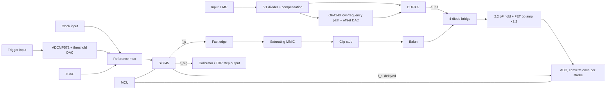

# Sampling oscilloscope front end derived from the yanartas-sensors sampler

A proposal, written by an LLM (Claude). It reuses the diode-bridge sampler of the
yanartas-sensors sensing board and replaces what the first study showed to limit it.
Nothing here has been built. Part data marked *unverified* could not be read from a
manufacturer datasheet.

## Summary

| Block | Proposal |
|---|---|
| Input | 1 MΩ, 10:1 divider into a BUF802 in composite-loop mode with an OPA140, after the [jmw active probe](https://jmw.name/projects/active-probe/) |
| Sampler | Same four-diode BAT15-04W bridge, driven from the buffer through 10 Ω, fixed reverse bias, 2.2 pF hold capacitor, gain made up by an op amp after the hold node |
| Strobe | A limited edge (35 ps comparator or CML gate), amplified to about 3 V by a saturating MMIC, clipped to a 100–160 ps pulse, then a balun |
| Timebase | One Si5345: strobe and signal clock from two fractional dividers of the same PLL, offset by the beat frequency |
| Trigger | Synchronous clock input and comparator trigger input (ADCMP572) share one path into the PLL reference; a time-to-digital converter is an optional third mode |
| Expected speed | About 2 GHz, 175 ps rise time, set by the BUF802; the simulated sampler alone is 73 ps |

The strobe driver is the main open risk: no part was confirmed to deliver 3 V with an
edge under 80 ps at low repetition rates.

A concept schematic of this proposal is in [`schematic/scope-frontend.kicad_sch`](../schematic/scope-frontend.kicad_sch)
([PDF](../schematic/scope-frontend.pdf)), generated by `schematic/gen_scope_frontend.py`.
Its input stage reuses the circuit of the jmw active probe, which is licensed CERN-OHL-S v2.

## What the first study changes

| Finding on the yanartas board | Consequence here |
|---|---|
| The sampler is as fast as the edge that reaches the clip line; a linear redriver does not sharpen it | The strobe comes from a limiting stage with a fast edge |
| A 0.2–0.75 V strobe cannot turn the bridge on against a real reverse bias | The strobe is about 3 V, so the bridge sits at 2 V reverse bias |
| The signal at the bridge was larger than the bias | The buffer's clamp pins limit the signal to less than the bias |
| 91 Ω feeds with 6 mm of trace behind them | Series resistors at the diodes, 25 Ω each |
| The hold node had 31 mm of trace to its amplifier | Hold capacitor and amplifier next to the bridge |
| Held voltage is a fraction of the input | Accepted and corrected by the gain stage and a DC calibration, as you suggested |

## Input stage

The reference design is taken over with two changes.

- **Topology.** 1.6 MΩ / 422 kΩ divider (5:1) with 0.6 pF compensation built from fixed
  capacitors. The low-frequency path goes through an OPA140 into the BUF802 auxiliary
  input, 5.6 kΩ + 100 pF between them, and a trimmer in the feedback network to match
  the two paths.
- **Parasitics.** High-value 0402 resistors carry 50–100 fF each, which peaked the
  reference design between 10 kHz and 10 MHz. Split them into series strings, including
  the 10 MΩ bias resistor.
- **Change 1: output.** The BUF802 drives the bridge through 10 Ω instead of a doubly
  terminated 50 Ω line. Its output impedance is 1.2 Ω at 100 MHz. In simulation this
  raises the sampler gain from 0.30 to 0.46 and cuts the settling tail from 30 % to
  12 %. It also absorbs the kick-out (29 mV peak-to-peak at the bridge), which never
  reaches the input connector.
- **Change 2: offset.** A DAC sums into the OPA140 path for vertical position.
- **Clamps.** CLH and CLL are set so the bridge input stays within ±0.5 V, inside the
  ±1 V bias.
- **Limits.** BUF802: 3.1 GHz at 1 Vpp and 1.6 GHz at 2 Vpp, 0.16 ns rise time for a
  1.2 V step, 2.3 nV/√Hz, ±4.5 to ±6.5 V supplies, 34 mA. The reference reached just
  over 2 GHz at 10:1 with 1.1 pF input capacitance on FR-408HR.

A direct 50 Ω input without the buffer would be faster (the sampler alone is 73 ps) but
puts the kick-out on the device under test and loses the 1 MΩ input.

## Sampler

Simulated with `sim/scope_sampler.py`; results in `results/scope-sampler.json`.
Strobe 3 V step with a 40 ps edge, 100 ps pulse, bias 2 V, 25 Ω per rail, 2.2 pF hold
unless stated.

| Variant | 10–90 % | Gain | Efficiency per strobe | Tail after 1 ns |
|---|---|---|---|---|
| Fixed bias, 50 Ω source | 78 ps | 0.30 | 63 % | about 30 % |
| **Fixed bias, 10 Ω source (proposed)** | 73 ps | 0.46 | 72 % | about 12 % |
| Same, 0.15 pF instead of 0.3 pF per rail to ground | 76 ps | 0.53 | 67 % | about 10 % |
| Bias bootstrapped from the hold buffer, 10 Ω source | 75 ps | 1.07 | 33 % | about 11 % |

Sensitivities, simulated on the bootstrapped variant only:

| Change | Effect |
|---|---|
| Strobe edge 80 ps instead of 40 ps | efficiency falls from 33 % to 12 %, 47 % overshoot |
| Strobe edge 150 ps | the bridge no longer turns on |
| Pulse 160 ps instead of 100 ps | efficiency 66 %, overshoot 2 %, rise time 79 ps |
| Step 2 V with bias 1.2 V | 72 ps, efficiency 26 % |
| Hold 10 pF / 1 pF | efficiency 10 % / 46 %, rise time unchanged |

Design points:

- **Gain stage.** A FET-input op amp at the hold node with a gain of about 2.2. The
  sampler gain depends on diode resistance during the strobe, so it moves with strobe
  amplitude and temperature. A switchable DC reference at the input calibrates gain and
  offset.
- **Offset.** Strobe imbalance leaves tens of millivolts on the hold node. Keep the two
  bias rails separately adjustable, as on the yanartas board.
- **Tail.** The held value sags by about 12 % over the nanosecond after an edge, because
  the rails' common-mode voltage follows the signal and then relaxes through the bias
  resistors. It is linear and can be removed in software if layout does not cure it.
- **Pulse width.** 160 ps is the better starting point: nearly the same speed, twice the
  efficiency and almost no overshoot.
- **Balun.** I did not establish that it is needed. A ground-referenced complementary
  drive also worked in the bootstrapped simulation. A differential driver without a
  balun is worth a test coupon.
- **Droop.** BAT15 reverse current is up to 5 µA at 1 V; on 2.2 pF that is up to
  2 V/µs for a mismatch of that size. The ADC must convert a fixed, short time after
  each strobe. At strobe rates below about 1 MHz a larger hold capacitor is needed.
  This estimate is from the datasheet maximum, not simulated.

## Strobe driver

Required: about 3 V into 50 Ω, edge 40–80 ps, from 10 kHz to 25 MHz repetition.

| Option | Data | Assessment |
|---|---|---|
| ADCMP572 or NB7L86M edge, then GVA-84+ driven into saturation | Edge 35 ps / 30 ps at 0.4 V. GVA-84+: DC–7 GHz, P1dB +20 dBm, gain 24 dB at 0.1 GHz and 12.5 dB at 6 GHz, 5 V 108 mA | Recommended first try. +20 dBm is 6.3 Vpp, so about 3 V of step. The output edge is not known; build a coupon |
| HMC870LC5 modulator driver | 2.5–8 Vpp, 20 ps (20–80 %), from a mirrored datasheet | Fast enough; low-frequency behaviour and availability unverified |
| ONET1151M | 1.5 Vpp, 26 ps, rated 1–11.35 Gbps, AC-coupled | Too small, and not rated for low rates |
| MAX3941 / MAX3942 | 3 Vpp / 6 Vpp | Obsolete |
| Fast CMOS logic | no edge data published | Not a basis for a design |

The step is clipped by a shorted stub after the amplifier, so the amplifier's coupling
capacitors only have to pass the edge. Balun candidates: TCM1-83X+ (10 MHz–8 GHz,
1.3 dB) or Marki BAL-0006SMG (0.5 MHz–6 GHz, 30 dB common-mode rejection).

## Timebase: two outputs of one PLL at a beat frequency

The strobe runs at f_s, slightly below the signal repetition rate f_sig. Each strobe
lands Δt later on the waveform:

- Δt = 1/f_s − 1/f_sig ≈ Δf / f_s², with Δf = f_sig − f_s
- one trace takes 1/Δf and holds f_s/Δf points
- the held voltage is the waveform slowed by f_s/Δf, so 3 GHz appears at 3 GHz · Δf/f_s

| f_s | Δf | Step | Points per period | Trace time | Bandwidth after the sampler |
|---|---|---|---|---|---|
| 10 MHz | 100 Hz | 1 ps | 100 000 | 10 ms | 30 kHz |
| 10 MHz | 1 kHz | 10 ps | 10 000 | 1 ms | 300 kHz |
| 1 MHz | 10 Hz | 10 ps | 100 000 | 100 ms | 30 kHz |

- **Efficiency is harmless in this mode.** The hold node averages about 1/efficiency
  strobes. Keep the step below about a third of rise time × efficiency: under 15 ps
  here.
- **ADC.** One conversion per strobe, clocked from a third PLL output at f_s with a
  fixed delay. The data is then low-pass filtered and decimated; the table shows how
  little bandwidth is left.
- **Part.** Si5345: each output has its own fractional divider, so two outputs at an
  arbitrary small ratio come from one VCO. Outputs 100 Hz–1028 MHz, jitter 120 fs in
  fractional mode, loop bandwidth 0.1 Hz–4 kHz. Divider word lengths were not checked,
  so the exact Δf grid is open.
- **Time zero.** A flip-flop that samples the signal clock with the strobe clock gives
  one edge per trace. With exact divider ratios a counter does the same.
- **Not recommended.** Si5351: 40–70 ps peak-to-peak period jitter against a 73 ps
  sampler. Two LMX2571/2572 would work but need two chips and I found no jitter figure.

A second output at f_sig drives a calibrator or a TDR step, which is the yanartas use
case with the FPGA removed.

## Trigger architectures

| | How | Works for | Limits |
|---|---|---|---|
| A. Internal | PLL on its TCXO, f_sig output drives the device | TDR, calibration | Only signals the instrument generates |
| B. Synchronous clock input | User clock is the PLL reference; strobe = clock × ratio − Δf | Clocked systems, 8 kHz–750 MHz | Needs a clock. Loop is at most 4 kHz wide, so faster clock jitter shows on the trace |
| C. Trigger input with phase recovery | ADCMP572 with threshold DAC and hysteresis squares the signal; its output is the PLL reference | Any periodic signal | Not data or bursts: the PLL wants 40–60 % duty, or pulses over 1.6 ns, and tolerates only 2 missing cycles in 8 above 10 MHz. The MCU must count the frequency first. Lock takes seconds at narrow bandwidth |
| D. Free-running strobe with time measurement | Strobe on the TCXO; a TDC measures trigger-to-strobe time for every sample | Repetitive but not periodic signals, and it shows time before the trigger | TDC-GPX2 or AS6501: 10–20 ps rms. TDC7200: 35–50 ps, marginal. Samples arrive in random order, so the hold-node memory must be undone with the calibrated efficiency |
| E. Triggered delay line | Trigger starts a programmable delay (SY89297U: 5 ps steps, 5 ns range) | Low repetition rates | 5 ns window, nothing before the trigger, 2 ps rms plus comparator dispersion |

Recommendation: build B and C. They are the same hardware, a comparator and a mux in
front of the PLL reference, and C degrades to B when the user has a clock. Leave a
footprint for D. Skip E.

ADCMP572 for the trigger path: 150 ps delay, 35 ps edges, 8 GHz equivalent input
bandwidth, 0.2 ps rms random jitter, 15 ps overdrive dispersion, input range −0.2 to
+1.2 V on 3.3 V. These are from a mirrored Rev. 0 datasheet. The input needs an
attenuator or clamp to stay in that range. The trigger source is an SMA; an internal
pick-off after the BUF802 through about 450 Ω is an option.

## Open items, in the order I would resolve them

1. Strobe driver coupon: comparator edge, GVA-84+, clip stub. Measure edge and amplitude.
2. Bridge coupon with that strobe, with and without a balun. Measure gain, offset, tail.
3. BUF802 stage driving the bridge through 10 Ω: stability and flatness with that load.
4. Hold-node droop against strobe rate with real diodes; choose the hold capacitor.
5. Si5345 divider resolution and the lock behaviour on a comparator output.

## Model limits

The sampler simulation uses ideal sources for the strobe and the buffer, a
common-mode choke as the balun, lossless traces, and the BAT15 chip model with
estimated package parasitics. The 12 % tail and the offsets depend on parasitics that
are guesses. The figures show that the approach works and what it is sensitive to; they
are not predictions of a built board.

## Cost-down

Schematic of this variant: [`schematic/scope-frontend-lowcost.kicad_sch`](../schematic/scope-frontend-lowcost.kicad_sch)
([PDF](../schematic/scope-frontend-lowcost.pdf)).

Prices are single-unit distributor prices in USD from search snapshots (November 2026),
good to about ±15 %. Only the parts that differ are counted; passives, PCB, connectors,
MCU, ADC and DACs are left out.

| Function | Baseline | Price | Low-cost | Price |
|---|---|---|---|---|
| Timebase | Si5344 | about 30 | Si5351C | 5.01 |
| Strobe edge | ADCMP572 + GVA-84+ | 26.81 + 3.10 | 2 × GVA-84+ driven from the PLL output | 6.20 |
| Balun | TCM1-83X+ | 8.70 | USB 3 common-mode choke (DLW21S type) | 0.29 |
| Trigger comparator | ADCMP572 | 26.81 | TLV3601 | 4.54 |
| Hold amplifier | OPA656 | 14.45 | OPA810 | 3.29 |
| Low-frequency amplifier | OPA140 | 4.29 | OPA197 | 0.82 |
| Trigger clamp | BAT15-04W | 0.74 | BAT54S | 0.02 |
| Split-rail supply | LTC3261 + TPS7A39 | 13.40 | TPS60403 with LC filters | 1.04 |
| Unchanged | BUF802, 2 × BAT15-04W | 8.25 | same | 8.25 |
| **Total of these parts** | | **about 137** | | **about 29** |

Also removed: the 1.8 V rail, the separate clock connector and the calibrator connector
(left as an option).

### What the saving costs

| Change | Consequence |
|---|---|
| Si5351C instead of Si5344 | Locks only to 10–100 MHz references; no lock below 10 MHz. It follows reference jitter instead of cleaning it. Period jitter is 40 ps typical and 95 ps maximum peak-to-peak, which adds little to a 175 ps system |
| No comparator in the strobe path | The PLL output has about 1 ns edges. Two saturating amplifier stages have to sharpen it to about 120 ps. This is the least certain part of the variant |
| Lower strobe amplitude and slower edge | Simulated with a 2 V step: 68–81 ps, gain 0.42–0.66. With a 120 ps edge, a 160 ps pulse and 1.6 V bias: 71 ps, gain 0.68, 90 % per strobe |
| Common-mode choke as balun | Simulated with 150 nH and 1 nH leakage: 46 ps, but overshoot rises from 12 % to 26 %. The real part's differential bandwidth is not in its listing |
| TLV3601 trigger comparator | 2.5 ns delay and CMOS output instead of 150 ps and CML. Adequate for a 10–100 MHz PLL reference; its jitter was not checked |
| OPA810 hold amplifier | About 30 MHz at a gain of 2.2 instead of several hundred. Settles within a 10 MHz strobe period, with little margin |
| OPA197 in the low-frequency path | Similar bandwidth to the OPA140 (10 MHz against 11 MHz). The crossover flatness must be re-trimmed; not simulated |
| Charge pump without the low-noise regulator | More supply ripple at the buffer. The reference design estimated 5 mV of ripple on its pump before the regulator |

Simulated with everything combined (choke, 2 V step, 80 ps edge, 160 ps pulse, 10 pF
hold): 68 ps, 27 % overshoot, gain 0.71, 23 % per strobe. The system stays at about
175 ps because the BUF802 sets it.

### Further steps, not drawn

- **No external trigger at all** (an instrument that only measures its own stimulus,
  as on the yanartas board): drop the TLV3601 and use an Si5351A at 2.11, or the
  MS5351M clone at about 1. Saves about 7 more.
- **50 Ω input only**: drop the BUF802 and the OPA197, saving 7.60. The sampler alone is
  faster than the buffer, but its kick-out (tens of millivolts) reaches the device
  under test and the 1 MΩ input is lost.
- **Not worth changing**: the BAT15-04W diodes and the GVA-84+. Cheaper gain blocks
  found were obsolete or thinly stocked.

## FPGA options (GW1NZ-1)

Two questions: can the FPGA's input delay primitives recover the trigger phase, and can
the FPGA replace the clock generator. Figures are from Gowin DS841-2.8E, UG286 and UG289.

| Resource | GW1NZ-1, LV, C6/I5 | Consequence |
|---|---|---|
| IODELAY | every I/O; 30 ps typical per step, no minimum or maximum given; 128 steps; 450–550 ps offset; static or dynamic, input or output but not both on one pin | 3.8 ns range per pin; the step has to be calibrated |
| Serialisers | IDES10 / OSER10 up to 1100 Mbps | 0.9–1 ns coarse bins in and out |
| PLL | one rPLL; input 3–400 MHz, VCO 400–800 MHz; IDIV and FBDIV 1–64, ODIV even values to 128, all integer; phase in 22.5° steps, fine delay 0.125 ns steps | No small frequency offset between two outputs |
| PLL jitter | not specified. The on-chip oscillator is 0.012 UI peak-to-peak typical | Unknown; must be measured |
| I/O standards | no LVDS input, no true LVDS output | Comparator and strobe path must be CMOS |

### Trigger phase recovery with IODELAY

This is workable as a time-to-digital converter, and it gives the "free-running strobe
with time measurement" mode (D in the trigger table) without a TDC chip.

- **Circuit.** The trigger comparator output is fanned out to N input pins. Each pin has
  a different static IODELAY code and feeds an IDES10 at 1 Gbps. The N pins form a
  thermometer code that divides each 1 ns bin into N parts. A single pin is useless for
  this: it gives one bit per event.
- **Precision** (`sim/fpga_tdc.py`, Monte Carlo with a ±20 % unknown step, 40 ps rms
  pin skew and 10 ps rms jitter, all three my assumptions):

  | Pins | Nominal bin | rms error, uncalibrated | rms error, calibrated | Scope rise time |
  |---|---|---|---|---|
  | 4 | 250 ps | 95 ps | 78 ps | 265 ps |
  | 8 | 125 ps | 64 ps | 48 ps | 215 ps |
  | 16 | 62 ps | 48 ps | 31 ps | 192 ps |
  | 24 | 42 ps | 40 ps | 24 ps | 186 ps |

  For comparison: a TDC7200 (35 ps rms) gives 197 ps, the Si5351C beat mode about
  177 ps, both on the 175 ps set by the BUF802.
- **Calibration** is a code-density test: triggers that are asynchronous to the FPGA
  clock land in each bin in proportion to its width. It runs continuously on the
  measurement data, so drift of the delay step with temperature is tracked. Re-tuning the
  codes afterwards for even bins would improve on the table; I did not simulate that.
- **PLL jitter mostly cancels.** The strobe and the TDC sampling clock come from the
  same clock, so only the jitter accumulated between trigger and strobe counts.
- **Costs.** 16 pins of the 48-pin package, a fan-out that does not slow the comparator
  edge (5 pF per pin), and the hold-node memory has to be undone because samples arrive
  in random time order.
- **Not evaluated:** a carry-chain TDC in the logic fabric, which would need one pin.

### FPGA instead of the clock generator

Yes for the low-cost variant, but as a different timebase, not as a drop-in.

- **The beat-frequency scheme is not possible.** One PLL with integer dividers cannot
  make two outputs a few parts per million apart.
- **What it does instead.** Either delay stepping (strobe placed by OSER10 in 1 ns steps
  plus IODELAY in 30 ps steps), as the yanartas board does, or a free-running strobe
  with the TDC above.
- **30 ps steps are enough.** That is about six points on a 175 ps edge.

| | Si5344 (baseline) | Si5351C (low cost) | GW1NZ-1 |
|---|---|---|---|
| Own stimulus (TDR, calibrator) | beat, 1 ps steps | beat, 1 ps steps | delay stepping, 30 ps steps; PLL jitter is common to both edges |
| External periodic signal | locks 8 kHz–750 MHz, cleans jitter | locks 10–100 MHz, follows jitter | free-running with TDC: any rate; or PLL lock from 3 MHz with unknown jitter |
| Non-periodic repetitive signal | no | no | yes, with the TDC |
| Timing error, rms | 0.1 ps class | about 10 ps (estimate) | 31 ps with 16 pins (simulated, assumptions above) |
| Time axis accuracy | exact divider ratios | exact divider ratios | calibrated delay steps; needs self-calibration |
| Strobe output | differential, needs a limiter | CMOS, about 1 ns edge | CMOS; edge rate not published |
| Extra needs | 1.8 V rail | none | 1.2 V core rail, an external crystal oscillator, configuration |

Recommendation: for the low-cost variant, replace the Si5351C with the GW1NZ-1 and use
the free-running strobe with a 16-pin TDC for external signals and delay stepping for
the instrument's own stimulus. It removes the 10–100 MHz trigger limit and handles
non-periodic triggers, for about 15 ps more rise time than the Si5351C. Keep the Si5344
where the 1 ps time axis and jitter cleaning matter. I have no price for the GW1NZ-1.

Open before committing to it: the FPGA's output edge rate and PLL jitter are both
unpublished, and the IODELAY step has no tolerance. All three can be measured with the
scope's own sampler on a first board.

## Triggering on a serial data stream (clock recovery)

For eye diagrams the strobe has to be timed against the bit clock of the data, which the
signal itself does not carry as a periodic edge. With about 2 GHz of bandwidth the scope
can show NRZ data up to roughly 2.5–3 Gbps, so the clock recovery has to cover about
100 Mbps to 3 Gbps. Part data and prices are from datasheets and DigiKey (November 2026)
unless marked.

| Option | Rates | Spread spectrum (0.5 %, 30–33 kHz) | Added parts, single-unit price | Verdict |
|---|---|---|---|---|
| A. Clock from the device under test into the clock input | whatever the timebase accepts | Si5344: its loop is at most 4 kHz wide, so it does not follow; the eye smears. Si5351C and FPGA PLL follow | none | Use whenever a clock exists (HDMI, source-synchronous LVDS, MIPI) and the link has no spread spectrum |
| B. Recovery IC, ADN2817 | 10 Mbps–2.7 Gbps, no reference needed, full-rate CML clock out | not verified; loss of lock is flagged at 1000 ppm | discontinued at DigiKey; ADN2812 about 91 at 1000 pieces (unverified); ADN2814 (to 675 Mbps only) 40.86 | Best fit on paper, but expensive and hard to buy. Loop bandwidth fixed by the chip |
| B2. SY87701AL | 28 Mbps–1.3 Gbps in eight bands | no: data must be within about 1000 ppm of its reference | 54.89, plus a reference near the data rate | No |
| C. FPGA with transceivers, ECP5UM | 270 Mbps–3.2 Gbps | lock window selectable up to ±4000/±7000 ppm; tracking not verified | 34.93, BGA, plus a reference within about 1000 ppm of the rate | Works for known standard rates; a second FPGA and a synthesiser for one function |
| D. Software recovery from time-stamped edges | up to the limiting buffer, 3.125 Gbps | yes, 8.7 ps rms in simulation | about 15–18 | Recommended with the FPGA timebase |
| E. Trigger on the data edges, no clock model | any | n/a | none | Fallback only: the eye is drawn relative to a neighbouring edge, which hides jitter |

### Option D in detail

It extends the free-running strobe with the FPGA input-delay converter.

- **Front end.** Tap the signal after the BUF802. A limiting buffer squares it
  (DS25BR100, DC to 3.125 Gbps, 7.58). A static divider counts rising edges
  (SY100EP33V, ÷4, 4 GHz, 2.98; two in series for ÷16). A translator brings the divided
  edges to CMOS (SN65EPT21, 300 MHz, 4.87) for the 1:4 buffer and the 16 FPGA pins.
- **Why divide.** Every divided edge still coincides with a data edge, so it sits on the
  bit grid, but the edge rate drops to what the converter handles: about 20 MHz on
  average at 1.25 Gbps with ÷16.
- **Recovery.** The FPGA time-stamps every divided edge against its own clock. Software
  fits bit index against time and gives each sample its position in the unit interval.
  The strobe times are exact in the same clock domain.
- **Precision** (`sim/sw_cdr.py`: 1.25 Gbps, ÷16, 31 ps rms per time stamp, 3 ps source
  jitter):

  | Clock recovery | No spread spectrum | 5000 ppm at 33 kHz |
  |---|---|---|
  | Fit over 33 edges (1.7 µs), edges before and after the sample | 8.7 ps rms | 8.7 ps rms |
  | Causal loop, natural frequency 1 MHz | 22 ps rms | 24 ps rms |
  | Causal loop, 300 kHz | 11 ps rms | 91 ps rms |
  | Causal loop, 100 kHz and below | 4–7 ps rms | loses lock |

  Averaging over many edges makes the recovered clock better than a single time stamp.
  Fitting after acquisition tracks spread spectrum without the lag of a real-time loop.
- **Loop bandwidth is a software parameter**, so the bandwidth a standard prescribes for
  jitter measurement can be emulated. SATA, for example, uses the bit rate divided by
  1667 or by 500.
- **Open points.** The dividers are static, but operation with irregular edges down to
  DC is my inference, not a datasheet statement. LVDS into the PECL divider input needs
  a bias network. The time stamps include the data-dependent jitter of the edges used.
  The hold-node memory has to be undone, as in every free-running mode.

### With the Si5344 baseline

The beat-frequency timebase needs a hardware clock, so only A, B or C apply, and the
Si5344 then filters whatever it is given at 4 kHz or less. That shows total jitter
including wander and smears links with spread spectrum. If eye diagrams of such links
matter, the FPGA timebase with option D is the better architecture.

### One IC for the divider chain

Assuming a fast comparator already follows the BUF802, the limiting buffer goes away and
the question is whether one IC can replace the two dividers, the translator and the 1:4
buffer. Constraint from the FPGA: the GW1NZ-1 has only plain CMOS input standards (no
referenced and no differential inputs), so LVDS, CML or PECL swings cannot be made
reliable for it with resistors alone. The IC has to have CMOS outputs.

| Part | Input | Ratios | Outputs | Price, stock (DigiKey) | Fit |
|---|---|---|---|---|---|
| **AD9508** | 0–1650 MHz, minimum pulse 303 ps; common mode 0.58–1.67 V | 1–1024 by SPI or I²C; 1, 2, 3, 4, 5, 6, 8, 16 by pin strap | 4 × LVDS/HSTL or **8 × 1.8 V CMOS**, 250 MHz, 1.18 ns edge typ at 10 pF | 15.83, 3746 | Best: divider, bypass and fan-out in one |
| AD9513 | 0–1.6 GHz; common mode 1.3–1.8 V, "should be ac-coupled" | 1–32, 4-level strap pins | 3 × 3.3 V CMOS, 650 ps edge typ at 3 pF | 19.36, 396 | Only one with 3.3 V CMOS; awkward to reconfigure, still needs fan-out |
| CDCM1804 | 0–800 MHz | 1, 2, 4, 8, 16 by pins | 3 × LVPECL + 1 × 3.3 V CMOS | 19.17 | Limits data to 1.6 Gbps |
| SY89874U / SY89873L | 3.2 GHz, any logic family DC-coupled | 1, 2, 4, 8, 16 by pins | LVPECL / LVDS only | 10.40 / 9.35 | Fastest, but needs a translator, so not one IC |
| CDCE18005 | 1500 MHz | 1–80 by SPI | 5 × 3.3 V CMOS among others | 21.88, 630 | 1.3–1.6 W; no margin |

Recommendation: AD9508, with the 16 FPGA time-stamp pins in a bank at 1.8 V.

- **It replaces four parts.** Its eight CMOS outputs drive two FPGA pins each, so the
  1:4 buffer is not needed either. The chain it replaces costs about 11.40; the AD9508
  is 15.83.
- **Trigger mode comes for free.** Ratio 1 passes the comparator edges through, and the
  ratio is set over the bus that is there anyway.
- **Comparator.** Its input window (0.58–1.67 V common mode) takes LVDS or 2.5 V LVPECL
  DC-coupled. 3.3 V CML or LVPECL, which is what the ADCMP572 delivers, is listed as not
  allowed. So this choice goes with an LVDS-output comparator, or a resistive divider on
  both legs of a CML output, which costs half the swing and was not checked against the
  AD9508's input sensitivity.
- **Speed.** A 303 ps minimum pulse is a 3.3 Gbps limit, about as far as the scope's
  bandwidth goes, with no margin.
- **To verify.** The datasheet says the divider "contains duty cycle correction that
  guarantees 50 %" without saying how. Whether that behaves with irregular edges is
  unknown; input is specified from 0 Hz. Datasheet read from a mirror (Rev. G).
