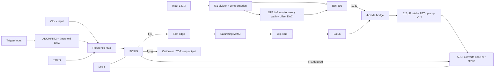

# Sampling oscilloscope front end derived from the yanartas-sensors sampler

A proposal, written by an LLM (Claude). It reuses the diode-bridge sampler of the
yanartas-sensors sensing board and replaces what the first study showed to limit it.
Nothing here has been built. Part data marked *unverified* could not be read from a
manufacturer datasheet.

## Summary

| Block | Proposal |
|---|---|
| Input | 1 MΩ, 10:1 divider into a BUF802 in composite-loop mode with an OPA140, after the [jmw active probe](https://jmw.name/projects/active-probe/) |
| Sampler | Same four-diode BAT15-04W bridge, driven from the buffer through 10 Ω, fixed reverse bias, 2.2 pF hold capacitor, gain made up by an op amp after the hold node |
| Strobe | A limited edge (35 ps comparator or CML gate), amplified to about 3 V by a saturating MMIC, clipped to a 100–160 ps pulse, then a balun |
| Timebase | One Si5345: strobe and signal clock from two fractional dividers of the same PLL, offset by the beat frequency |
| Trigger | Synchronous clock input and comparator trigger input (ADCMP572) share one path into the PLL reference; a time-to-digital converter is an optional third mode |
| Expected speed | About 2 GHz, 175 ps rise time, set by the BUF802; the simulated sampler alone is 73 ps |

The strobe driver is the main open risk: no part was confirmed to deliver 3 V with an
edge under 80 ps at low repetition rates.

A concept schematic of this proposal is in [`schematic/scope-frontend.kicad_sch`](../schematic/scope-frontend.kicad_sch)
([PDF](../schematic/scope-frontend.pdf)), generated by `schematic/gen_scope_frontend.py`.
Its input stage reuses the circuit of the jmw active probe, which is licensed CERN-OHL-S v2.

## What the first study changes

| Finding on the yanartas board | Consequence here |
|---|---|
| The sampler is as fast as the edge that reaches the clip line; a linear redriver does not sharpen it | The strobe comes from a limiting stage with a fast edge |
| A 0.2–0.75 V strobe cannot turn the bridge on against a real reverse bias | The strobe is about 3 V, so the bridge sits at 2 V reverse bias |
| The signal at the bridge was larger than the bias | The buffer's clamp pins limit the signal to less than the bias |
| 91 Ω feeds with 6 mm of trace behind them | Series resistors at the diodes, 25 Ω each |
| The hold node had 31 mm of trace to its amplifier | Hold capacitor and amplifier next to the bridge |
| Held voltage is a fraction of the input | Accepted and corrected by the gain stage and a DC calibration, as you suggested |

## Input stage

The reference design is taken over with two changes.

- **Topology.** 1.6 MΩ / 422 kΩ divider (5:1) with 0.6 pF compensation built from fixed
  capacitors. The low-frequency path goes through an OPA140 into the BUF802 auxiliary
  input, 5.6 kΩ + 100 pF between them, and a trimmer in the feedback network to match
  the two paths.
- **Parasitics.** High-value 0402 resistors carry 50–100 fF each, which peaked the
  reference design between 10 kHz and 10 MHz. Split them into series strings, including
  the 10 MΩ bias resistor.
- **Change 1: output.** The BUF802 drives the bridge through 10 Ω instead of a doubly
  terminated 50 Ω line. Its output impedance is 1.2 Ω at 100 MHz. In simulation this
  raises the sampler gain from 0.30 to 0.46 and cuts the settling tail from 30 % to
  12 %. It also absorbs the kick-out (29 mV peak-to-peak at the bridge), which never
  reaches the input connector.
- **Change 2: offset.** A DAC sums into the OPA140 path for vertical position.
- **Clamps.** CLH and CLL are set so the bridge input stays within ±0.5 V, inside the
  ±1 V bias.
- **Limits.** BUF802: 3.1 GHz at 1 Vpp and 1.6 GHz at 2 Vpp, 0.16 ns rise time for a
  1.2 V step, 2.3 nV/√Hz, ±4.5 to ±6.5 V supplies, 34 mA. The reference reached just
  over 2 GHz at 10:1 with 1.1 pF input capacitance on FR-408HR.

A direct 50 Ω input without the buffer would be faster (the sampler alone is 73 ps) but
puts the kick-out on the device under test and loses the 1 MΩ input.

## Sampler

Simulated with `sim/scope_sampler.py`; results in `results/scope-sampler.json`.
Strobe 3 V step with a 40 ps edge, 100 ps pulse, bias 2 V, 25 Ω per rail, 2.2 pF hold
unless stated.

| Variant | 10–90 % | Gain | Efficiency per strobe | Tail after 1 ns |
|---|---|---|---|---|
| Fixed bias, 50 Ω source | 78 ps | 0.30 | 63 % | about 30 % |
| **Fixed bias, 10 Ω source (proposed)** | 73 ps | 0.46 | 72 % | about 12 % |
| Same, 0.15 pF instead of 0.3 pF per rail to ground | 76 ps | 0.53 | 67 % | about 10 % |
| Bias bootstrapped from the hold buffer, 10 Ω source | 75 ps | 1.07 | 33 % | about 11 % |

Sensitivities, simulated on the bootstrapped variant only:

| Change | Effect |
|---|---|
| Strobe edge 80 ps instead of 40 ps | efficiency falls from 33 % to 12 %, 47 % overshoot |
| Strobe edge 150 ps | the bridge no longer turns on |
| Pulse 160 ps instead of 100 ps | efficiency 66 %, overshoot 2 %, rise time 79 ps |
| Step 2 V with bias 1.2 V | 72 ps, efficiency 26 % |
| Hold 10 pF / 1 pF | efficiency 10 % / 46 %, rise time unchanged |

Design points:

- **Gain stage.** A FET-input op amp at the hold node with a gain of about 2.2. The
  sampler gain depends on diode resistance during the strobe, so it moves with strobe
  amplitude and temperature. A switchable DC reference at the input calibrates gain and
  offset.
- **Offset.** Strobe imbalance leaves tens of millivolts on the hold node. Keep the two
  bias rails separately adjustable, as on the yanartas board.
- **Tail.** The held value sags by about 12 % over the nanosecond after an edge, because
  the rails' common-mode voltage follows the signal and then relaxes through the bias
  resistors. It is linear and can be removed in software if layout does not cure it.
- **Pulse width.** 160 ps is the better starting point: nearly the same speed, twice the
  efficiency and almost no overshoot.
- **Balun.** I did not establish that it is needed. A ground-referenced complementary
  drive also worked in the bootstrapped simulation. A differential driver without a
  balun is worth a test coupon.
- **Droop.** BAT15 reverse current is up to 5 µA at 1 V; on 2.2 pF that is up to
  2 V/µs for a mismatch of that size. The ADC must convert a fixed, short time after
  each strobe. At strobe rates below about 1 MHz a larger hold capacitor is needed.
  This estimate is from the datasheet maximum, not simulated.

## Strobe driver

Required: about 3 V into 50 Ω, edge 40–80 ps, from 10 kHz to 25 MHz repetition.

| Option | Data | Assessment |
|---|---|---|
| ADCMP572 or NB7L86M edge, then GVA-84+ driven into saturation | Edge 35 ps / 30 ps at 0.4 V. GVA-84+: DC–7 GHz, P1dB +20 dBm, gain 24 dB at 0.1 GHz and 12.5 dB at 6 GHz, 5 V 108 mA | Recommended first try. +20 dBm is 6.3 Vpp, so about 3 V of step. The output edge is not known; build a coupon |
| HMC870LC5 modulator driver | 2.5–8 Vpp, 20 ps (20–80 %), from a mirrored datasheet | Fast enough; low-frequency behaviour and availability unverified |
| ONET1151M | 1.5 Vpp, 26 ps, rated 1–11.35 Gbps, AC-coupled | Too small, and not rated for low rates |
| MAX3941 / MAX3942 | 3 Vpp / 6 Vpp | Obsolete |
| Fast CMOS logic | no edge data published | Not a basis for a design |

The step is clipped by a shorted stub after the amplifier, so the amplifier's coupling
capacitors only have to pass the edge. Balun candidates: TCM1-83X+ (10 MHz–8 GHz,
1.3 dB) or Marki BAL-0006SMG (0.5 MHz–6 GHz, 30 dB common-mode rejection).

## Timebase: two outputs of one PLL at a beat frequency

The strobe runs at f_s, slightly below the signal repetition rate f_sig. Each strobe
lands Δt later on the waveform:

- Δt = 1/f_s − 1/f_sig ≈ Δf / f_s², with Δf = f_sig − f_s
- one trace takes 1/Δf and holds f_s/Δf points
- the held voltage is the waveform slowed by f_s/Δf, so 3 GHz appears at 3 GHz · Δf/f_s

| f_s | Δf | Step | Points per period | Trace time | Bandwidth after the sampler |
|---|---|---|---|---|---|
| 10 MHz | 100 Hz | 1 ps | 100 000 | 10 ms | 30 kHz |
| 10 MHz | 1 kHz | 10 ps | 10 000 | 1 ms | 300 kHz |
| 1 MHz | 10 Hz | 10 ps | 100 000 | 100 ms | 30 kHz |

- **Efficiency is harmless in this mode.** The hold node averages about 1/efficiency
  strobes. Keep the step below about a third of rise time × efficiency: under 15 ps
  here.
- **ADC.** One conversion per strobe, clocked from a third PLL output at f_s with a
  fixed delay. The data is then low-pass filtered and decimated; the table shows how
  little bandwidth is left.
- **Part.** Si5345: each output has its own fractional divider, so two outputs at an
  arbitrary small ratio come from one VCO. Outputs 100 Hz–1028 MHz, jitter 120 fs in
  fractional mode, loop bandwidth 0.1 Hz–4 kHz. Divider word lengths were not checked,
  so the exact Δf grid is open.
- **Time zero.** A flip-flop that samples the signal clock with the strobe clock gives
  one edge per trace. With exact divider ratios a counter does the same.
- **Not recommended.** Si5351: 40–70 ps peak-to-peak period jitter against a 73 ps
  sampler. Two LMX2571/2572 would work but need two chips and I found no jitter figure.

A second output at f_sig drives a calibrator or a TDR step, which is the yanartas use
case with the FPGA removed.

## Trigger architectures

| | How | Works for | Limits |
|---|---|---|---|
| A. Internal | PLL on its TCXO, f_sig output drives the device | TDR, calibration | Only signals the instrument generates |
| B. Synchronous clock input | User clock is the PLL reference; strobe = clock × ratio − Δf | Clocked systems, 8 kHz–750 MHz | Needs a clock. Loop is at most 4 kHz wide, so faster clock jitter shows on the trace |
| C. Trigger input with phase recovery | ADCMP572 with threshold DAC and hysteresis squares the signal; its output is the PLL reference | Any periodic signal | Not data or bursts: the PLL wants 40–60 % duty, or pulses over 1.6 ns, and tolerates only 2 missing cycles in 8 above 10 MHz. The MCU must count the frequency first. Lock takes seconds at narrow bandwidth |
| D. Free-running strobe with time measurement | Strobe on the TCXO; a TDC measures trigger-to-strobe time for every sample | Repetitive but not periodic signals, and it shows time before the trigger | TDC-GPX2 or AS6501: 10–20 ps rms. TDC7200: 35–50 ps, marginal. Samples arrive in random order, so the hold-node memory must be undone with the calibrated efficiency |
| E. Triggered delay line | Trigger starts a programmable delay (SY89297U: 5 ps steps, 5 ns range) | Low repetition rates | 5 ns window, nothing before the trigger, 2 ps rms plus comparator dispersion |

Recommendation: build B and C. They are the same hardware, a comparator and a mux in
front of the PLL reference, and C degrades to B when the user has a clock. Leave a
footprint for D. Skip E.

ADCMP572 for the trigger path: 150 ps delay, 35 ps edges, 8 GHz equivalent input
bandwidth, 0.2 ps rms random jitter, 15 ps overdrive dispersion, input range −0.2 to
+1.2 V on 3.3 V. These are from a mirrored Rev. 0 datasheet. The input needs an
attenuator or clamp to stay in that range. The trigger source is an SMA; an internal
pick-off after the BUF802 through about 450 Ω is an option.

## Open items, in the order I would resolve them

1. Strobe driver coupon: comparator edge, GVA-84+, clip stub. Measure edge and amplitude.
2. Bridge coupon with that strobe, with and without a balun. Measure gain, offset, tail.
3. BUF802 stage driving the bridge through 10 Ω: stability and flatness with that load.
4. Hold-node droop against strobe rate with real diodes; choose the hold capacitor.
5. Si5345 divider resolution and the lock behaviour on a comparator output.

## Model limits

The sampler simulation uses ideal sources for the strobe and the buffer, a
common-mode choke as the balun, lossless traces, and the BAT15 chip model with
estimated package parasitics. The 12 % tail and the offsets depend on parasitics that
are guesses. The figures show that the approach works and what it is sensitive to; they
are not predictions of a built board.
